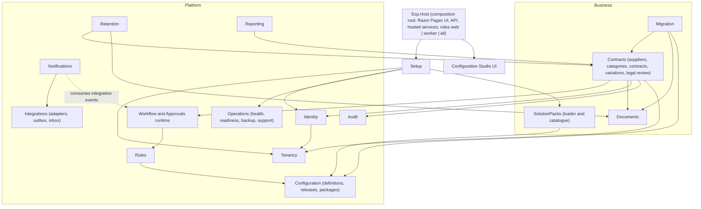
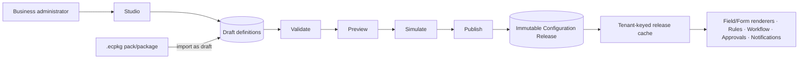
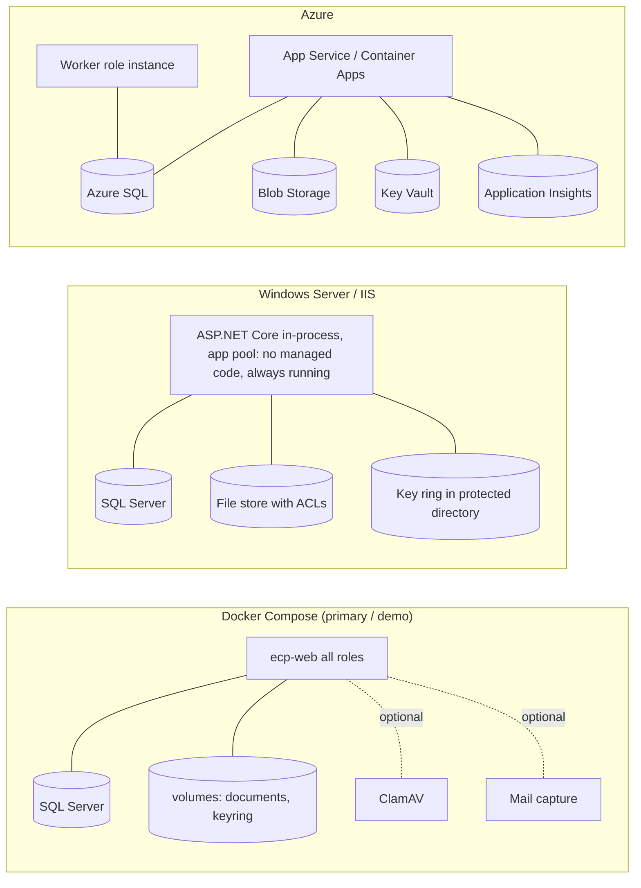
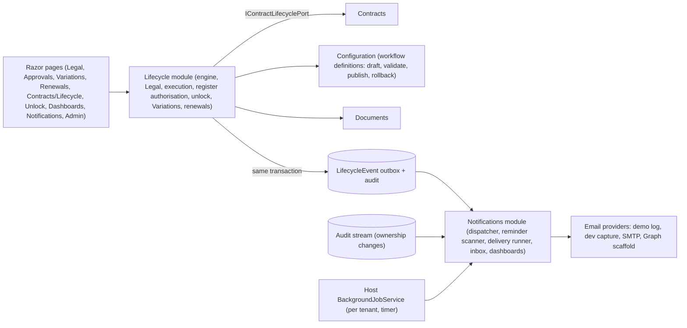
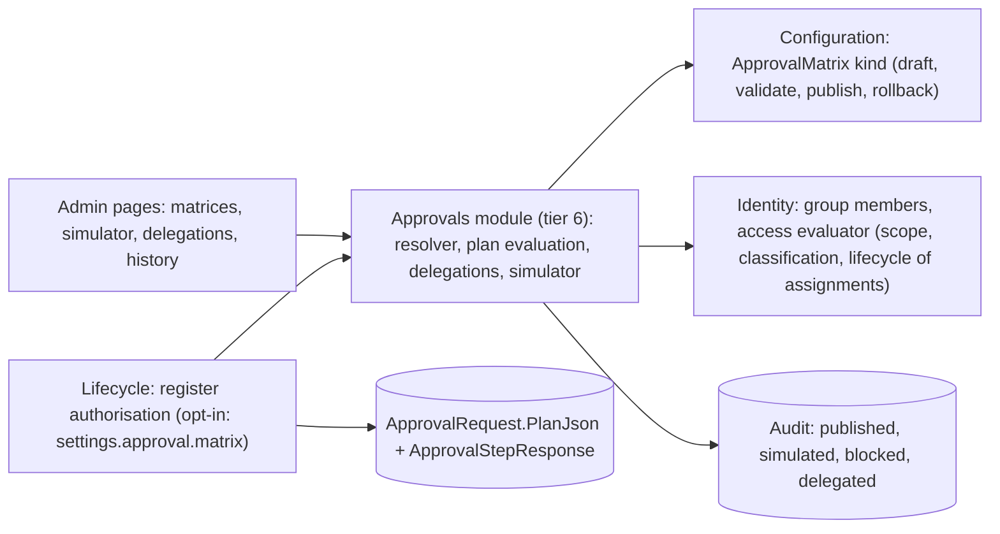
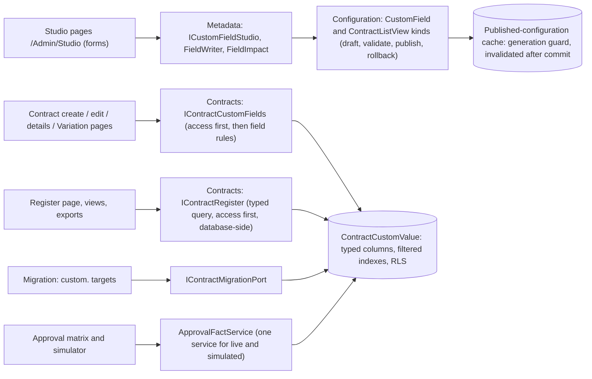
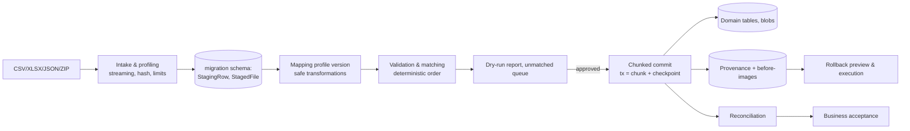

# Architecture

Status: **design baseline, nothing implemented yet.** Every choice here is either traceable to `requirements/` or recorded as an assumption (`ASM-nn`) in `docs/REPOSITORY_REVIEW.md` and as a *Proposed* ADR in `decisions/`. Changing architecture after implementation starts requires an ADR (`prompts/02-RESUME-PROMPT.md`).

Related documents: `docs/DOMAIN_MODEL.md`, `docs/SECURITY.md`, `docs/THREAT_MODEL.md`, `docs/TESTING.md`, `docs/IMPLEMENTATION_PLAN.md`.

## 1. Goals and drivers

| Driver | Source | Architectural consequence |
|---|---|---|
| Portable: business change by configuration, not source forks | `PORTABILITY_AND_NO_CODE.md` | Metadata-driven fields, forms, rules, workflows, approvals; business names exist only in packs (ASM-19); portability tests PRT-001 to PRT-015 |
| No arbitrary code in configuration | `CLAUDE.md` | Closed-vocabulary interpreters only; no scripting engines |
| Tenant, organisation, role, ownership, classification, lifecycle and lock rules enforced server-side | `CLAUDE.md` | One access evaluator; query filters plus Row-Level Security; domain-layer lock enforcement |
| Three deployment models with identical behaviour | `DEPLOYMENT_REQUIREMENTS.md` | Host abstractions for storage, secrets, key ring, scheduling; one codebase and one schema |
| Migration is Phase 1 mandatory | `CONFIRMED_DECISIONS.md` | Migration is a first-class module built before the designers |
| Audit, immutability, evidence | Master | Append-only hash-chained audit committed in the same transaction as changes |
| Supportable by a small team | Master ("supportable modular monolith") | One deployable, one database, strong module boundaries enforced by tests |

## 2. Constraints discovered (see `REPOSITORY_REVIEW.md` section 1)

- The build environment has no .NET SDK, no running Docker daemon and no Windows/IIS/Azure. First task T0.1 installs the SDK from the Ubuntu archive and tests whether a container engine or a native SQL Server is usable.
- Consequence for the plan: IIS and Azure artefacts are produced and statically validated but labelled *scaffold, unverified* until run on those platforms (`CLAUDE.md` labelling rule).

## 3. Technology baseline (ASM-01, ASM-02, ASM-03)

| Concern | Choice | Notes / ADR |
|---|---|---|
| Runtime | .NET 10 LTS, ASP.NET Core, C# | .NET 8 leaves support November 2026 |
| Data | EF Core with SQL Server provider; SQL Server 2022+ and Azure SQL; `datetime2` UTC instants; `rowversion` concurrency | ADR-0006 |
| UI | Server-rendered Razor Pages, antiforgery, strict CSP with nonces, small TypeScript islands for designers; no client-side `eval` | ADR-0013 |
| API | Versioned JSON API under `/api/v1`, OpenAPI generated and diff-checked in CI | `API_AND_WEBHOOKS_SPEC.md` |
| Background work | Hosted services plus transactional outbox/inbox; SQL application locks for singletons | ADR-0010 |
| Identity | OpenID Connect (generic and Entra), cookie session for UI, bearer for API; Demo identity in non-production only | ADR-0007 |
| Documents | `IDocumentStorageProvider`; local filesystem first, Azure Blob adapter | ADR-0012 |
| Serialisation of configuration | Canonical JSON with JSON Schema per definition kind | ADR-0008 |
| Spreadsheet/Archive libraries | Permissively licensed Open XML based libraries; `System.IO.Compression` with hardened wrappers | ADR-0014, RISK-10 |
| Testing | xUnit, Testcontainers or native SQL Server, Playwright with axe-core, NetArchTest-style architecture tests | `docs/TESTING.md` |
| Packaging | Container image (non-root), framework-dependent IIS publish, Bicep for Azure | ADR-0005 |

## 4. Module architecture (modular monolith)

One deployable process hosts all modules. A module owns its tables (own schema), its domain model and its public contract. Other modules use only the public contract (interfaces, DTOs, integration events). Architecture tests fail the build if a module references another module's internals, if the dependency graph has a cycle, or if domain code references infrastructure (ADR-0001).



**Dependency rule** (enforced by tests). Tiers, lowest first: (0) SharedKernel, Persistence; (1) Audit; (2) Tenancy, Identity; (3) Configuration; (4) Rules; (5) Workflow; (6) Contracts, Documents, Integrations; (7) Notifications, Migration, Reporting, Retention; (8) SolutionPacks, Operations; (9) Setup; (10) Host. A module may depend only on lower tiers, plus the specific same-tier edges drawn in the diagram (for example Contracts to Documents, Notifications to Integrations). Upward needs are met by **dependency inversion** and **events**, never by a reference:

- The access evaluator (Identity, tier 2) needs relationship facts such as "active category assignment" and "assigned approver". Identity defines `IRelationshipProvider`; Contracts and Workflow implement it and register it at composition time.
- Workflow does not call Notifications. It writes integration events through the outbox; Notifications consumes them.
- Audit is written through `IAuditWriter` (tier 1, which depends only on the SharedKernel and Persistence) by every module in the same transaction.

### Module responsibilities

| Module | Owns | Public contract (examples) |
|---|---|---|
| SharedKernel | Result types, ids, clock (`IClock`), `ITenantContext`, error codes, canonical JSON, hashing | Types only; no I/O |
| Tenancy | Tenant, Organisation, LegalEntity, Division, BusinessUnit, Site | `ITenantDirectory`, tenant resolution |
| Identity | Users, memberships, role assignments, group mapping, delegation, elevation, access evaluator (relationship facts supplied through `IRelationshipProvider`) | `IAccessEvaluator`, `ICurrentUser`, `IRelationshipProvider` |
| Audit | Audit events, hash chain, evidence export | `IAuditWriter`, `IAuditQuery` |
| Configuration | Definitions, versions, releases, drafts, validation, simulation harness, packages | `IConfigurationReader` (published release snapshot), `IConfigurationAuthoring`, `IPackageImporter` |
| Rules | Condition/action interpreter, field-value evaluator, calculated display | `IRuleEngine`, `IExpressionEvaluator` |
| Workflow (planned name; the lifecycle slice delivers its engine as the Lifecycle module below; an approval-matrix resolver remains Future) | Workflow instances, transitions, guards, approval matrix resolver | `IWorkflowEngine`, `IApprovalResolver` |
| Contracts | Supplier, Category and assignments, Contract, Variation, RecordUnlock | `IContractService`, `IContractQuery` |
| Documents | Document, versions, storage, scan status, download authorisation | `IDocumentService`, `IDocumentStorageProvider` |
| Approvals (tier 6; implemented) | Approval matrices (a Configuration kind), the resolver and trace, plan evaluation (sequential, parallel, first response, all required), approval delegations with cycle protection, the simulator | `IApprovalMatrixStore`, `IApprovalResolver`, `IApprovalSimulator`, `IApprovalDelegations`, `IApprovalSimulationInputs`, `IApprovalFactContributor`; knows nothing of contracts or workflow states |
| Lifecycle (tier 7; implemented) | Workflow definitions (Configuration kinds `WorkflowContractLifecycle`, `WorkflowVariation`), the transition engine and guard evaluator, status history, Legal review (rounds, comments, attachments, events), execution records and the e-signature boundary, register-authorisation requests with immutable snapshots, emergency unlocks, Variations, renewals, the lifecycle outbox | `ILifecycleService`, `ILegalReviewService`, `ISignatureRequestService`, `ISignatureEventInbox`, `IRegisterAuthorisationService`, `IRecordUnlockService`, `IVariationService`, `IRenewalService`, `ILifecycleOutbox`, `IWorkflowDefinitions`; reaches contract state only through `IContractLifecyclePort` |
| Metadata (tier 5; implemented) | Custom field model (17 types), the definition document and its strict parser/validator (`CustomField` Configuration kind), value parsing and formatting, the closed calculator, impact analysis, the form-based Studio service | `ICustomFieldCatalogue`, `ICustomFieldStudio`, `ICustomFieldUsage`, `IWorkflowStateSource`; values are stored and served by Contracts |
| Formats (tier 0; implemented) | CSV and XLSX readers and writers, formula-injection defence (`SafeCell`) | `CsvReader`, `CsvWriter`, `XlsxWriter`; shared by Migration and Exports |
| Migration | Projects, profiles, batches, staging, matching, commit, rollback, reconciliation; loads core and additional fields | `IMigrationService`; consumes Contracts/Documents public contracts only |
| Notifications (tier 9; implemented) | Notification policy (a Configuration kind), recipient resolution, rendering, notifications and deliveries with attempts, reminder windows and tracking, in-app inbox, email providers, job runs, ten dashboards | `INotificationInbox`, `INotificationAdmin`, `IReminderScanner`, `INotificationDispatcher`, `IDeliveryRunner`, `INotificationJobs`, `IReminderSettings`, `IDashboardService` |
| Integrations | Adapters, outbox, inbox, webhook endpoints, egress guard | Provider interfaces from `ADAPTER_CATALOGUE.md` |
| Retention | Policies, legal holds, disposition | `IRetentionService` |
| Reporting | Projections and curated views, export endpoints | `IReportingService` |
| Packs (`Ecp.Packs`, tier 0; implemented, S7) | The `.ecpkg` format: safe archive reader and deterministic writer, canonical JSON, manifest, builder, content scan, compatibility, ES256 signing and trust policy, command-line tool library | `PackReader`, `PackBuilder`, `PackTrustPolicy`, `IPackKeyResolver`, `IPackageSigner`, `IPackageSignatureVerifier`, `PackCli` |
| Solution packs in Configuration (implemented, S7) | The unified loader over the shipped read-only directory and the tenant's installed packs, trust and compatibility on every read, tenant package cache, storage provider, validation, Pack Manager services, assignment (drafts only), trust-key store, diagnostics | `IPackLoader`, `IPackManager`, `IPackAssignments`, `IPackTrustKeys`, `IPackDiagnostics`, `ISolutionPackCatalogue`, `IOrganisationPackContent` |
| Setup (tier 9; implemented) | Wizard state (protected bootstrap file mirrored to `setup.SetupRecord`), 14 idempotent stages, setup readiness checks, sanitised report, organisation onboarding (the `OrganisationOnboarding` configuration kind, ledger `setup.OnboardingItem`, CSV import, synthetic preview) | `ISetupService`, `IOnboardingService` |
| Operations | Health, maintenance mode, backup/restore tooling, support bundle, upgrade pre-flight | `IOperationsService` |

### Solution layout (planned, no code yet)

```
src/Ecp.sln
src/Ecp.SharedKernel/
src/Modules/<Module>/            one project per module (+ <Module>.Tests under tests/)
src/Ecp.Host/                    web UI, API, hosted services, composition root
templates/packs/blank/           shipped pack SOURCES (JSON + pack-source.json); the host build writes read-only .ecpkg files to <output>/packs
templates/packs/jbs-procurement/
src/Ecp.Packs/  src/Ecp.PackTool/  pack format library and the ecp-pack command-line tool
templates/demo/                  demo data packages, document templates
deploy/docker/  deploy/iis/  deploy/azure/
tests/<Module>.Tests/  tests/Ecp.Architecture.Tests/  tests/Ecp.E2E.Tests/
```

## 5. Configuration (metadata) architecture



- **Definitions** are canonical JSON documents of a fixed set of kinds (`CONFIGURATION_LIFECYCLE_SPEC.md` section 1), each validated against a JSON Schema and the Studio closed vocabularies. They are versioned, immutable once published, grouped into **releases**.
- **Runtime** reads a *release snapshot* (immutable, cached per tenant and release id). Publishing a release atomically switches the pointer and emits a cache-invalidation message; nothing mutates a snapshot.
- **Workflow and approval versions are pinned** on instances (RISK-06). The rules engine records the release id it used.
- **Custom field values** are stored as typed rows (ADR-0009): one row per entity/field with typed columns (`string`, `decimal`+currency, `date`, `datetime`, `bool`, `guid`) and child rows for multi-choice. Static composite indexes `(TenantId, FieldDefinitionId, <typed value>)` serve search for every field; no DDL is ever issued when fields change. Reporting projections flatten values by view or job.
- **Interpreters, not compilers.** Rules, calculated-display fields and templates are evaluated by small purpose-built interpreters over typed ASTs with node, depth and time limits. No Roslyn, Jint, Liquid, Scriban or expression-tree compilation of administrator input.
- **Packs are data.** JBS names, states, roles-to-permission defaults, approval tiers and terminology exist only in pack sources under `templates/packs/` and the `.ecpkg` files built from them; no pack is an embedded resource, and the loader names no pack (PRT-001, ADR-0026, architecture tests `PackRuleTests`).
- **Draft collaboration:** drafts carry the base release id and a row version; publish performs a three-way check and requires rebase when the base changed (RISK-19).

## 6. Tenant-isolation architecture (ASM-04; RISK-02; ADR-0003)

Defence in depth; each layer is independently tested so that one failure cannot expose data.

| Layer | Mechanism |
|---|---|
| Identity | Tenant derived from the authenticated principal or validated host mapping; never from client input (`TENANCY_AND_ORGANISATION_SPEC.md` section 3) |
| Request/Job scope | `ITenantContext` is set by middleware (requests) or by the job runner from the job record. Data access without a scope throws. No ambient/thread-static state: the context flows through DI scope |
| ORM | A base `TenantDbContext` applies a global query filter on `TenantId` to every tenant-owned entity (discovered by marker interface; a test fails when an entity lacks the marker or filter). `IgnoreQueryFilters` is banned by analyzer except in an allowlisted installation-level service |
| Database | **Row-Level Security** with a predicate on `TenantId` using `SESSION_CONTEXT('TenantId')`, set by a connection interceptor on every open and cleared on return to the pool. Foreign keys include `TenantId` in composite keys so a child cannot reference a parent from another tenant. Unique indexes include `TenantId` |
| Raw SQL | Only through a wrapper that requires a scope and parameters; reviewed list of allowed raw queries |
| Cache | Cache keys are constructed by a helper that always prefixes tenant id; a test asserts no cache key lacks a tenant segment |
| Files | Storage key prefix `t/{tenantId}/…`; the provider rejects keys outside the current prefix; no listing across prefixes |
| Jobs/outbox | Messages carry `TenantId`; the dispatcher opens a scope per message |
| Search/reports | Same filters; reporting views are filtered by RLS and per-tenant principals (`REPORTING_QLIK_SPEC.md`) |
| Logs/traces | Tenant id is a structured field; support bundles are per tenant |
| Tests | Cross-tenant matrix across records, documents, jobs, caches, reports, imports and exports (`docs/TESTING.md` section 5) |

Organisation scope is enforced by the access evaluator and by optional organisation filters on organisation-owned entities (not a security boundary by itself).

## 7. Data architecture

- One database. **Schema per module** (for example `contracts`, `documents`, `migration`, `config`, `audit`, `identity`, `reporting`, `setup`). **One DbContext per module**, one ordered migration runner, one migration history. A module's tables are only written through its services; cross-module reads use public query interfaces or the `reporting` views (ADR-0006).
- **Primary keys** are sequential GUIDs generated in the application (index-friendly, safe to expose only after authorisation; never the sole access control).
- **Concurrency:** `rowversion` on mutable aggregates; API surfaces ETag / `If-Match`.
- **Time:** instants as `datetime2(7)` UTC via `IClock`; date-only as `date` in the organisation time zone (ASM-12).
- **Money:** `decimal(19,4)` plus ISO 4217 code; never summed across currencies.
- **Audit:** `audit.Event` append-only, hash-chained per tenant, written in the same transaction as the change; the runtime DB principal has INSERT and SELECT only (ADR-0011).
- **Outbox/Inbox:** `integration.Outbox`, `integration.Inbox` in the same database for atomic enqueue.
- **Migrations:** forward-only, idempotent scripts generated by EF, applied by the runner at start-up for Demo/Test and by explicit pre-flight in Production; each upgrade has a pre-flight check and a documented rollback path (backup restore).
- **Indexes and size:** static indexes; audit partitioned monthly (plan, not initial); document metadata separate from blobs.

## 8. Deployment architecture (ADR-0005; RISK-13)

Same binaries, same schema, same wizard. Host differences are isolated in a small `HostEnvironment` abstraction: secret provider, storage provider, key-ring store, scheduler role and path conventions.



| Concern | Docker | IIS | Azure |
|---|---|---|---|
| Database | SQL Server container (Developer for demo; licensing note in install guide) or external | SQL Server | Azure SQL |
| Documents | Named volume (local provider) | Directory with least-privilege ACL | Blob container, private, managed identity |
| Secrets | Docker secrets / environment | DPAPI-protected file or env | Key Vault references |
| Key ring | Persisted volume | Protected directory (machine-scoped) | Blob with Key Vault wrapping |
| Jobs | Same process (`all`) or separate `worker` container | Same process; app pool set to stay alive; no overlapping lease | Separate worker role; SQL application lock lease prevents double processing |
| Scale | Single instance supported; multiple instances behind a proxy with worker lease | Single instance supported | Multiple web instances plus one leased worker |
| TLS | Reverse proxy / Kestrel cert | IIS binding | App Service managed certificate |
| Verification here | Compose file linted; run if a container engine is available (T0.1) | Publish output and `web.config` validated statically; *scaffold, unverified* | Bicep built if tooling allowed; *scaffold, unverified* |

All images use a non-root user, include ICU and time-zone data (L-06), run read-only root filesystem where possible, and are built from a pinned base image digest. Health endpoints: `/health/live`, `/health/ready`, `/health/startup`.

## 9. Background processing and integrations (ADR-0010)

- **Outbox** rows are written in the same transaction as the change. A dispatcher claims batches using `UPDLOCK, READPAST`, sends via the adapter with retries and jitter, marks processed, and dead-letters after the limit. Consumers are idempotent by `dedupeKey`.
- **Inbox** rows are inserted with a unique `(provider, externalEventId)` key; a duplicate insert means "already seen".
- **Scheduled jobs:** reminders, unlock expiry, projection refresh, outbox dispatch, orphan-blob sweeper, audit verification, export expiry. Each job takes a named `sp_getapplock` lease, runs within an explicit tenant scope per unit of work, and is resumable.
- **Egress guard:** all outbound HTTP uses one `HttpClient` factory with SSRF protections (`ADAPTER_CATALOGUE.md`, README rule 7).

### 9.1 Lifecycle and notifications architecture (as implemented; ADR-0019 to ADR-0021, `docs/LIFECYCLE_AND_NOTIFICATIONS.md`)



* The Lifecycle module is tier 7 and the Notifications module tier 9 (the architecture tests enforce both, including "no module references another module's persistence"). Contracts exposes `IContractLifecyclePort` (state changes with history, controlled field changes, successor creation, reminder candidates, current owners) and `IPendingApprovalSource` (lets the access layer know when an approver may read a contract). Identity gained an `ApproverGroupKey` on assignments and a pending-approval layer in the evaluator.
* Every state change is one unit of work: contract state, `StatusHistory`, `LifecycleEvent` and audit commit together or not at all. Idempotency is by `ClientRequestId`; one pending approval per subject, one open Variation per contract and one renewal in progress per contract are unique filtered indexes.
* Notifications are produced by a dispatcher that reads the outbox (parked after ten failed attempts) and a cursor over the audit stream, never by the lifecycle code, so a notification failure cannot fail a transition.
* The host timer calls `INotificationJobs.RunAllAsync` for each active tenant (dispatch, email delivery, reminder scan, unlock expiry) and records each run; the same service backs the administration page. The work is idempotent, so running it on two instances or twice is safe.
* Concurrency was verified on SQL Server (exactly one of two simultaneous approvals wins). A multi-instance lease for the timer is Future (ADR-0010 describes it; today every instance runs the idempotent jobs).

### 9.2 Approval matrix architecture (as implemented; ADR-0022, `docs/APPROVAL_MATRIX.md`)



* One resolver serves both the simulator and a real submission. The plan, trace and explanations are stored with the request, so a later publication never changes an in-flight approval; who may respond is re-checked against the group and delegations as they are now.
* Without `settings.approval.matrix` the lifecycle runs the reference model (one approver group, first response wins) exactly as before.

### 9.3 Configurable metadata, search, views and exports (as implemented; ADR-0023, `docs/CUSTOM_FIELDS.md`, `docs/SEARCH_AND_VIEWS.md`, `docs/EXPORTS.md`, `docs/CONFIGURATION_STUDIO.md`)



* Definitions are configuration; values are typed rows; a hidden field is absent from every read path; one fact service serves live approvals and the simulator; every configured-field condition is an uncorrelated `IN` subquery.
* SQL Server behaviour of the new tables and indexes is exercised by the 183 `SqlServer` tests on CI (run 22), and a 10,000-contract SQL Server baseline is in `PERFORMANCE.md`. The PER-002 query-plan review is not done (see `TESTING.md` section 8.2).

### 9.4 Terminology (as implemented in S4; ADR-0028, `docs/TERMINOLOGY.md`)

* **Model** in `Ecp.SharedKernel` (tier 0, no business wording): `TermCatalogue` (42 keys, neutral wording), `TermSet` (layered, locale-aware), `TermTokens` (the `[[key|modifier]]` language). `DomainException.RawMessage` keeps tokenised text; `Message` is neutral.
* **Resolver and kind** in `Ecp.Configuration` (tier 5): `ITerminologyResolver`, `ITerminologyCache` (tenant, organisation, locale, published version), the `Terminology` configuration kind with `terminology.*` permissions, `ITerminologyAdministration` (form-based pages' read/write model). Pack terminology is read through `IPackLoader` only.
* **Consumers** (higher tiers) take `ITerminologyResolver`: register query engine and change history (Contracts), notification dispatcher, reminders, inbox and dashboards (Notifications), migration reports, exports, view service. The Host adds `TermContext` (per request), `TermLocalizer` (every `L["…"]` expands tokens) and `TermMiddleware`.
* **Dependency direction** is unchanged and enforced by the architecture tests: no module references a pack or a business; wording flows from data to the edge of a response.

### 9.5 Capabilities (as implemented in S6; ADR-0030, `docs/CAPABILITIES.md`)

* **Model** in `Ecp.SharedKernel` (tier 0, no business wording): `CapabilityKeys`, `CapabilityCatalogue` (five capabilities bound to the closed workflow vocabularies, register fields and built-in list or card keys), `CapabilitySet` (organisation over pack over the platform default of everything on).
* **Resolver, kind and administration** in `Ecp.Configuration` (tier 5): `ICapabilityResolver` (dependencies resolved lazily to keep the configuration service's kind graph acyclic), `ICapabilityCache` (tenant, organisation, release and pack identity), the `Capabilities` configuration kind with `capabilities.*` permissions, `ICapabilityAdministration`. Pack defaults are read through `IPackLoader` only. Resolution fails open.
* **Gate and compatibility** in `Ecp.Lifecycle` (tier 7): `CapabilityGate` at `LifecycleEngine.ExecuteAsync` and `AvailableAsync`; `ICapabilityCompatibility` (workflows using a capability that is off; work in flight) implemented there and reached from Configuration through the interface only.
* **Consumers** take `ICapabilityResolver`: register query engine and built-in views (Contracts), dashboards (Notifications), onboarding and setup (Setup), pack assignment (Configuration), and the Host's `TermContext` for navigation and forms.
* **Dependency direction** is unchanged: no module names a pack or a business, and the architecture tests (`tests/Ecp.Architecture.Tests/CapabilityGuardTests.cs`) refuse a second spelling of a capability key.

## 10. Migration architecture (ADR-0004; `MIGRATION_SUPPLEMENT.md`)



- The migration module calls Contracts and Documents **only through their public contracts**, so all domain rules (validation, lock, audit) apply to imported data. Legacy-load exceptions are explicit parameters of those contracts, not backdoors (`MIGRATION_SUPPLEMENT.md` section 7).
- Staging is physically separate; a dry run cannot write to target by construction (the dry-run service has no reference to the commit writers; a test verifies zero target diffs).
- Resume and idempotency come from unique idempotency keys plus per-chunk checkpoints.

**Implementation (2026-10-16, ADR-0018).** The slice is built as `Ecp.DataMigration`: staging and ledger tables in the `migration` schema (13 tables, RLS), the services `IMigrationProjects`, `IMappingProfiles`, `IMigrationBatches`, `IMigrationIntake`, `IMigrationValidation`, `IMigrationCommit`, `IMigrationRollback`, hand-written CSV, XLSX and ZIP readers, and pages under `/Migration`. Contracts and Documents expose migration ports (`IContractMigrationPort`, `IDocumentMigrationPort`) that the commit and rollback use inside the migration's unit of work. Details: `docs/MIGRATION.md`.

## 11. Document storage (ADR-0012)

`IDocumentStorageProvider` operations: `PutAsync(key, stream)`, `OpenReadAsync(key)`, `DeleteAsync(key)`, `ExistsAsync(key)`, `GetPropertiesAsync(key)`. Keys are `t/{tenant}/{sha256-prefix}/{sha256}` (content-addressed within a tenant, enabling "link existing content"). Every upload streams through: size limit, signature sniffing, hash, quarantine write, scan, then promote to the committed prefix with `scanStatus`. Downloads are authorised per request by the access evaluator (record visibility, classification, scan status) and streamed with `Content-Disposition` from sanitised names; there are no public URLs. A reference-count table governs deletion.

## 12. Cross-cutting concerns

| Concern | Approach |
|---|---|
| Errors | RFC 9457 problem details; stable error codes; no internals leaked; correlation id in every response |
| Logging | Structured; tenant, correlation, actor; secret and PII redaction filter; no request bodies by default |
| Observability | OpenTelemetry-compatible metrics/traces; health checks per adapter; SIEM export of audit via sink |
| Localisation | Resource files, `en-AU` default, ICU in images, terminology aliases from configuration (L-01 to L-08) |
| Accessibility | WCAG 2.2 AA practices, axe in CI, keyboard-first designers (A-01 to A-12) |
| Validation | Server-side only is authoritative; shared rules from the same definitions drive client hints |
| Feature flags | Configuration definitions; cannot add behaviour that code lacks |
| Rate limiting | Built-in limiter, per principal and IP; stricter on setup, auth, import/export |

## 13. Quality attribute targets (initial, adjust with Q-13)

| Attribute | Target |
|---|---|
| Correctness | Domain and security rules covered by automated tests before a task is ticked |
| Performance | Contract list/search p95 < 500 ms at 100k contracts and 50 custom fields; migration commit of 25k contracts and 50k documents in a single resumable run; measured by TESTING PER-xxx |
| Availability | Single instance with restartable jobs; RPO/RTO placeholders configurable (`OPERATIONS_SPEC.md`) |
| Security | `docs/SECURITY.md`; threat model reviewed each milestone |
| Maintainability | Module boundaries enforced; ADRs; no module > agreed size without review |
| Portability | PRT-001 to PRT-015 gates |

## 14. Functionality status labels

`CLAUDE.md` requires labelling each capability as **implemented**, **mocked**, **disabled** or **future**. The label for every capability is tracked in `TASKS.md` (column *Status*) and shown in the readiness report for integrations. Nothing is *implemented* until code and tests exist.

## 15. ADR index

| ADR | Topic | State |
|---|---|---|
| 0001 | Modular monolith | Proposed |
| 0002 | Metadata extensibility | Proposed |
| 0003 | Tenant isolation | Proposed |
| 0004 | Migration staging | Proposed |
| 0005 | Deployment models | Proposed |
| 0006 | Database layout: schema and DbContext per module | Proposed |
| 0007 | Identity and authorisation model | Proposed |
| 0008 | Configuration versioning and releases | Proposed |
| 0009 | Custom-field value storage and reporting projections | Proposed |
| 0010 | Background processing, outbox and inbox | Proposed |
| 0011 | Audit immutability | Proposed |
| 0012 | Document storage and content addressing | Proposed |
| 0013 | UI technology and API style | Proposed |
| 0014 | Supply chain: dependencies, SBOM, licences, pack signing | Proposed (signature algorithm amended by 0026) |
| 0015 | Bulk-migration module name (`Ecp.DataMigration`) | Proposed |
| 0016 | Setup state and first-run protection | Proposed |
| 0017 | Organisation onboarding as a configuration kind with a provenance ledger | Proposed |
| 0018 | Migration slice design: staging, provenance ledger, resumable commit, provenance-driven rollback | Proposed |
| 0023 | Configurable metadata, typed search, list views and the form-based Studio | Accepted |
| 0019 | Five-level classification, privileged access and support/emergency elevation | Accepted (lifecycle slice) |
| 0020 | Lifecycle engine, workflow definitions as configuration, execution boundary | Accepted (lifecycle slice) |
| 0021 | Notifications, reminders and operational dashboards | Accepted (lifecycle slice) |
| 0026 | Solution packs are external, signed, tenant-scoped data (S7) | Accepted (owner, 2026-10-17) |
| 0027 | The signature boundary is provider-neutral (S3) | Accepted (owner, 2026-10-17) |
| 0028 | Terminology is data: stable keys, layered labels, no label ever decides authority (S4) | Accepted (owner, 2026-10-17) |
| 0029 | Role codes, permission codes and approver-group keys are permanent identifiers (S5) | Accepted (owner, 2026-10-17) |
| 0030 | Optional platform steps are configurable capabilities, never authority (S6) | Accepted (owner, 2026-10-17) |

ADRs move to *Accepted* when the first milestone that depends on them completes with passing tests, or earlier by explicit owner decision.

## 16. Second business as configuration only (S9)

Slice S9 added **no architecture**. A second complete business, Harborline Construction (`templates/packs/construction-subcontracts`, `docs/CONSTRUCTION_SUBCONTRACTS_PACK.md`), runs on the pack, terminology, capability, custom-field, approval-matrix, workflow, notification-policy, view, classification and branding mechanisms exactly as they were. The one platform source change is a generic defect fix (contract-field labels in `_ContractFields.cshtml` now resolve through terminology). The boundary is enforced by tests rather than convention: `tests/Ecp.Architecture.Tests/SecondBusinessGuardTests.cs` scans every shipped platform file and every built `Ecp.*` assembly for the pack's vocabulary, refuses any project file that names the pack, and checks that the S9 commits touched only the pack, tests, documents and a short written list of generic fixes. Three packs (Blank, reference, Harborline) coexist in one installation; an organisation resolves its pack, terminology, capabilities, workflows, matrices, fields, views and notification policy by tenant and organisation, and tenant-wide documents (classification scale, branding) are the one place where businesses in a shared tenant must agree.
