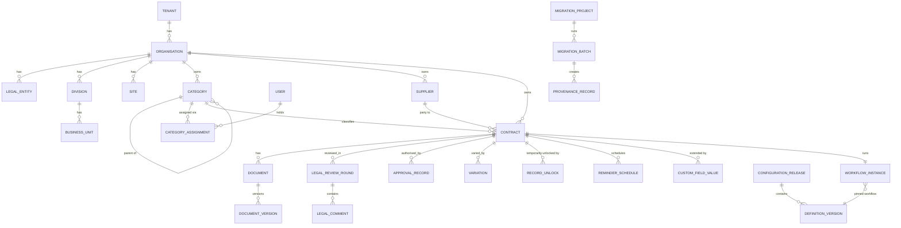
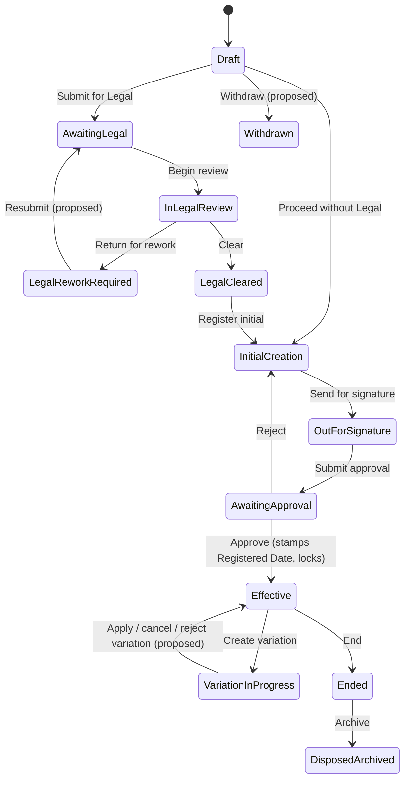

# Domain Model

Status: **design baseline.** Field-level detail lives in `requirements/03-data-dictionary/`; this document gives the aggregates, relationships, invariants and events that code must preserve. Terms: `requirements/02-reference/GLOSSARY.md`. Tags `[CONFIRMED]` / `[PROPOSED]` as in `requirements/README.md`. Invariant IDs (`INV-nn`) are referenced by tests in `docs/TESTING.md`.

## 1. Conventions

- Aggregates are consistency boundaries; one transaction changes one aggregate (plus its audit and outbox rows).
- Every tenant-owned entity implements `ITenantOwned` (`TenantId`); organisation-scoped ones add `OrganisationId`. `TenantId` is set from `ITenantContext`, never from input.
- Mutable aggregates carry `RowVersion`. Instants are UTC; date-only values are organisation-local dates.
- Codes (state, field, role, permission, lookup) are stable strings; labels are configuration.
- Domain code contains **no** business-pack names (PRT-001). Behaviour that differs between businesses comes from configuration definitions.
- Aggregates raise **domain events**; the outbox turns them into integration events.

## 2. Context map

## 3. Aggregates

| Aggregate (root) | Contains | Module | Notes |
|---|---|---|---|
| Tenant | Organisation, LegalEntity, Division, BusinessUnit, Site | Tenancy | Structure changes are audited; deleting a structural node that is referenced is refused |
| User | Memberships, RoleAssignments, GroupMappings, Delegations, Elevations | Identity | Linked by `(issuer, subject)` never email alone |
| Category | Subcategories (self-reference), CategoryAssignments | Contracts | Assignments are effective-dated; ownership follows the active one |
| Supplier | Supplier attributes | Contracts | Optional adapter enrichment is a proposal, not an overwrite |
| **Contract** | Core fields, CustomFieldValues, WorkflowInstance reference, lock state, reminders | Contracts | Largest aggregate; see section 4 |
| Variation | Proposed changes, its own WorkflowInstance | Contracts | Parent referenced by id, not contained |
| LegalReview | Rounds, Comments | Workflow/Contracts | Rounds append-only after close |
| ApprovalSubmission | Resolved steps, ApprovalRecords | Workflow | Pins matrix version |
| Document | Versions, scan status, classification | Documents | Versions immutable |
| ConfigurationDefinition | Versions | Configuration | See section 5 |
| ConfigurationRelease | Member definition versions, validation evidence | Configuration | Immutable |
| MigrationProject / MigrationBatch | Staging rows, files, matches, checkpoints, provenance, reconciliation | Migration | See section 7 |
| AuditEvent | (single) | Audit | Append-only; hash chain |
| OutboxMessage / InboxMessage | (single) | Integrations | |
| RetentionPolicy / LegalHold | | Retention | RetentionPolicy is a configuration definition |

## 4. Contract aggregate

### 4.1 State and lock

The `status` is the code of a state in the workflow definition version pinned at creation (`Contract.workflowVersionId`). Only the workflow engine mutates it (INV-02). `recordLocked` is derived from the state's lock behaviour plus any open `RecordUnlock` (INV-03, INV-04).

Solid transitions are in `status-transitions.csv` `[CONFIRMED]`; those marked *proposed* come from `status-transitions-supplemental.csv`.

### 4.2 Invariants

| ID | Invariant | Source |
|---|---|---|
| INV-01 | `agreementReference` is unique per `(TenantId, OrganisationId)` | `contracts.csv`; Q-07 |
| INV-02 | `status` changes only through the workflow engine; no setter is public | CON-03 |
| INV-03 | A locked contract rejects changes to any field not editable after Effective, regardless of caller | CLAUDE.md |
| INV-04 | The lock is cleared only by an open `RecordUnlock` (time-boxed, audited) and returns automatically | CLAUDE.md; Master |
| INV-05 | `registeredDate` and `registeredBy` are set exactly once by `Approve` (or by an authorised legacy load) and never edited | `contracts.csv`; ASM-06 |
| INV-06 | `effectiveDate` and `registeredDate` are independent values | `CONFIRMED_DECISIONS.md` |
| INV-07 | A contract in `VariationInProgress` is locked and has exactly one open Variation | ASM-15 |
| INV-08 | Variation changes only fields marked `Variation only` (or custom fields flagged editable by Variation) | `contracts.csv` |
| INV-09 | Edit permission requires an **active** assignment for the contract's category at the time of the action (or a role that grants broader edit) | `CONFIRMED_DECISIONS.md` |
| INV-10 | `Approve` requires an executed copy, an authorised approver of the pinned matrix step, and (by default) a different person from the submitter | `status-transitions.csv`; ASM-17 |
| INV-11 | A Legal review round closes with exactly one outcome; closed rounds and comments are immutable | ASM |
| INV-12 | Evergreen implies no `endDate`; a non-Evergreen contract with a blank `endDate` is a warning | `contracts.csv` |
| INV-13 | Currency code is required whenever `estimatedValue` is present; amounts in different currencies are never summed | CON-16 |
| INV-14 | A legacy-loaded contract has `isLegacyLoad = true`, is locked, and carries its source status | `MIGRATION_SUPPLEMENT.md` |
| INV-15 | Contracts are never hard-deleted by users; removal is Withdrawn (pre-Effective) or archive | `CONFIRMED_DECISIONS.md` |
| INV-16 | A transition is atomic with its audit event, stamps and outbox messages | AUDIT_SPEC |

### 4.3 Domain events

`ContractCreated`, `ContractUpdated` (with changed field codes), `ContractStatusChanged`, `ContractLocked`, `ContractUnlocked`, `LegalRoundOpened`, `LegalRoundClosed`, `ApprovalRequested`, `ApprovalDecided`, `ContractRegistered`, `VariationOpened`, `VariationApplied`, `VariationClosed`, `ReminderScheduled`, `ReminderDue`, `DocumentAdded`, `ContractArchived`. Integration events derived from these are the webhook event types in `API_AND_WEBHOOKS_SPEC.md`.

## 5. Configuration model

### 5.1 Entities

| Entity | Purpose | Key attributes |
|---|---|---|
| `ConfigurationDefinition` | Identity of a configurable item | `TenantId`, `OrganisationId?`, `Kind`, `Code` (unique with scope), `CurrentPublishedVersionId` |
| `DefinitionVersion` | One immutable version of a definition | `DefinitionId`, `VersionNo`, `State` (Draft, Validated, Published, Superseded, Discarded), `ContentJson` (canonical), `ContentHash`, `SchemaVersion`, `BaseReleaseId`, `RowVersion` (drafts), author, publisher, reason |
| `ConfigurationRelease` | An atomic published set | `ReleaseNo` (per scope), member `DefinitionVersionId`s, `ReleaseHash`, `EffectiveFromUtc`, validation and simulation evidence, `PreviousReleaseId`, `RollbackOfReleaseId?` |
| `PackageImport` | Record of a package import | package id and version, manifest hash, signature result, dry-run report, conflict decisions, resulting draft ids |
| `TrustedPublisherKey` | Trust anchor for packs | public key, key id, state, registered by |
| `FeatureFlagState` | Effective flag values | derived from release |

Kinds: Field, Form, RuleSet, Workflow, ApprovalMatrix, Lookup, Terminology, Branding, FeatureFlags, NotificationTemplate, DocumentType, DocumentTemplate, RetentionPolicy, ReminderPolicy, RoleTemplate, IntegrationSettings.

### 5.2 Rules

| ID | Rule |
|---|---|
| INV-20 | A published `DefinitionVersion` is never modified or deleted |
| INV-21 | A release contains at most one version per definition and validates as a whole before it can exist |
| INV-22 | Rollback creates a new release whose members equal an earlier release's members; `RollbackOfReleaseId` is set; history is never rewritten |
| INV-23 | Publishing requires `BaseReleaseId` equal to the current release or an explicit rebase |
| INV-24 | `WorkflowInstance` stores `WorkflowDefinitionVersionId` and `ApprovalMatrixVersionId` at start and they do not change except by an approved migration plan |
| INV-25 | A definition referenced by an in-flight instance cannot be altered in a way that breaks it (safe-change rules) |
| INV-26 | Configuration content contains only closed-vocabulary constructs (no code, no free-text expressions) |
| INV-27 | Field `code` and type are immutable once values exist |
| INV-28 | Packages create drafts only; they never publish |

### 5.3 Custom field values

`CustomFieldValue(TenantId, EntityType, EntityId, FieldDefinitionId, ValueString, ValueDecimal, CurrencyCode, ValueDate, ValueDateTime, ValueBool, ValueGuid, RowVersion)` plus `CustomFieldValueItem` for multi-choice. Exactly one typed value column is populated per row, enforced by a check constraint. The field's *type* comes from the definition version; validation uses the definition version in force at write time, and the value stores `FieldDefinitionVersionId` for traceability. Deprecated fields keep their values.

### 5.4 Workflow runtime

`WorkflowInstance(TenantId, SubjectType, SubjectId, DefinitionVersionId, CurrentStateCode, StartedUtc, RowVersion)`; `TransitionLog` is the audit trail (also written to audit). `ApprovalSubmission(SubjectId, MatrixVersionId, ResolvedSteps json, SubmittedBy, SubmittedUtc, State)` and `ApprovalRecord` per decision. Guards and permissions are read from the pinned definition; the engine is generic.

## 6. Documents

`Document` (logical) and `DocumentVersion` (immutable content reference). Invariants:

| ID | Invariant |
|---|---|
| INV-30 | A version's `sha256` is computed by the platform from stored bytes; a manifest hash is only cross-checked |
| INV-31 | A version's storage key begins with its tenant prefix; the provider refuses otherwise |
| INV-32 | A download requires access to the parent record (or restricted staging permission) plus classification clearance plus a permitted scan status |
| INV-33 | Content deduplication links only within the same tenant |
| INV-34 | `isExecutedCopy` satisfies guards only when the version scan status is Clean (or Skipped by explicit tenant policy) |
| INV-35 | A document with no contract exists only in restricted staging, never visible to ordinary users |
| INV-36 | Documents are archived, not deleted, except through disposition |

## 7. Migration model

Entities are in `requirements/03-data-dictionary/migration-entities.csv`. Aggregates: `MigrationProject` (settings, legacy-load policy, freeze window) and `MigrationBatch` (state machine, staging, checkpoints, provenance, reconciliation).

| ID | Invariant |
|---|---|
| INV-40 | A dry-run batch never creates or changes target rows, blobs, outbox messages, notifications or reminders |
| INV-41 | Every target row, blob link and audit event produced by a batch carries its `MigrationBatchId` |
| INV-42 | `(TenantId, OrganisationId, SourceSystem, SourceRecordId)` is unique among contracts; document and supplier keys per `MIGRATION_SUPPLEMENT.md` section 2 |
| INV-43 | A chunk and its checkpoint commit atomically; replay of a committed chunk is a no-op |
| INV-44 | Rollback selects only provenance records of its own batch; shared reference data created by the batch is removed only if unreferenced elsewhere |
| INV-45 | A batch cannot reach Reconciled unless the reconciliation identities balance or exceptions are approved |
| INV-46 | No transformation truncates values |
| INV-47 | A batch references mapping profile version and configuration release captured at creation; both are immutable for the batch's life |
| INV-48 | Cross-tenant and cross-organisation references are rejected during validation and again at commit |
| INV-49 | Unmatched and failed files stay in the restricted staging area until resolved or discarded by an audited action |

## 8. Audit and integration records

| ID | Invariant |
|---|---|
| INV-50 | `AuditEvent` is append-only: no update or delete path exists and the runtime principal lacks the rights |
| INV-51 | `AuditEvent.sequence` is gap-free and strictly increasing per tenant |
| INV-52 | The audit hash chain verifies: each event's hash covers its content and the previous hash |
| INV-53 | `OutboxMessage` has a `DedupeKey` unique per tenant |
| INV-54 | `InboxMessage` is unique per `(Provider, ExternalEventId)` |

Audit is also written in the same transaction as the change it describes (INV-16).

## 9. Authorisation concepts in the model

- `RoleAssignment(UserId, RoleCode, ScopeType, ScopeId, EffectiveFrom, EffectiveTo, GrantedBy, Reason)`; scope types: Installation, Tenant, Organisation, Division, Site, ApproverGroup.
- `Delegation(DelegatorId, DelegateId, ScopeType, ScopeId, From, To, Reason)` and `Elevation(UserId, Purpose, Reason, From, To, TenantId?)` are modelled as below.
- The permission and role definitions come from `requirements/02-reference/`; the shipped JBS role templates are pack data.

| ID | Invariant |
|---|---|
| INV-60 | A delegation or role grant never exceeds the rights the grantor holds, and is limited to the grantor's scope |
| INV-61 | An elevation has a reason and an expiry, is visible to tenant administrators, and every action under it is audited with the elevation id |

## 10. Value objects

`Money(amount, currencyCode)`, `DateRange`, `Percentage`, `EmailAddress`, `Url` (https only for outbound), `Sha256`, `CorrelationId`, `AgreementReference` (normalised, case-preserved), `Code` (validated pattern), `LocalisedText`. Value objects validate on construction; invalid state is unrepresentable in the domain layer.

## 11. Open modelling questions

| Question | Where it surfaces | ID |
|---|---|---|
| Is `agreementReference` unique per organisation or tenant? | INV-01 | Q-07 |
| Can a contract have more than one open Variation? | INV-07 | ASM-15 |
| Do suppliers need to be shared across organisations? | Supplier aggregate | future |
| Are Legal review rounds a workflow concept or a Contracts aggregate? Currently Contracts-owned data driven by workflow transitions | LegalReview | design review at M6 |
| How are contract *templates* (clauses, controlled T&Cs) modelled beyond document templates? | Documents/Configuration | future |
