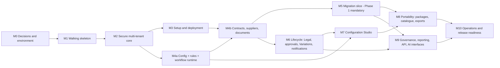

# Implementation Plan

Status: **plan only. No application code exists.** Task-level tracking is in `TASKS.md` (IDs, dependencies, acceptance). This document explains the sequencing logic, milestone gates and the decisions that must be made first. Architecture: `docs/ARCHITECTURE.md`. Tests: `docs/TESTING.md`. Findings behind the order: `docs/REPOSITORY_REVIEW.md`.

## 1. Approach

1. **Vertical slices, working software.** `CLAUDE.md` and `prompts/01-INITIAL-BUILD-PROMPT.md` forbid stopping at scaffolding. Every milestone ends with something runnable end to end and backed by tests that actually ran.
2. **Runtime before designers.** Migration, workflows and the JBS reference configuration need the *runtime* of fields, rules, workflow and approvals, not their graphical designers. The Studio (designers) comes after migration (CON-17). Reference configuration is loaded as **data** through a minimal pack loader that uses the same validators the Studio will use.
3. **Security spine first.** Tenant isolation, the access evaluator and audit are built before domain features so every later feature inherits them and cannot be written without them (ARC tests enforce this).
4. **Risk-first spikes.** The environment (no .NET SDK, no container engine running, unverified SQL Server availability) is the largest delivery risk (RISK-01), so M0 resolves it before anything else.
5. **Honest labelling.** Each capability is labelled *implemented*, *mocked*, *disabled* or *future* in `TASKS.md`. IIS and Azure artefacts are *scaffold, unverified* until run on those platforms.
6. **No guessing on authority.** `[OPEN]` items are implemented behind configuration or isolated seams so a different business answer (Q-nn) changes data, not architecture.
7. **Definition of done per task:** code + tests from the listed IDs passing + docs updated + audit/security considered + `TASKS.md` updated. A task with no passing test is not done.

## 2. Dependency analysis (why this order)

| Fact | Consequence |
|---|---|
| Every feature needs tenant scope, authorisation and audit | M1–M2 precede all domain work |
| Ownership security needs categories and effective-dated assignments | A minimal Category/Assignment slice lands in M2 with the evaluator |
| Setup wizard needs identity, tenancy and a database; its pack step needs configuration | Wizard (M3) ships with the Blank pack; JBS selection is wired in M4 |
| Fields, workflow, approval and rules must exist as engines before any pack can load | M4a before M4b before M5 |
| Contract aggregate needs workflow (status), custom fields (values), documents (executed copy guard), ownership | M4b after M4a, with documents in the same milestone |
| Migration maps to custom fields, workflow states, categories, suppliers and creates documents, audit and provenance | M5 depends on M4a, M4b and DCM |
| Outbox is written inside workflow transitions | Outbox tables and writer in M4a; dispatcher, notifications and DocuSign in M6 |
| Legacy-load needs lock semantics and workflow state codes | Lock invariants in M4b (not M6) |
| Studio validation = pack loader validation | Shared validators built once in M4a (CFG-01/RUL/WFL) |
| Packages/catalogue need releases, drafts and validators | M8 after M7 |
| Governance features (classification end-to-end, retention, audit explorer, reporting) read everything | M9 after lifecycle |
| Backup/restore, upgrade, support bundles need a stable schema and a full feature set | M10 (framework hooks earlier) |

**Critical path:** M0 → M1 → M2 → M4a → M4b → M5 → M8 → M10. M3 (setup) and M6 (lifecycle) run in parallel with the middle of that path where capacity allows; M7 depends on M6 for the approval/Legal flows it designs.

## 3. Decisions required before or early in M0

| # | Decision | Needed by | Default if unanswered |
|---|---|---|---|
| 1 | Accept ASM-01 (.NET 10 LTS, SQL Server 2022+) | M0 | Proceed (reversible before M1) |
| 2 | Accept ASM-04 (tenant hard boundary; organisation policy scope) | M0 (high reversal cost) | Proceed; revisit only if owner objects |
| 3 | SQL Server availability for tests (T0.1 outcome; Q-14) | M0 exit | Option C (`ECP_TEST_SQL`) required if A and B fail |
| 4 | Q-02 role-permission matrix | M2 start | Proposed matrix implemented as data |
| 5 | Q-07 agreement reference uniqueness scope: **resolved** (D3, tenant-wide); Q-19 exact JBSAUS pattern | M4b | Placeholder numbering rule, configurable |
| 6 | Q-01 approval semantics | M6 start | ASM-08 |
| 7 | Q-11 / Q-12 migration scope questions | M5 / M5b | ASM-16; historical slice deferred |
| 8 | Q-16 skills registration: **resolved** (D5; moved to `.claude/skills/`, rewritten) | M0 | done |
| 9 | Q-13 volumes | M1 | Budgets in `ARCHITECTURE.md` section 13 |

## 4. Milestones, scope and exit gates

Exit gates are expressed as test-ID sets from `docs/TESTING.md`. All gates also require: build with warnings-as-errors, `ARC-*` for rules relevant at that point, SBOM/vulnerability/licence scans, an updated `TASKS.md`, an updated `THREAT_MODEL.md` change-log entry, and the relevant skill reviews (`.claude/skills/security-review`, `.claude/skills/tenant-isolation-review`, `.claude/skills/portability-review`).

### M0 Decisions and environment

Scope: environment spike (install .NET 10 SDK from the Ubuntu archive; restore from NuGet; test container engine; test native SQL Server; Playwright); accept or amend ADRs; answer blocking questions; skills decision; doc link-check tooling. Repository hygiene (`.gitignore`, `.env.example`, `.gitkeep` files) and this design pass are already done.
Gate: environment report with run/not-run facts; SQL Server strategy chosen and recorded; ADRs accepted or amended; blocking Qs recorded.

### M1 Walking skeleton

Scope: solution, shared kernel, host baseline (errors, headers, antiforgery, rate limiting, health, OpenAPI, structured logging with redaction), persistence infrastructure (tenant base context, filters, `SESSION_CONTEXT` interceptor, migration runner), audit core (hash chain), clock/localisation baseline, Docker image and Compose, test infrastructure and scans.
Gate: ARC-001/002/007/008/009; AUD-001 to AUD-005; SEC-001, SEC-019, SEC-060 to SEC-062; DEP-001/002/005/006 *or* recorded as not verifiable; application starts and returns health in a container and natively.
Label: foundation *implemented*; Compose *implemented* if verified.

### M2 Secure multi-tenant core

Scope: Tenancy, Identity (Demo identity guarded; OIDC/Entra configuration points tested against a mock IdP), permission catalogue and role matrix loaded from `requirements/02-reference/`, access evaluator with all layers, delegation, elevation, last-admin protection, minimal Category and CategoryAssignment, RLS policies, isolation suite for the entities that exist.
Gate: AUT-001 to AUT-016 (applicable subset); TEN-001 to TEN-021 (existing entities), TEN-030 to TEN-033, TEN-040; ARC-003 to ARC-006; SEC-002 to SEC-006, SEC-010; threat-model review. **No domain feature may start until this gate passes.**

### M3 Setup and deployment awareness

Scope: bootstrap store, setup token, resumable wizard stages S1–S4, S6–S11, S17–S18 with Blank pack; readiness check framework and catalogue; sanitised report; accessible wizard UI; organisation onboarding part 1 (structure, users/groups, role templates, delegated administrators); IIS publish foundation and Azure Bicep scaffold with install guides.
Gate: SEC-008, SEC-009, SEC-010; DEP-007; A11Y-009 and wizard portion of A11Y-002; DEP-003/DEP-004 as *scaffold, unverified*; Docker end-to-end first run (if engine available).

### M4a Configuration and runtime engines

Scope: configuration kernel (definitions, versions, releases, canonical JSON, schemas, snapshot cache), lookups/terminology/flags/branding runtime, field definitions with typed value storage and search indexes, rules engine, calculated display and template engine, outbox/inbox tables and writer, workflow engine runtime with validator and pinned versions, approval matrix resolver and simulator core, minimal pack loader with Blank and JBS packs as data.
Gate: INV-20 to INV-28; NCD-001, NCD-003 to NCD-006, NCD-010, NCD-012, NCD-013, NCD-014; WFL-001 to WFL-003, WFL-006, WFL-007, WFL-013; APR-001 to APR-010; PKG-010; PRT-001, PRT-003; ARC-010.

### M4b Core domain: contracts, suppliers, documents

Scope: Supplier and Category management, Contract aggregate with core and extended fields, custom values, status via engine, lock enforcement, legacy-load flags, ownership by category assignment, create/view/search/edit UI and API, document module with local storage, streaming upload, hashing, quarantine and scan hook (mock), download authorisation, search, wizard pack selection (JBS), onboarding part 2 (taxonomy and supplier CSV import).
Gate: INV-01 to INV-16 (subset), INV-30 to INV-36; AUT-005, AUT-007; SEC-011 to SEC-016; TEN suite extended to all new entities; WFL-004 to WFL-006; PER-001/002 baseline; A11Y-001/002 for contract screens. **Demonstrable slice:** install → onboard → create contract → ownership-restricted edit → attach document.

### M5 Migration vertical slice (Phase 1 mandatory)

Scope: everything in `requirements/09-migration/` plus the supplement: CSV/XLSX/JSON/ZIP intake and profiling, mapping engine and preview, dry run and error workbook, attachment ingestion with deterministic matching and unmatched queue, commit with checkpoints and strategies, legacy-load policy, provenance and before-images, reconciliation and acceptance, freeze window, rollback and compensating archival, wizard UI, Medius and generic starter profiles as pack data, end-to-end sample, runbook and guides.
Gate: MIG-001 to MIG-026; TEN-010; SEC-012 to SEC-015; PER-003 baseline; documented exact commands and results from a synthetic end-to-end run (`prompts/10-MIGRATION-VERTICAL-SLICE.md`). M5b (historical Legal/approval/Variation data) waits on Q-12 and M6.

### M6 Lifecycle: Legal, approvals, Variations, notifications

Scope: Legal review rounds, platform approval flows (backup, delegation, segregation of duties), Variations, emergency unlock, reminders (Evergreen, Critical Notice), notification service with dedupe, outbox dispatcher and job framework (leases), adapter framework and egress guard, e-signature interface with Mock and DocuSign adapter.
Gate: WFL-004, WFL-008 to WFL-012; APR-005 to APR-008; AUT-008, AUT-012, AUT-013; NTF-001 to NTF-007; CNC-001 to CNC-004; ADP-001 to ADP-008; SEC-007. DocuSign real-account tests are opt-in; the adapter is labelled *implemented, unverified against a live account* until run.

### M7 Configuration Studio

Scope: draft/validate/preview/simulate/publish/rollback UI and API, version history and diff, two-person publish, field/form/rules/workflow/approval-matrix designers with simulators, lookups/taxonomy/terminology/branding/flags/notification-template administration, onboarding wizard part 3 and generated quick guides.
Gate: NCD-001 to NCD-015; A11Y-008; PRT-003, PRT-004, PRT-010; E2E journey run by a Business Configuration Administrator only.

### M8 Portability

Scope: configuration package export/import with dry run, conflicts, draft application, rollback; signing, trust anchors and catalogue; pack upgrade (three-way); second non-JBS pack; records, documents, audit and full-tenant export with round trip.
Gate: PKG-001 to PKG-011; IMP-001 to IMP-006; PRT-001 to PRT-015.

### M9 Governance, reporting, API, AI interfaces

Scope: classification end to end, retention/legal hold/disposition, Audit Explorer and evidence export, reporting projections and curated per-tenant views and export API (Qlik guide), full API surface and outbound webhooks, AI assistance and supplier-intelligence interfaces (disabled/mock), ERP and monitoring/SIEM adapters.
Gate: RET-001 to RET-006; AUD-006, AUD-007; SEC-040 to SEC-045; SEC-050 to SEC-053; AUT-006; TEN-007 to TEN-009 for projections and views.

### M10 Operations and release readiness

Scope: backup/restore and validation, upgrade pre-flight and rollback, maintenance mode, support bundle with redaction, DR documentation with RPO/RTO placeholders, IIS/Azure hardening, accessibility and localisation pass, performance, complete documentation set, release-readiness review using all skills, `E2E-DOD-001`.
Gate: BRS-001 to BRS-004; UPG-001 to UPG-004; SEC-030, SEC-031; PER-001 to PER-006; A11Y-001 to A11Y-020; DEP-008; documents in `TASKS.md` track DOCS complete; unresolved findings recorded by severity. **Production approval remains external governance** (`CLAUDE.md`).

## 5. Mapping of `prompts/01-INITIAL-BUILD-PROMPT.md` first-slice items to milestones

| `prompts/01-INITIAL-BUILD-PROMPT.md` item | Milestone |
|---|---|
| 1 Modular-monolith solution | M1 |
| 2 SQL Server model and migrations | M1 (infra), M2+ (entities) |
| 3 Tenant isolation | M1–M2 |
| 4 Docker deployment | M1 |
| 5 IIS publish foundation | M3 |
| 6 Azure deployment scaffold | M3 |
| 7 Resumable first-run setup wizard | M3 |
| 8 Organisation onboarding wizard | M3 (part 1), M4b (part 2), M7 (part 3) |
| 9 Demo identity plus OIDC/Entra configuration points | M2 |
| 10 Roles/policies and delegated administration | M2 |
| 11 Supplier, Contract, Document, MigrationBatch core models | M4b (Supplier, Contract, Document), M5 (MigrationBatch) |
| 12 Basic contract create/view/search/edit | M4b |
| 13 Category-ownership security | M2 (evaluator, categories), M4b (contract edit) |
| 14 Audit events | M1 |
| 15 Health/readiness | M1 (health), M3 (readiness) |
| 16 Automated tests and verified run commands | Every milestone |

`prompts/01-INITIAL-BUILD-PROMPT.md` places "MigrationBatch core models" in the first slice; they are scheduled in M5 because they require the engines in M4. This is a deliberate, recorded deviation (CON-17).

## 6. Environment and tooling plan

1. Install `dotnet-sdk-10.0` via apt (verified available: 10.0.112). Pin the SDK with `global.json`.
2. Use central package management with lock files; restore in locked mode.
3. SQL Server for tests per `docs/TESTING.md` section 3 (Option A, B or C).
4. Playwright with the existing Chromium (`PLAYWRIGHT_BROWSERS_PATH=/opt/pw-browsers`, do not download browsers).
5. Keep a `docs/ENVIRONMENT.md` (created by T0.1) recording exactly what ran and what could not.
6. Commit small, tested increments to the working branch; never commit secrets or live data (`SECURITY-NOTICE.md`).

## 7. Deferred and explicitly out of scope for the first release

*Future:* additional solution packs beyond Blank, JBS and the portability-proof pack; SharePoint/Graph document provider and migration connector; object-storage providers; per-tenant encryption keys; supplier sharing across organisations; right-to-left and additional languages; migration of in-flight workflow items; live DocuSign/ERP/risk integrations (interfaces and mocks only until accounts exist).
*External governance:* penetration testing, security review sign-off, accreditation, formal production approval, retention period confirmation, legal advice.

## 8. Documentation schedule

| Deliverable (Master "Documentation deliverables") | Task | Written at |
|---|---|---|
| Installation guides (Docker, IIS, Azure) | DOCS-INSTALL | M1 (Docker), M3 (IIS, Azure), M10 (hardening) |
| First-run and onboarding guides | DOCS-ONBOARD | M3, M4b, M7 |
| No-code admin guides | DOCS-NOCODE | M7 |
| Migration runbook, attachment naming/manifest guide, cutover and reconciliation guides | DOCS-MIG | M5 (from `docs/MIGRATION_RUNBOOK_TEMPLATE.md`) |
| API and integration docs | DOCS-API | M9 |
| Security and threat model | DOCS-SEC | maintained every milestone |
| Operations, backup/restore, upgrade, DR | DOCS-OPS | M10 |
| Data dictionary (published) | DOCS-DICT | M4b, refreshed each milestone |
| Architecture diagrams | DOCS-ARCH | maintained |
| Accessibility statement template | DOCS-A11Y | M10 |
| JBS solution-pack guide | DOCS-JBS | M8 |
| Production-readiness checklist | exists (`docs/PRODUCTION_READINESS_CHECKLIST.md`) | maintained |

## 9. Open items that gate milestones

| Question | Gates | Interim behaviour |
|---|---|---|
| Q-02 | M2 | Implement the proposed matrix as data; changing it is a data change |
| Q-19 | M4b | Configurable prefix + zero-padded sequence; JBS pack uses a JBSAUS prefix |
| Q-01, Q-03, Q-04, Q-05, Q-09 | M6 | Proposed semantics behind configuration |
| Q-06, Q-08, Q-10 | M9 | Proposed levels, Indefinite retention, views + API |
| Q-11, Q-12 | M5 / M5b | ASM-16; historical slice deferred |
| Q-13, Q-14 | M1 / M3 | Defaults in `ARCHITECTURE.md` |
| Q-15, Q-17 | M10 / M3 | en-AU only; licence text placeholder |
