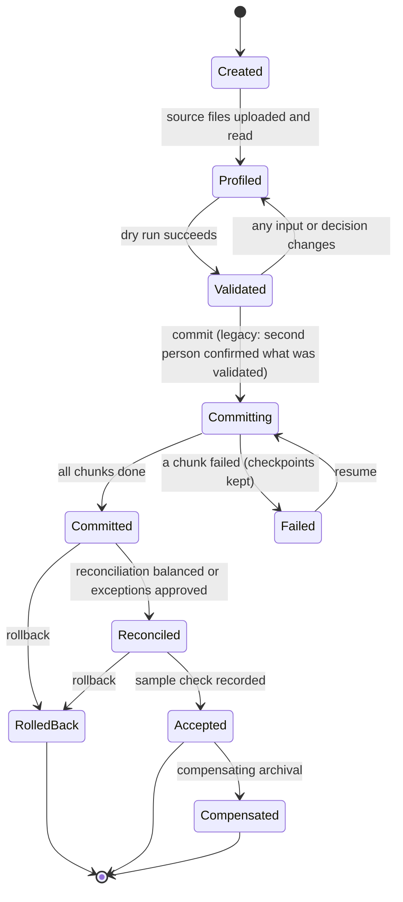

# Data migration

Status of this capability: **Implemented** for the scope below and exercised by automated tests and by a scripted run of the real screens. Items marked *Future*, *Mocked*, *Disabled* or *Scaffolded – Not Verified* are called out where they appear. Production approval is external governance; nothing here declares it.

This document describes the migration vertical slice (`src/Modules/Ecp.DataMigration`, pages under `src/Ecp.Host/Pages/Migration`). The requirements it implements are `requirements/09-migration/*` and `prompts/10-MIGRATION-VERTICAL-SLICE.md`; the design decisions are in `decisions/ADR-0018-migration-slice-design.md`.

## 1. What it does

A Procurement Administrator loads a legacy contract register (CSV or Excel), its attachment manifest and a ZIP of attachment files into a tenant, through the application's screens, without any code. A load is safe to repeat, can be stopped and resumed, is reconciled against its source, can be rolled back until it is accepted, and leaves a provenance trail for every record it touched.

| # | Capability | Where |
|---|---|---|
| 1 | Migration project (source system, data owner, extraction date, reference policy, cutover freeze window, legacy-load policy) | `/Migration`, `/Migration/Projects/{id}` |
| 2 | Migration batch (Dry run, Rehearsal or Final; duplicate strategy; document duplicate option; pinned mapping profile version and configuration release) | project page, `/Migration/Batches/{id}` |
| 3 | Mapping profiles (versioned; draft, validate, publish, immutable once published; field mappings CSV, lookup CSV, options) | `/Migration/Profiles` |
| 4 | Dry-run validation (writes nothing to the target; summary, per-mapping preview of original and transformed values, message list) | batch page, `/Messages`, `/Rows` |
| 5 | Source-to-target mapping (safe transformation catalogue only; no code, SQL or expressions) | profile page |
| 6 | CSV import (UTF-8 with or without BOM, UTF-16, Windows-1252 only when explicitly chosen; delimiter detection; RFC 4180) | batch page |
| 7 | XLSX import (chosen sheet; cached formula values; hidden rows and sheets flagged; `.xlsm` refused; DTD prohibited) | batch page |
| 8 | Attachment manifest import (CSV or XLSX, standalone or at the root of the ZIP) | batch page |
| 9 | ZIP attachment upload (path, extension, signature, size, ratio, duplicate and link checks; nothing extracted to disk) | batch page |
| 10 | Deterministic attachment matching (SourceRecordId, then AgreementReference, then the configured naming rule, then the parent folder; never a guess) | `/Files` |
| 11 | Unmatched attachment queue (resolve by hand, discard with a reason, release a held file) | `/Files` |
| 12 | Migration error report (Excel and CSV, formula-injection neutralised) | batch page |
| 13 | Reconciliation report (rows, manifest, files, source against target, distributions; saved and exportable) | `/Reconciliation` |
| 14 | Provenance tracking (ledger of every supplier, category, contract and document created, updated or linked, with before-images; shown on contract details; audit events carry the batch id) | `/Provenance`, contract details, `/Admin/Audit?batch=` |
| 15 | Idempotent re-run (stable idempotency keys; source record id is the identity; same file twice changes nothing) | all |
| 16 | Acceptance workflow (reconcile, sample check, outstanding items acknowledged, accept; after acceptance only compensating archival) | batch page |
| 17 | Safe rollback (provenance-driven; removes what is untouched, archives what has moved on, keeps shared reference data) | batch page |

## 2. The workflow



1. **Project.** Pick the organisation (only organisations the person may stage for are offered), name the source system and data owner. Optionally record the cutover freeze window and a legacy-load policy.
2. **Mapping profile.** Create a profile, open a draft version, import the field-mapping CSV and the lookup CSV (`migration-samples/field-mapping-profile-complete.csv`, `status-lookup-map.csv`), set options (create missing categories, attachment naming rule, open-ended extension types) and publish. A published version never changes; a change is a new version.
3. **Batch.** Choose the kind, the duplicate strategy (reject, skip existing, update mapped fields, create a new reference, manual review) and the document duplicate option (reject a duplicate hash, link the existing document, add a version, keep separate with a warning, or hold for manual review). The batch pins the profile version and the configuration release in force.
4. **Upload.** The contracts file, optionally the manifest, optionally the ZIP. Source rows are retained exactly as read. Re-uploading the same file changes nothing; a different file replaces the earlier one and withdraws any confirmation.
5. **Dry run.** Maps, validates and plans every row and file without touching the target. Blockers (for example no profile, no source file) stop the run; row errors do not. The result carries a fingerprint of everything validated.
6. **Decide.** Rows sent to manual review, unmatched or ambiguous files, held files and rejected rows are dealt with on the Rows and Files screens. Each decision changes the plan, so the dry run is repeated.
7. **Confirm (legacy load only).** A second person with `migration.legacy_load` confirms what was validated. The committer cannot confirm their own load, and changing any input withdraws the confirmation.
8. **Commit.** Runs in chunks (default 500) of one transaction each, with a checkpoint per chunk. A lease prevents two runs at once; if the process dies the lease lapses and a resume continues from the checkpoint without duplicating or losing anything.
9. **Reconcile.** Totals must balance (source rows = accepted + rejected + skipped; accepted = created + updated; manifest rows and archive files each account for every item) and the source distributions must equal the target's. Imbalances need a recorded approval.
10. **Accept.** The data owner records a sample check and acknowledges outstanding items. Acceptance is final for rollback.
11. **Rollback or compensate.** See section 8.

## 3. Mapping profiles

* Field mapping CSV columns: `SourceColumn, TargetField, Transformation, DefaultValue, Required, LookupMapKey, Validation, Notes`. Lookup CSV columns: `LookupMapKey, SourceValue, TargetCode`.
* Transformations may be chained with `+`. The catalogue is closed: `Trim`, `NormaliseWhitespace`, `Upper`, `Lower`, `TitleCase`, `ParseDate` (explicit format), `ParseDateTime` (explicit format and time zone), `ParseDecimal`, `ParseInteger`, `MapBoolean`, `Concat`, `Split`, `FixedDefault`, `LookupMap`. A profile that names anything else, or a target field that does not exist, fails validation with a message. Regular expressions are not transformations; the attachment naming rule is the only pattern, and it runs on the non-backtracking engine with a 250 ms timeout.
* Lookups: a value with no entry is `MIG-E004` when the mapping is required (the lookup key is set and the mapping is a hard `LookupMap`), and is passed through when the lookup is soft (a `LookupMapKey` alongside another transformation, as in the sample category columns).
* Values are never truncated: a value over its maximum is `MIG-E009`.
* Additional (custom) fields: **Implemented** for every type except calculated, person and file-reference. Target `custom.<key>` (lower-case letters, digits and underscores, for example `custom.service_tier`). The dry run checks every mapped key against the organisation's published field definitions (release recorded in the message), then every value: type and limits, defined and active choices, one value for a single-valued field, `;` between the values of a multiple-choice field. A source value that is not a code (or label) of the field's choices is **not guessed**: map it with a `LookupMap` transformation and lookup entries, or the row is rejected (`MIG-E022`). A retired field, or one not yet in force, takes no new values (`MIG-E021`, a blocker when the profile maps it). The stored value is the canonical code; the value as the source gave it is kept beside it with the batch id and source system. Reruns are idempotent (an unchanged value is not rewritten); an update keeps a before-image of the configured values under `cf.<key>`, and rolling back an update restores them; rolling back a creating batch removes an untouched record together with its configured values, and archives a record that has had activity since (its values are kept). The `staging.*` targets are still accepted and retained but not loaded.
* Core fields a profile can now set: `contractType`, `agreementType`, `riskLevel`, `functionCode`, `sapOutlineAgreementNumber`, `noticePeriodValue` and `noticePeriodUnit` (both or neither), `criticalNotice`. Legal entity, business unit and site are not yet mapping targets (**Future**); a contract can be given them afterwards.
* Sample columns and mapping rows: `migration-samples/contracts-import-custom-fields.csv` and `migration-samples/field-mapping-profile-custom-fields.csv` (with `status-lookup-map.csv` and the `tier` entries shown in the sample profile).

## 4. Intake formats and limits

| Source | Behaviour |
|---|---|
| CSV | BOM stripped; UTF-16 detected; Windows-1252 only when the uploader chooses it; delimiter detected (comma, semicolon, tab, pipe) or chosen; quoted fields with embedded newlines; ragged rows kept, flagged and rejected with `MIG-E013`; duplicate headers refused |
| XLSX | Hand-written reader (no third-party spreadsheet library); first visible sheet or the chosen one; cached values of formulas; Excel date serials via the workbook's date system; hidden rows flagged (`MIG-W007`); `.xlsm` refused; external links are not followed (cached values are read and a notice recorded); DTD processing prohibited |
| ZIP | Entries are read in memory and written to restricted, content-addressed staging; traversal (`..`), absolute, UNC, drive, reserved device names, symbolic links, duplicate names, disallowed extensions, signature mismatches and decompression bombs are refused or marked invalid per entry |
| Limits (configurable under `Migration` in `appsettings.json`) | 250,000 rows, 500 columns, 32,768 characters per cell, 500 MB per source file; 20,000 archive entries, 5 GB total, 500 MB per entry, compression ratio 100:1 (checked above 10 MB); 2 GB upload |
| Exports | Excel and CSV exports prefix cells that begin with `=`, `+`, `-`, `@`, tab or carriage return so a spreadsheet never evaluates them |

## 5. Rows, duplicates and idempotency

* Identity of a record is `(organisation, source system, SourceRecordId)`. A row whose identity exists is the *same* record; its handling follows the duplicate strategy. An unrelated record that already uses the same agreement reference is a *collision*, never updated.
* Agreement references are unique across the tenant. The source reference is always kept as `SourceAgreementReference`; with the `GenerateNew` policy, or the *create a new reference* strategy, the organisation's numbering rule allocates the target reference.
* *Update mapped fields* changes only fields that differ (money compared by amount), keeps a before-image of the old values, and refuses locked records (`MIG-E012`) unless the project's legacy policy explicitly allows overwriting locked records and a reason is recorded. An ordinary load never changes workflow state.
* Running the same file again produces `Skipped` rows (`MIG-W002`) and changes nothing, including the document store: files are recognised by content hash.

## 6. Legacy records

A legacy load is the only way a migration may create contracts in a state other than the initial one. It needs: a project legacy policy (allowed statuses, expiry date), `migration.legacy_load` for the creator, a second person's confirmation of the validated fingerprint, and a batch marked legacy. Loaded records are locked (effective contracts are immutable except through Variations or an audited emergency unlock). The source Registered Date is imported only when the policy allows it, only when it is present, and is shown on the contract as *from the source system*; otherwise the platform's own registration time is used and `MIG-W005` is recorded. Dates are stored in UTC.

## 7. Attachments

1. **Manifest** rows (`SourceRecordId, AgreementReference, RelativePath, FileName, DocumentType, DocumentDate, VersionLabel, IsExecutedCopy, ParentDocumentSourceId, Sha256, Notes`) pair with archive files by normalised relative path. A manifest row with no file is `MIG-F009`; two rows naming one file is `MIG-F012`; an invalid row is `MIG-F019` and its file is held; a declared hash that differs is `MIG-F017`.
2. **Matching** runs in a fixed order and stops at the first method that yields exactly one contract: manifest SourceRecordId, manifest AgreementReference, the profile's naming rule (group `sourceRecordId` or `agreementReference`), then the exact parent folder name against the row's document folder or agreement reference. More than one candidate is *ambiguous* (`MIG-F012`): the candidates are recorded as proposals and a person chooses; the platform never breaks a tie. No candidate is `MIG-F010` or `MIG-F011`.
3. **Queue.** Unmatched, ambiguous, rejected-target (`MIG-F015`) and held files wait. A person can pair a file with a contract row in the batch (recorded as method *Manual* with their name), discard it with a reason, or release a held file. Commit proceeds without them; reconciliation reports them as *unmatched* or *discarded*; acceptance requires acknowledgement of outstanding items.
4. **Scan.** Every file is passed to the malware scanner. No real scanner adapter exists (**Disabled**); a mock that recognises the standard EICAR test string is registered outside Production (**Mocked**, demonstration only). With `Migration:RequireMalwareScan` (set automatically in Production) a file that could not be scanned is held (`MIG-F014`) rather than imported. An infected file is invalid (`MIG-F013`) and never imported.
5. **Import.** Files become documents attached to the contract, through the Documents module (content-addressed blobs, versions, classification inherited from the contract). The document duplicate option decides what happens when the same content already exists (`MIG-F007`): reject it, link the existing document, add a version, keep it separate with a warning, or hold it for a person to decide. A repeated file name within a contract is warned (`MIG-F008`).

## 8. Provenance, reconciliation, acceptance and rollback

* **Provenance ledger** (`migration.ProvenanceRecord`): one record per supplier, category, contract and document the batch created, updated or linked, with the batch id, action, the target's identity, a before-image for updates, and a reversal state (Active, Reversed, Archived, Retained, NotReversible). Contract details show the source system, source record id, batch and Registered Date origin. Every audit event the batch produces carries the batch id and is filterable on the audit screen.
* **Reconciliation** is recomputed from the staged data and the target, never from counters: rows, manifest, files, documents created, target checks and distributions (by status, category and currency value). It can be saved (versioned) and exported.
* **Acceptance** needs the latest reconciliation to balance (or approved exceptions), a recorded sample check and an acknowledgement of anything outstanding.
* **Rollback** (before acceptance) acts strictly on the batch's own provenance: untouched records created by the batch are removed; contracts or documents that have moved on (workflow activity, later versions, documents attached) are **archived, never deleted**, with the reason; suppliers and categories that other records still use are **kept**; updates are restored from their before-images only if nothing changed since. Child categories are removed before their parents. A preview shows exactly what would happen.
* **Compensation** (after acceptance) archives what the batch created and leaves shared reference data in place; nothing is deleted.

## 9. Security

| Rule | How it is enforced |
|---|---|
| Tenant isolation | EF global tenant filters on every migration entity; SQL Server row-level security; composite foreign keys carry `TenantId`; tenant-key guard (`MIG-F016`) at commit |
| Role and scope | `migration.stage`, `migration.commit`, `migration.legacy_load`, `migration.rollback`, `migration.accept` are held by the Procurement Administrator role only; evaluated against the stored organisation of the project, never against anything submitted. Another tenant or an out-of-scope organisation sees *not found*; an in-scope person without the permission sees *forbidden* |
| Separation of duties | The person who commits a legacy load cannot be its confirmer |
| No code execution | Closed transformation catalogue; non-backtracking regular expression with timeout for naming rules only; no SQL, scripts or templates |
| Hostile files | Section 4; staged files are never served from staging and never executed |
| Secrets and data | Synthetic samples only; messages never contain secrets or other tenants' data; the error report holds source values the person already uploaded |
| Audit | Hash-chained audit entries for every state change, with the batch id; administrative readers see that a change happened, not business values |
| Cutover freeze | While a project's freeze window is open and the target freeze is on, creating contracts by hand in that organisation is refused (`cutover_freeze`); the migration itself is not blocked |

## 10. Configuration

`appsettings.json`, section `Migration`: `ChunkSize` (500), `CommitLease` (2 minutes), `MaxUploadBytes`, `RequireMalwareScan` (forced on in Production), `ReadLimits`, `ArchiveLimits`. Mapping profile options are per profile version.

## 11. Message catalogue

Every code the code can produce appears here; `MigrationCatalogueTests` fails the build if one is missing.

| Code | Meaning |
|---|---|
| MIG-E001 | Required value missing |
| MIG-E002 | Date or date and time could not be parsed with the configured format |
| MIG-E003 | Number could not be parsed |
| MIG-E004 | Lookup value not mapped, or a value not on the tenant's list (for example a classification) |
| MIG-E005 | Duplicate source record in the same file |
| MIG-E006 | Duplicate agreement reference or source record already loaded (the strategy decides: reject, skip, update, generate, manual) |
| MIG-E007 | Cross-tenant or cross-organisation reference, or a manifest row that names a different source system |
| MIG-E008 | Status not valid for the target workflow or not allowed by the legacy-load policy |
| MIG-E009 | Value exceeds its maximum length (never truncated) |
| MIG-E010 | Ambiguous supplier match (needs manual resolution) |
| MIG-E011 | Category or subcategory unresolved |
| MIG-E012 | Legacy-load policy violation, including overwriting a locked record without permission |
| MIG-E013 | Ragged row (more fields than headers) or duplicate column header |
| MIG-E014 | Mapping or lookup file is missing a required column |
| MIG-E015 | Value shorter than the minimum or not the exact length the mapping validation requires |
| MIG-E020 | `custom.<key>` names a field that is not an additional field of this organisation |
| MIG-E021 | The additional field is retired or not in force, so it takes no new values |
| MIG-E022 | Value is not a defined (and still offered) choice or lookup member of the field |
| MIG-E023 | Value breaks the additional field's type or validation (length, range, pattern, date range) |
| MIG-E025 | The additional field cannot be loaded by a migration (calculated, person or file reference) |
| MIG-E026 | The organisation has no lifecycle definition to take its contracts' initial state from (no solution pack of its own and no installation default); the dry run stops before any row is read |
| MIG-W001 | Value normalised (trimmed, case, whitespace) |
| MIG-W002 | Default applied, or row skipped because nothing would change |
| MIG-W003 | End date blank with an open-ended extension type (expected) |
| MIG-W004 | Registered date earlier than effective date |
| MIG-W005 | Source Registered Date not imported because the legacy-load policy does not allow it |
| MIG-W006 | Information: the manifest was read from the archive, or a supplier name differs from the existing supplier with the same vendor number |
| MIG-W007 | Row hidden in the workbook (read and flagged) |
| MIG-W008 | Reader notice (encoding detected, delimiter detected, sheet chosen, formulas read as cached values) |
| MIG-W009 | Parent document named in the manifest was not found; imported without a parent |
| MIG-F001 | Archive path traversal, absolute, drive, UNC or reserved path rejected |
| MIG-F002 | Extension not on the allowlist |
| MIG-F003 | Content signature does not match the declared type |
| MIG-F004 | Empty file |
| MIG-F005 | Corrupt or encrypted file or archive |
| MIG-F006 | File, archive or entry count exceeds limits (including decompression bombs) |
| MIG-F007 | Duplicate content hash (the document duplicate option decides) |
| MIG-F008 | Duplicate file name within a contract |
| MIG-F009 | Orphan manifest entry (no file) |
| MIG-F010 | Orphan file (no manifest entry and no contract matches its name or folder) |
| MIG-F011 | No match found (unmatched queue), or the naming rule timed out on a path |
| MIG-F012 | Ambiguous match, or two manifest rows name one file (unmatched queue) |
| MIG-F013 | Malware scan reported an infection |
| MIG-F014 | Malware scanner unavailable (file held; Production does not proceed) |
| MIG-F015 | Target contract not found in this batch, rejected, or not loaded |
| MIG-F016 | Tenant mismatch |
| MIG-F017 | File content hash differs from the one the manifest declares |
| MIG-F018 | Archive holds more than one entry with the same path |
| MIG-F019 | Manifest row invalid (for example no RelativePath) |

## 12. Demonstration and test evidence

### 12.1 The scripted run of the real screens

`tools/migration-demo.py` signs in as the seeded demo users over HTTP (antiforgery tokens, multipart uploads) and drives the same pages a browser uses, loading `contracts-import.csv`, `attachment-manifest.csv` and the attachment ZIP from `migration-samples/`.

```bash
dotnet build src/Ecp.Host -c Debug
rm -rf src/Ecp.Host/data                       # a fresh synthetic Demo database
cd src/Ecp.Host
ASPNETCORE_ENVIRONMENT=Development ASPNETCORE_URLS=http://127.0.0.1:5088 dotnet bin/Debug/net10.0/Ecp.Host.dll &
cd ../.. && python3 -I tools/migration-demo.py
```

Result of the run (exit status 0; synthetic data only):

```text
== 1. Migration project                      ok  project created
== 2. Mapping profile ... published          ok  profile version published and unchangeable
== 3. Legacy-load policy and a legacy final batch (profile pinned)   ok
== 4. Upload contracts-import.csv and the attachment ZIP             ok  contracts file, archive and the manifest inside it are registered
== 5. Dry run (nothing is written to the target)                     ok  the register is still empty of the sample contracts
== 6. Legacy load: a second person confirms ...                      ok  commit refused before a second person confirms; batch committed
== 7. Reconciliation and acceptance                                  ok  reconciliation balanced; batch accepted
== 8. What the application now shows
   ok  Contracts: DEMO-AGR-0001 and DEMO-AGR-0002 are listed
   ok  contract details show Migration provenance (source record id)
   ok  Documents: 3 downloadable documents are attached to the migrated contracts
   ok  a migrated document downloads (HTTP 200)
   ok  Suppliers: Southern Cross Demo Supplies Pty Ltd was created
   ok  Provenance ledger lists contracts, suppliers and documents created by the batch
   ok  Audit entries carry the batch id (legacy_loaded, document.imported)
   ok  the error report downloads as a real workbook
END-TO-END MIGRATION VIA THE UI: ALL STEPS PASSED
```

The reconciliation page of that run reported: source rows 2 (accepted 2, rejected 0, skipped 0; created 2, updated 0); manifest rows 3 (paired 3, orphans 0, invalid 0); files in the archive 3 (imported 3, failed 0, invalid 0, duplicates 0, unmatched 0, discarded 0); documents created 3; status *Effective* 2 = 2; category ENERGY-ELEC 1 = 1 and PACKAGING-FLEX 1 = 1; estimated value AUD 1,025,000.00 = 1,025,000.00; **Balanced**.

### 12.2 Automated tests

```bash
dotnet test tests/Ecp.UnitTests          --filter "FullyQualifiedName~Migration"        # formats, mapping, matcher, planner, domain, catalogue
dotnet test tests/Ecp.Integration.Tests  --filter "Category=Migration"                  # 22 scenarios, SQLite (lightweight; not SQL Server proof)
set -a; . .ecp-dev/test-sql.env; set +a                                                 # tools/sqlserver-up.sh creates a disposable SQL Server
dotnet test tests/Ecp.Integration.Tests  --filter "Category=Migration"                  # the same 22 scenarios again on SQL Server (RLS, composite keys)
dotnet test tests/Ecp.Api.Tests          --filter "Category=Migration"                  # the whole flow through the real pages
dotnet test tests/Ecp.Architecture.Tests
```

Scenarios (each runs on SQLite and on SQL Server; without `ECP_TEST_SQL` the SQL Server copies are **skipped and reported NOT VERIFIED**, never Passed):

| Scenario | Proves |
|---|---|
| sample contracts, manifest and archive load end to end | suppliers, contracts, documents, audit entries and provenance exist; reconciliation balanced; acceptance |
| a dry run writes nothing to the target | target snapshot (records, stamps, counters, blobs) unchanged |
| error and reconciliation totals equal the processed input | no cut or executed content; formula injection neutralised |
| the mapping preview shows original and transformed values | per-mapping change counts |
| a legacy load needs a policy, a second person and exactly what was validated | confirmation bound to the fingerprint; withdrawn by any change |
| the source Registered Date follows the policy and is never made up | `MIG-W005`, labelled origin |
| a stopped commit resumes without losing or duplicating anything | eight kill and failure points across both phases and chunk boundaries |
| re-running a file is idempotent; updating keeps before-images | zero change on re-run; locked records refused; rollback of an update |
| each duplicate strategy behaves as specified | reject, skip, update, create-new-reference, manual review (decision survives revalidation) |
| the reference policy can generate every target reference | source reference preserved |
| rollback removes only the selected batch's changes and keeps shared data | shared supplier kept; earlier and later batches untouched |
| a record that has moved on is archived, not deleted | activity-aware rollback |
| after acceptance rollback is refused and compensation keeps everything | nothing deleted |
| unmatched files wait in a queue until a person resolves or discards them | manual match and discard audited; rejected target refused |
| attachments match in a fixed order and the platform never breaks a tie | naming rule, folder, ambiguous candidates |
| unsafe archive entries and infected files never reach the target | traversal, executable, signature mismatch, EICAR, `.xlsm`, bomb |
| production holds attachments when no scanner can clear them | `MIG-F014` |
| another tenant and people without the permission cannot see or run a migration | 404 and 403 behaviour; audit invisible across tenants |
| the cutover freeze stops hand-keyed contracts but not the migration | window open and closed |
| a batch keeps the profile version it was created with | pinning; drafts cannot be pinned; published versions immutable |
| missing categories are created only when the profile says so | creation and rollback removal, children before parents |
| spreadsheet and UTF-16 sources load exactly like CSV | XLSX and UTF-16 |

## 13. Assumptions, contradictions and known limits

Recorded in `TASKS.md` (MGR-ASM-*). In short:

* The reference-data phase and the contracts phase commit together in the *Contracts* checkpoint (suppliers and categories are created in the chunk of the first contract that needs them); documents follow in their own phase. Checkpoints are therefore "Contracts" and "Documents".
* Attachments match only within their own batch (a file cannot attach to a contract loaded by an earlier batch).
* The supplement's catalogue stopped at `MIG-E012`, `MIG-W004`, `MIG-F016`; the codes above that are new (E013–E015, W005–W009, F017–F019).
* No outbox, notification or reminder emission exists yet, so migration emits none (**Future**).
* No real malware scanner (**Disabled**; mock outside Production).
* JSON/ZIP-package sources are **Future**. Person and file-reference additional fields cannot be matched from a source file and are refused (`MIG-E025`).
* The UI commits synchronously within the request (resumable); a background worker is **Future**.
* Rollback preview for categories is indicative: a child is judged on its own when the rollback runs.
* SQL Server proof depends on the disposable container; when unavailable those tests are **NOT VERIFIED**.
