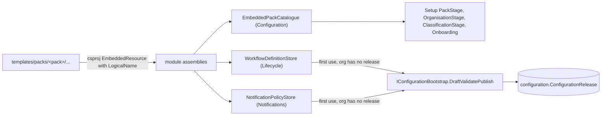
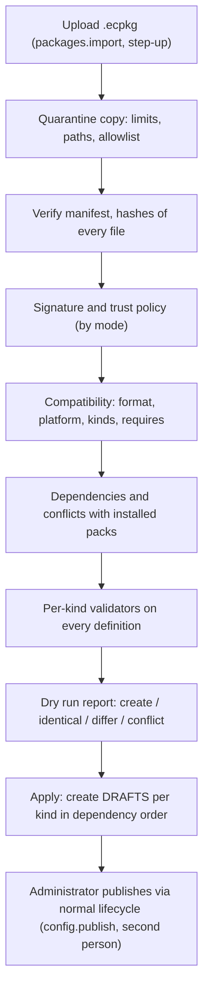
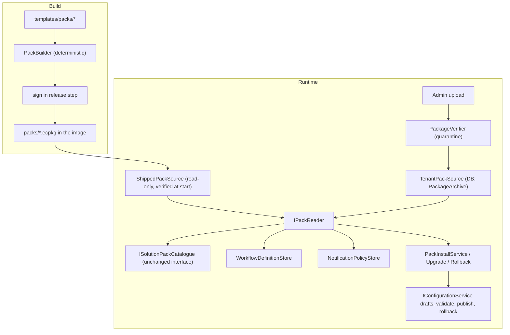

# Pack Architecture: externalising solution packs (slice S7, design)

Status: **Design only; nothing in this document is implemented.** It is the review of slice S7 of `docs/PORTABILITY_REMEDIATION_PLAN.md` (action R7: "pack loader and store; remove embedded JBS resources"; findings P-03 and, for the guard, P-09 stage C). It builds on the existing package requirements (`requirements/08-portability/CONFIGURATION_PACKAGE_SPEC.md`, tests PKG-001 to PKG-012, ADR-0008 configuration versioning, ADR-0014 supply chain and pack signing) and on the code as it is at commit `380f72e` and later. Where this document proposes something the requirements do not already say, it is marked **Proposal**; where it needs an owner decision, it is listed in section 12.

Reading guide: sections 1 and 2 are what exists; sections 3 to 8 are the design asked for (loader, signing, versioning, compatibility, upgrades, rollback); sections 9 to 11 are target architecture summary, security model and migration; sections 12 to 15 are decisions, risks, effort and order.

## 1. Current embedded-pack architecture (verified in the code)

### 1.1 How a pack reaches an organisation today



* **Three independent readers** of embedded resources, each in a different assembly, each with its own resource-name convention:
  * `Ecp.Configuration`: `EmbeddedPackCatalogue` lists every resource named `Ecp.Pack.*.json` and deserialises it as `SolutionPackInfo` (pack id, name, version, description, `synthetic`, publisher, `features`, `ownershipModel`, `approvalModel`, and `defaults`: culture, time zone, currency, reference prefix, classification levels, contract types, categories). It is a **singleton** and is read once at startup.
  * `Ecp.Lifecycle`: `WorkflowDefinitionStore.ReadPackDefinition(packId, kind)` reads the resource named `Ecp.Workflow.<packId>.contract-lifecycle.json` for the lifecycle or the matching `variation` name for the Variation workflow (`WorkflowKinds.ResourceName`).
  * `Ecp.Notifications`: `NotificationPolicyStore.ReadPackPolicy(packId)` reads `Ecp.Notifications.<packId>.notification-policy.json`.
* **Lazy installation.** A pack's definitions are not installed when the pack is chosen. The first time an organisation needs a workflow or a notification policy and has published none, the store resolves the organisation's pack (`PackSelection.ResolveAsync`, S1), reads the embedded file, and publishes it through `IConfigurationBootstrap.DraftValidatePublishAsync(..., "system", "Installed the <pack> reference ...")`. From then on the organisation runs on its own published release (immutable, hashed, versioned, rollback-able). A concurrent first use is handled by catching the unique-release-number failure and reading the winner.
* **Selecting a pack** (Setup `PackStage`, onboarding `SelectPackAsync`) only stores a key: `Organisation.SolutionPackKey` and a tenant-level `SolutionPack` configuration release `{ "packId": "..." }` whose validator (`SolutionPackKind`) checks the id against the catalogue. Onboarding can additionally **merge the pack's `defaults`** (categories, contract types) into the onboarding draft; nothing is removed.
* **Nothing else is pack data yet.** Custom fields, approval matrices, list views, branding and terminology are configuration kinds, but no pack ships them; the JBS approval matrices and demonstration fields exist only as samples (section 2).
* **The pack metadata is only partly honoured.** `features`, `ownershipModel` and `approvalModel` are parsed and displayed and never read by the engine (finding P-04, slice S6).

### 1.2 What the architecture gets right (and S7 must preserve)

* A pack is **data only**; nothing in it is executed. Everything installed goes through the same kind validators as the Studio (`IConfigurationKind`), so a pack cannot install what an administrator could not publish.
* Installed content becomes the organisation's **own immutable, hashed release**; contracts are pinned to workflow releases; so changing or removing a pack later cannot change an in-flight contract.
* Pack selection is per organisation, with no code default (S1).

### 1.3 What makes it impossible to add a second business without a rebuild (P-03)

1. The data is **compiled into assemblies**: eight `EmbeddedResource` lines in three project files (`Ecp.Configuration.csproj` lines 13 and 14, `Ecp.Lifecycle.csproj` lines 19 to 22, `Ecp.Notifications.csproj` lines 18 and 19), each with a hand-written `LogicalName`.
2. The **resource-name convention is code** (`WorkflowKinds.ResourceName`, the `Ecp.Notifications.{packId}...` string, the `Ecp.Pack.` prefix scan). A new kind of pack content needs a new reader in a new module.
3. The **catalogue is a startup singleton over assembly resources**, so it cannot learn about a pack installed at run time, and it is not tenant-aware.
4. The **build and image are coupled to the pack files**: the Dockerfile must `COPY templates/packs/`, and `tools/check-repo.py` (section 5b) fails the build if an embedded path is not copied and not `.dockerignore`d.
5. There is **no integrity, provenance or version check**: an embedded file is trusted because it was compiled in. There is no notion of an installed pack version, so no upgrade, no "which version is this organisation on", and no compatibility check.
6. The `SolutionPack` release records only `{ packId }`: it does not say which version or which content was installed, so a later upgrade could not tell an unmodified installation from a modified one.

## 2. Inventory of pack resources

### 2.1 Embedded today (the S7 scope)

| Resource | Embedded by | Logical name | Read by | Config kind it becomes | Scope |
|---|---|---|---|---|---|
| `templates/packs/blank/pack.json`, `templates/packs/jbs-procurement/pack.json` | `Ecp.Configuration.csproj` | `Ecp.Pack.<id>.json` | `EmbeddedPackCatalogue` (Setup, onboarding, classification stage, `SolutionPackKind`) | catalogue entry (not a release); `SolutionPack` release records the selection | tenant |
| `templates/packs/<pack>/workflows/contract-lifecycle.json` (x2) | `Ecp.Lifecycle.csproj` | `Ecp.Workflow.<id>.contract-lifecycle.json` | `WorkflowDefinitionStore` | `WorkflowContractLifecycle` | organisation |
| `templates/packs/<pack>/workflows/variation.json` (x2) | `Ecp.Lifecycle.csproj` | `Ecp.Workflow.<id>.variation.json` | `WorkflowDefinitionStore` | `WorkflowVariation` | organisation |
| `templates/packs/<pack>/notifications/notification-policy.json` (x2) | `Ecp.Notifications.csproj` | `Ecp.Notifications.<id>.notification-policy.json` | `NotificationPolicyStore` | `NotificationPolicy` | organisation |

Eight files, two packs (`blank`, `jbs-procurement`), three assemblies, three readers.

### 2.2 Not embedded, but part of the same problem

| Resource | Where | Status | S7 position |
|---|---|---|---|
| `sample-data/jbs-procurement-solution-pack.json` | repository | A 6-key stub (ASM-19), unused by code | Superseded by the real pack; retire or convert to a `DemoData` package later |
| `sample-data/demo-custom-fields.json`, `synthetic-approval-matrix-advanced.json`, `synthetic-generic-value-approval-matrix.json` | repository | Used by tests and as samples only; **not installed by any pack** | Candidates for pack content (`CustomField`, `ApprovalMatrix` kinds) in a later pack-content slice; **out of S7** |
| `sample-data/demo-organisation-structure.json`, `demo-users-and-roles.json`, `demo-categories-and-assignments.json`, `demo-contracts.json` | embedded in `Ecp.Host` as `Ecp.Demo.*` | Demonstration data for the Demo/Test host | A `DemoData` package kind (spec section 2) is the eventual home; **out of S7**, stays embedded in the host for now (it is the demo, not a pack) |
| `src/Modules/Ecp.Contracts/Register/system-views.json` | embedded in `Ecp.Contracts` | The 11 shipped list views, one named for a JBS state (R-06) | Platform default today; becomes a `ContractListView` pack/default kind in S4/S6; **out of S7** |
| `requirements/02-reference/role-permission-matrix.csv`, `permission-catalogue.csv` | embedded in `Ecp.Identity` | The compiled role catalogue and permission vocabulary | **Platform vocabulary, not a pack.** The role decision is S5/S8; packs may later carry `RoleTemplate` definitions that map onto a catalogue |
| Platform key material | none today | There is no signing key and no trust anchor in the repository | New: public trust anchor(s) only (section 5.4) |

### 2.3 What the package spec says a pack should eventually contain but no pack does yet

Fields, forms, rule sets, approval matrix, lookups, terminology, branding defaults, notification templates and reminder policies, role templates, retention policy, ownership model (`CONFIGURATION_PACKAGE_SPEC.md` section 9). The package **format** must reserve these kinds now (so adding them later is a minor version, not a format change), but S7 itself only moves the four content types of section 2.1.

## 3. The external pack loader (design)

### 3.1 Principles

1. **One place reads pack content.** A single `IPackReader` replaces the three embedded readers; stores ask it for "the definition of kind K from pack P at the version installed for this organisation". Stores keep their lazy-install behaviour; only the *source* changes.
2. **Packs are immutable, verified artefacts.** A package is verified once when it enters a store, kept as the original bytes plus its verified manifest, and never modified. Reading from the store never re-trusts the filesystem.
3. **Two sources, one interface.** (a) **Shipped packs**: read-only `.ecpkg` files in a directory next to the application (`Ecp:Packs:ShippedDirectory`, default `<app>/packs`), produced by the build from `templates/packs/`. (b) **Tenant-installed packs**: stored in the database (tenant-scoped), put there by an administrator through the import procedure. A catalogue folder or URL (spec section 8) is a later third source and is **out of S7**.
4. **Same validators as the Studio.** Applying a package reuses every `IConfigurationKind.ValidateAsync`; there is no pack-only validation path that could drift.
5. **Apply creates drafts, never published releases** (PKG-010) for tenant installs. The built-in **lazy install of shipped packs keeps its current behaviour** (system publishes a first release when an organisation has nothing) so existing flows, tests and the "empty organisation just works" behaviour do not change.

### 3.2 Components

| Component | Module | Responsibility |
|---|---|---|
| `PackageManifest`, `PackageFormat` | `Ecp.Configuration` (a new Packages folder) | Manifest model, canonical form, `formatVersion`, limits. Pure, no I/O |
| `PackageVerifier` | `Ecp.Configuration` | Unpack into a quarantine area; enforce archive limits; verify allowlist, hashes, signature, compatibility; return a `VerifiedPackage` or a list of reasons. Reuses the safe-path and limit code of `Ecp.DataMigration.Formats` (`ArchivePaths`, `ArchiveLimits`): **move that code to a shared place (`Ecp.Formats`) first**, because `Ecp.Configuration` cannot depend on `Ecp.DataMigration` (tier rule) |
| `IPackSource` | `Ecp.Configuration` | `ShippedPackSource` (directory, read-only, verified at startup) and `TenantPackSource` (database). Lists `PackRef(packKey, version, packageSha256, source)` and opens a verified package |
| `IPackReader` | `Ecp.Configuration` | `ReadDefinition(packKey, version, kind, code)`, `ReadInfo(packKey, version)`; replaces `EmbeddedPackCatalogue` internals and the two `ReadPack*` methods |
| `ISolutionPackCatalogue` (kept) | `Ecp.Configuration` | Same interface the Setup and onboarding code already uses; now backed by `IPackReader`. `List()` returns shipped packs plus the current tenant's installed packs; `Find(id)` resolves the **latest compatible installed version** of a pack key |
| `PackInstallService` | `Ecp.Configuration` | Import procedure (section 3.4): quarantine, dry run, conflicts, apply-as-drafts, audit |
| `PackUpgradeService`, `PackRollbackService` | `Ecp.Configuration` | Sections 7 and 8 |
| `PackBuilder` (tool, not runtime) | `tools/` or a small console project | Builds `.ecpkg` from `templates/packs/<id>/` deterministically; signs in the release pipeline; used by the build, by tests and (later) by export |
| Persistence | `Ecp.Configuration` migration | New tables, section 3.5 |

The tier rule is respected: `Ecp.Configuration` already sits below the modules that own kinds (`Ecp.Lifecycle`, `Ecp.Notifications`). The loader therefore hands **raw JSON** to the kind (`IConfigurationKind.ValidateAsync(orgId, json)` / `IConfigurationBootstrap`) and never learns a kind's schema. Kind-specific knowledge (for example "this workflow names an approval matrix that must be published first") stays inside the kind.

### 3.3 Where a pack is looked up (resolution)

```
organisation.SolutionPackKey
   -> installed pack record for (tenant, organisation, packKey)         [new; section 3.5]
        if present: use that exact version for lazy installs and upgrades
        if absent:  latest compatible version visible to the tenant:
                    tenant-installed first only if the same publisher key, else shipped
   -> IPackReader.ReadDefinition(packKey, version, kind, code)
   -> kind validators -> release (as today)
```

Rules: a shipped pack key is **reserved**; a tenant-installed package may not use a shipped pack key unless its publisher key equals the shipped one (otherwise a tenant could shadow `jbs-procurement` with different content for other organisations of its own tenant, and could confuse the audit trail). Two versions of one key may coexist in a store; an organisation uses the version it was installed at until it upgrades.

### 3.4 Import procedure (quarantine to draft)



* Steps up to the dry run **write nothing** to the target (PKG-002). The quarantine copy is deleted on completion or failure. All checks run on the **quarantined bytes**, and the bytes that are stored are the ones that were verified (no re-read of the upload).
* **Order of kinds matters** because existing validators cross-reference: the approval matrix must be published before a workflow that names it (`WorkflowDefinitionKind`), and the classification policy before a notification policy that names levels. The loader orders by a fixed dependency list (**Proposal**: `ClassificationPolicy`, `CustomField`, `ApprovalMatrix`, workflows, `NotificationPolicy`, `ContractListView`, `Branding`) and the dry run reports a validator failure with the kind it came from.
* **Agreement Reference conflicts** (PKG-012): a pack carrying a reference prefix is checked against the tenant's other organisations' rules in the dry run.
* The result of an import is an **import operation** record (id, package hash, actor, mode, outcome, per-kind draft ids) used by rollback (section 8) and by audit.

### 3.5 New persistence (Proposal; additive, no change to existing tables)

| Table (schema `configuration`) | Columns (essentials) | Purpose |
|---|---|---|
| `PackageArchive` | Id, TenantId (null for none, shipped packs are not stored), PackKey, Version, PackageSha256, ManifestJson, Bytes (varbinary(max), size-capped), Signer KeyId, SignatureStatus, ImportedUtc, ImportedBy | Immutable store of verified tenant-installed packages. Unique (TenantId, PackKey, Version) and (TenantId, PackageSha256) |
| `PackInstallation` | Id, TenantId, OrganisationId, PackKey, Version, PackageSha256, InstalledUtc, InstalledBy, BaselineJson (kind -> content hash at install), OperationId | Which pack and version an organisation is on, and the **baseline** for three-way upgrades |
| `PackOperation` | Id, TenantId, Kind (Install, Upgrade, Rollback), PackKey, FromVersion, ToVersion, ActorId, Mode, Outcome, DraftIdsJson, ReleaseNumbersBeforeJson, CreatedUtc | Groups the drafts and releases of one operation for audit and group rollback |
| `TrustedPublisherKey` | Id, TenantId, KeyId, Algorithm, PublicKey, Label, RegisteredBy, RegisteredUtc, RevokedUtc, RevokedBy | Tenant-registered trust anchors and revocation (spec section 4) |

Tenant isolation follows the module's existing pattern (tenant-owned entities, composite keys, global query filter, Row-Level Security on SQL Server) and gets the same layer-off tests. **Shipped packs are not stored in the database**; they are global, read-only files.

## 4. Package structure

### 4.1 Archive (`.ecpkg`, a ZIP; format version 1)

This is the layout already confirmed in the spec, specialised to the kinds that exist.

```
manifest.json                         required; canonical JSON (sorted keys, UTF-8, no BOM, LF)
signature.json                        optional in Demo/Test; required for catalogue/shipped packs in Production
definitions/
  SolutionPack/pack.json              the catalogue entry and defaults (today's pack.json)
  WorkflowContractLifecycle/contract-lifecycle.json
  WorkflowVariation/variation.json
  NotificationPolicy/notification-policy.json
  (reserved, not yet shipped: ClassificationPolicy, CustomField, ApprovalMatrix, ContractListView,
   Branding, Terminology, Lookup, FeatureFlags, RoleTemplate, RetentionPolicy, DocumentType ...)
assets/                               reserved; allowlisted types only
docs/README.md, docs/CHANGELOG.md     required for catalogue packs
```

`definitions/<Kind>/<code>.json` keeps the spec's shape. Because the implemented configuration model is **one document per kind per scope** (the spec's "definition per code" is finer than what `ConfigurationRelease` stores), **Proposal:** for format version 1 each kind has exactly one definition file per scope, and `code` is a human-readable file name that the manifest maps to `(kind, scope)`. Finer-grained items (a single custom field, a single workflow state) are handled as *keyed items inside* a document for merge purposes (section 7.3), not as separate files.

### 4.2 Manifest (format version 1)

The spec's fields are kept; additions are marked.

```json
{
  "formatVersion": 1,
  "packageId": "org.example.pack.jbs-procurement",
  "packKey": "jbs-procurement",
  "name": "JBS Procurement Reference",
  "description": "...",
  "version": "2.1.0",
  "kind": "SolutionPack",
  "publisher": { "name": "Platform (built-in)", "keyId": "ecp-platform-2026" },
  "createdUtc": "2026-10-20T00:00:00Z",
  "compatibility": { "minPlatformVersion": "1.0.0", "maxPlatformVersion": null, "kindSchemas": { "WorkflowContractLifecycle": 1, "WorkflowVariation": 1, "NotificationPolicy": 1, "SolutionPack": 1 } },
  "synthetic": true,
  "contents": [ { "path": "definitions/WorkflowContractLifecycle/contract-lifecycle.json", "kind": "WorkflowContractLifecycle", "scope": "organisation", "code": "contract-lifecycle", "sha256": "..." } ],
  "dependencies": [],
  "requires": [],
  "excludes": "secrets, users, role assignments"
}
```

Additions (**Proposal**): `packKey` (the short key an organisation stores in `SolutionPackKey`, so **no data migration** of `Organisation.SolutionPackKey`), `scope` per content entry, and `compatibility.kindSchemas` (the document `schemaVersion` each kind file uses). `packageId` is the globally unique identity; `packKey` is the tenant-local handle.

### 4.3 Determinism

* The builder writes entries in sorted path order with a fixed timestamp, fixed compression level and no extra fields, so building the same inputs yields the same bytes and the same `packageSha256` (reproducible; also required by spec section 6 for export).
* `packageSha256` = SHA-256 of the exact `manifest.json` bytes (the manifest contains every file's hash, so it commits to the whole package).
* **Canonicality is enforced on read:** the verifier re-serialises the parsed manifest canonically and rejects a manifest whose bytes differ, which removes signature malleability.

## 5. Package signing (design)

### 5.1 What is signed

The exact bytes of `manifest.json` (which lists the SHA-256 of every other file). `signature.json`:

```json
{ "formatVersion": 1, "alg": "Ed25519" , "keyId": "ecp-platform-2026", "signedUtc": "...", "signature": "<base64>" }
```

The `alg` field gives algorithm agility without a format change (ADR-0014: "algorithm agility via `keyId` and manifest `formatVersion`").

### 5.2 Algorithm: a finding that needs a decision

The spec and ADR-0014 say **Ed25519**. Checked on this repository's runtime (.NET 10.0.12): **the base class library has no Ed25519** (`System.Security.Cryptography.Ed25519` does not exist); it does include ECDSA, RSA and, newly, ML-DSA. Options:

| Option | Dependency | Notes |
|---|---|---|
| A. Ed25519 via a vetted library (for example BouncyCastle, MIT) | New package; licence allowlist and SBOM entry; a supply-chain surface | Matches the confirmed spec; small, deterministic signatures |
| B. **ECDSA P-256 (built in)** with `alg: "ES256"` | None | No new dependency or native code; widely supported by HSM/Key Vault; non-deterministic signatures (fine); slightly larger |
| C. ML-DSA (built in on .NET 10) | None, but needs OS crypto support at run time | Platform-dependent; risky for Windows/IIS and container parity |

**Recommendation: B for format version 1, keep `alg` in `signature.json`, and add Ed25519 later if a customer or the owner requires it** (it is a verifier-only addition). This departs from a `[CONFIRMED]` line in the spec, so it needs explicit owner approval (decision D-1, section 12). If the owner insists on Ed25519, choose A and record the licence and SBOM evidence in ADR-0014 first.

### 5.3 Trust anchors and policy by mode

| Source of the key | Registered by | Used for |
|---|---|---|
| **Platform key** (public key compiled into the host as a constant or shipped as a file next to it) | The release process | Verifying the shipped `.ecpkg` files |
| **Tenant publisher keys** | A Tenant Administrator (`packages.import`, audited, step-up) | Verifying packages a tenant imports from a publisher it trusts |
| **Revocation list** | Platform (shipped with each release) and Tenant Administrator | Reject a package signed by a revoked key, including packages already stored when they are re-verified |

| Mode | Shipped packs | Tenant import |
|---|---|---|
| Demo / Test | Hash-verified; signature verified if present; unsigned allowed with a visible warning | Unsigned allowed with a warning |
| **Production** | **Signature required** and verified against the platform key; the host refuses to start the pack catalogue (readiness check fails) otherwise | Signature from a trusted key required for catalogue/shipped-publisher packs; **unsigned only through an explicit, reasoned, audited Tenant Administrator override** (PKG-005); checksums always required |

### 5.4 Key custody (ADR-0014, to be finalised)

* The **private key never enters the repository or the application**. Release signing is a release-pipeline step using a key held offline or in a vault; a developer build signs with a **throw-away key generated at build/test time** and the test host trusts that key explicitly (never the platform key).
* The repository holds **public keys only** (and a revocation list). Rotation: a new `keyId` is added as a second trust anchor, packs are re-signed, the old key is retired by revocation after a grace period; documented in DOCS-OPS.
* **Shipped-pack signing must not block development:** in Demo/Test the shipped folder may be unsigned, so contributors and CI need no secret. Production images are signed by the release step.

## 6. Package versioning (design)

* **Identity:** `packageId` (unique, reverse-domain, bound to the publisher key) and `packKey` (tenant-local handle, equal to today's pack ids `blank` and `jbs-procurement`, so nothing stored changes).
* **Version:** semantic version. Rules (**Proposal**):
  * `(packageId, version)` is **immutable**: importing the same version with a different `packageSha256` is rejected, never overwritten.
  * **Major** = a change that can break an organisation's local modifications or removes content; **minor** = added content or optional fields; **patch** = corrections that change no structure. The CHANGELOG states which.
  * Pre-release versions (`-rc.1`) are accepted only in Demo/Test.
  * **Version floor / downgrade protection:** an organisation cannot move to a lower version than it runs except through the explicit rollback operation (section 8), because a validly signed old package can otherwise be replayed to reintroduce a fixed defect.
* **Dependencies:** `dependencies` names other packs by `packageId` and a version range; resolution is checked at import (missing or conflicting dependency rejects, PKG-007). In S7 no shipped pack has dependencies; the field and its check exist so a vertical pack can later layer on `blank`.
* **The organisation's record:** `PackInstallation` stores pack key, version, package hash and the baseline hashes. The existing tenant-level `SolutionPack` release is extended with optional `version` and `packageSha256` (an absent value means a legacy embedded installation, section 10).

## 7. Package compatibility validation (design)

Checks, in order; the first four reject the whole package, the rest are reported per definition. All run in the dry run and again at apply.

| Check | Rule | Test |
|---|---|---|
| Format | `formatVersion` major is supported; unknown major rejected | PKG-011 |
| Platform | Platform version within `[minPlatformVersion, maxPlatformVersion]`. The platform version is the host's informational version; **S7 must introduce a single authoritative platform version constant** (there is none today) | PKG-007, PKG-011 |
| Kinds | Every `kind` in `contents` is a known configuration kind on this host; unknown kinds rejected (closed vocabulary) | PKG-011 |
| Kind schema | Each document's `schemaVersion` is within what the kind's parser accepts (the kinds already carry a `schemaVersion`; the notification policy accepts only 1) | PKG-011 |
| Requires | `requires` (features, adapters) is **informational and never enables anything**; a missing capability is a warning on the dry run | spec section 2 |
| Content safety | Allowlisted types, size, ratio, depth, no scripts or macros, no URLs to non-allowlisted hosts, no secrets, no role assignments or permission grants beyond the importer's | PKG-006, PKG-008 |
| Per-kind validation | The kind's own validator on each definition with the target's context (classification scale, published matrices, role catalogue) | PKG-010 |
| Data compatibility | A change that would invalidate stored data is blocked (lifecycle spec section 3 "compatibility" and section 5 safe-change rules), for example removing a workflow state occupied by an in-flight contract | lifecycle spec |
| Conflicts | Per definition against the target: absent, identical, different (section 3.4); reference-number conflicts | PKG-003, PKG-012 |

## 8. Package upgrades (design)

### 8.1 Model

An upgrade moves an organisation from installed version *Vn* to *Vm* of the same pack key. It is a **three-way comparison per definition**: *base* (the content installed at *Vn*, recorded as a hash in `PackInstallation.BaselineJson` and recoverable from the stored/shipped package), *local* (the organisation's latest release of that kind), *theirs* (the content in *Vm*).

| base vs local | local vs theirs | Result |
|---|---|---|
| unchanged | any | **Fast-forward**: draft = theirs |
| changed | theirs equals base | Keep local; nothing to do |
| changed | theirs differs from base | **Conflict**: needs resolution |
| absent in theirs | | **Deprecated**, not deleted (lifecycle spec): reported; stays until an administrator removes it |

### 8.2 Resolution and granularity (**Proposal**)

* The release model stores one document per kind, so v1 resolves conflicts at **document level**: *keep local*, *replace with package*, or *edit a merged draft by hand* with a side-by-side diff. This is honest and safe, and it is enough for the two shipped packs.
* An optional `IKindMerger` per kind (implemented by the owning module, so the loader still knows no schema) can merge **keyed items** automatically: workflow states and transitions by code, notification events by event name, custom fields by key. A kind without a merger falls back to document-level. Mergers are a later increment; they must respect the safe-change rules (cannot remove a state in use).
* The result is always a **draft** per kind that goes through validate, preview/simulate and publish; nothing is published by the upgrade itself.

### 8.3 In-flight work

Contracts pinned to workflow release *r* keep *r*; the new release applies to new contracts and to contracts not yet pinned (existing behaviour). Migrating pinned contracts to a newer workflow is a separate, already-deferred capability and **not part of S7**.

### 8.4 Existing installations (baseline backfill)

Organisations created before S7 have releases published from the embedded files with the note "Installed the <pack> reference ...". A backfill (an EF data migration or a startup reconciliation) computes the hash of each shipped definition at the version they were installed from and, **where an organisation's first release hash equals it, records a baseline**; where it does not match, the baseline is "unknown" and the definition is treated as **locally modified** (the conservative choice: never overwritten silently).

## 9. Package rollback (design)

Three layers, from smallest to largest; the first two exist today.

1. **Discard the draft.** An applied-but-unpublished package changes nothing (PKG-010); discarding drafts is the undo.
2. **Per-kind rollback.** `IConfigurationService.RollbackAsync` publishes an earlier release's content as a new release (history never rewritten). Contracts pinned to older releases are untouched.
3. **Operation rollback (new).** `PackOperation` records, for each kind an install or upgrade published, the release number current *before* it. "Roll back this operation" re-publishes those earlier contents (one new release per kind, in reverse dependency order) and restores the previous `PackInstallation` row. It is **blocked with an explanation** where a safe-change rule would be violated (for example a kind whose earlier content lacks a field that now has values), and it is itself audited and subject to the same publish controls.

Further rules:

* **Stored packages are never deleted while referenced** (by a `PackInstallation`, an in-flight operation or a pinned release's provenance). An unreferenced version can be marked retired, not removed, so audit evidence stays reproducible.
* **Rolling back never lowers the platform's own safety floor:** a version later marked revoked (key revoked, or a defect declared) cannot be re-installed by rollback without the explicit override.
* **Multi-kind atomicity.** Publishing is per kind in its own unit of work today. The operation therefore publishes kinds in order and, on failure part-way, runs the compensating rollback for the kinds already published and reports precisely what happened. Whether a single enclosing unit of work is practical (cache invalidation after commit, the audit chain's gap-free sequence) is a **spike to run first** (risk R-4).

## 10. Target architecture (summary)



What changes for callers: `WorkflowDefinitionStore` and `NotificationPolicyStore` replace a call to `typeof(...).Assembly.GetManifestResourceStream` with `IPackReader.ReadDefinition`. Setup and onboarding keep calling `ISolutionPackCatalogue`. Kinds, validators, release storage, pinning and the access model are unchanged. **No compiled code names a pack, and no project file embeds one.**

## 11. Migration strategy (strangler, behaviour-preserving first)

**Principle:** the first increments change *where bytes come from* and prove the bytes and the behaviour are identical; new capability (signing, tenant install, upgrade) comes only after the embedded path is gone.

| Step | Change | Proof | Rollback of the step |
|---|---|---|---|
| 1 | Introduce `IPackReader` over the **embedded** resources; point the three readers at it. No behaviour change | The whole existing suite passes unchanged | Revert the commit |
| 2 | Build `.ecpkg` files from `templates/packs/` with `PackBuilder`; add `ShippedPackSource`; add a **golden test**: the bytes of every definition in the package equal the bytes of the file that is embedded today, for both packs | Golden hash test (PKG-001 style), plus a test that installs from both sources and compares the published release hashes | Keep the embedded source selectable |
| 3 | Switch the default source to the shipped folder (`Ecp:Packs:Source`); the test hosts point at a folder built in the test run | Full suite on SQLite and SQL Server; the JBS and Blank scenarios (`PackResolutionScenarios`, lifecycle, notification, migration) unchanged | Flip the option back (embedded still present) |
| 4 | **Remove** the eight `EmbeddedResource` lines, the `Ecp.Pack.` scan, the two `ReadPack*` methods and the `LogicalName` convention; change the Dockerfile to copy built packages, not sources; update `tools/check-repo.py` section 5b; add a **readiness check** that fails when the shipped pack folder is missing or unverifiable | The `jbs-procurement` text disappears from every `src` project file (P-03 closed); ARC-010 stage C can scan project files | Revert (one commit) |
| 5 | Add signing, trust anchors, mode policy (section 5) | PKG-004, PKG-005 | Policy option to accept unsigned in Demo/Test |
| 6 | Tenant import (quarantine, dry run, conflicts, apply-as-draft), UI and audit | PKG-002, 003, 006, 007, 008, 010, 012 | Feature gated by permission `packages.import` |
| 7 | Upgrade (baseline backfill, three-way) | PKG-009 | Discard drafts |
| 8 | Operation rollback and retention rules | New tests | n/a |

**Data migration:** none for steps 1 to 4 (the same `SolutionPackKey` values, the same releases). Step 6 adds four tables (additive EF migration). Step 7 adds the baseline backfill. No existing release, contract, pin or `SolutionPackKey` changes, and the JBS pack's content must remain **byte-identical** until someone deliberately publishes a new version.

## 12. Compatibility strategy

| Area | Rule |
|---|---|
| Stored data | `Organisation.SolutionPackKey` values (`blank`, `jbs-procurement`) are unchanged; `packKey` equals them. Existing releases keep their content, hash and pins |
| Pack content | The two shipped packs keep byte-identical definition files at the first externalised version; a golden test enforces it. Any content change is a new pack version with a CHANGELOG entry, never a silent edit |
| Behaviour | Lazy install, `PackSelection` (S1), `Ecp:DefaultPackId`, the `no_solution_pack` refusal and the Setup/onboarding flows are unchanged. A pack key with no installed/shipped pack gives a **new** stable code `pack_not_installed` (distinct from `no_solution_pack`) |
| Interfaces | `ISolutionPackCatalogue` keeps its shape (`List`, `Find`); `SolutionPackInfo` keeps its fields (`features`, `ownershipModel`, `approvalModel` stay informational until S6). `IConfigurationBootstrap`, `IConfigurationService`, `IConfigurationKind` unchanged |
| Hosts | New options live under `Ecp:Packs` (`Source`, `ShippedDirectory`, `TrustPolicy`); defaults reproduce today's behaviour in Demo/Test; Production defaults to "signature required" and the readiness check reports the state. Existing deployment files (Docker, compose, IIS, Azure scaffolds) gain only a read-only packs folder |
| Tests | `TestPacks` and the test composition point at a folder built from `templates/packs/` in the test run; no test needs a signing secret |
| Forward compatibility | `formatVersion` and `compatibility.kindSchemas` let a newer package say what it needs; an older host rejects with a plain message rather than half-installing |
| Reserved kinds | Format v1 reserves the kinds listed in section 4.1, so packs that carry fields, matrices, roles or flags are a minor change when S5/S6 and the kinds are ready |

## 13. Security model

### 13.1 Assets and trust boundaries

* **Assets:** the integrity of the configuration an organisation runs on (workflows, notification recipients, approvers, classification), tenant isolation, the audit chain, the signing keys.
* **Boundaries:** the upload (hostile), the quarantine area, the verified package store (tenant-scoped, immutable), the shipped folder (read-only, signed in Production), the configuration lifecycle (the only way content becomes effective).

### 13.2 Threats and controls

| Threat | Control |
|---|---|
| Zip bomb, path traversal, symlinks, device names, huge entries | Shared archive limits (entries, total size, per-entry size, ratio, depth); path normalisation rejects `..`, absolute, UNC, drive, colon, reserved names; symlinks and non-regular entries rejected (PKG-006) |
| Executable or macro content, scripts, templates with logic | Allowlisted extensions only (`.json`, `.md`, `.csv`, images, macro-free Office); every definition is parsed by its kind's strict parser (unmapped members disallowed) and the closed-vocabulary validators; the notification template validator already rejects logic; **no kind executes code** (ARC-007 bans expression compilation) |
| Tampering in transit or at rest | SHA-256 of every file in the manifest; signature over the manifest; verified bytes stored once and re-verified when read for install; reject files not listed (PKG-004) |
| Malicious but validly signed content | Signing proves origin, not safety: content is **still validated** and applied only as **drafts** that need `config.publish` and (in Production) a second person |
| Privilege escalation through the package | Packages cannot contain role assignments, identity group ids, secrets, permission grants beyond the importer's, or URLs to non-allowlisted hosts (PKG-008); `requires` never enables a feature or adapter |
| Replay of an old vulnerable version | Version floor per pack key per organisation; downgrade only through audited rollback; revoked keys and revoked versions refused |
| Key compromise | Offline/vault custody; public keys only in the repository; `keyId` rotation; revocation list shipped with releases and administrable per tenant |
| Namespace attack (a tenant package impersonating a shipped one) | Shipped pack keys and `packageId`s are reserved to the platform key; a tenant package with a shipped key but another publisher is rejected |
| Cross-tenant leakage | The package store and installations are tenant-owned with the standard filter, composite keys and Row-Level Security, with layer-off tests; shipped packs hold no tenant data |
| Confused deputy / TOCTOU | All checks on quarantined bytes; the stored bytes are the verified bytes; install reads from the store, never from the upload path |
| Denial of service | Size and count caps, bounded JSON depth, bounded parse time, one import at a time per tenant, import is a privileged action |
| Insider misuse | `packages.import` (Critical) plus `config.publish`; step-up authentication; second-person publish; every operation audited with package hash, signer and result |
| Unsigned pack accepted in Production by accident | Production default is "signature required"; the only unsigned path is the explicit, reasoned, audited override; the readiness check shows the policy in force |

### 13.3 Permissions and audit

`packages.import` and `packages.export` already exist in the permission catalogue (TenantAdministrator and BusinessConfigurationAdministrator; Critical and High). Proposed audit events: `pack.import.verified`, `pack.import.rejected`, `pack.install.drafted`, `pack.upgrade.drafted`, `pack.operation.rolledback`, `pack.key.registered`, `pack.key.revoked`, `pack.unsigned.override`, each carrying package hash, pack key, version, signer key id and the draft or release numbers.

## 14. Decisions needed from the owner

| # | Decision | Recommendation |
|---|---|---|
| D-1 | Signature algorithm: the spec says Ed25519, but .NET 10 has none built in | ECDSA P-256 (`ES256`) now, `alg` field for later Ed25519; otherwise approve a vetted library and its licence/SBOM entry |
| D-2 | Where tenant-installed packs live | Database (tenant-scoped, backed up with the data); shipped packs as read-only files in the image |
| D-3 | Merge granularity for upgrades in the first release | Document-level with a diff; keyed mergers later |
| D-4 | Relax the plan's dependency of S7 on S5 and S6 | Yes for S7a to S7c: the format reserves role and feature kinds; only pack *content* for roles and flags needs S5/S6 |
| D-5 | Production policy for unsigned tenant imports | Allowed only through the audited, reasoned Tenant Administrator override, as the spec says; default off |
| D-6 | Downgrade policy | Only via audited operation rollback; never by importing an older version |
| D-7 | Who holds the production signing key and where | A named release owner with an offline key or vault; a procedure in DOCS-OPS before the first signed release |
| D-8 | Whether `DemoData` packages and the Demo host's embedded demo files are in scope | No: a later slice |

## 15. Risks

| ID | Risk | L | I | Mitigation |
|---|---|---|---|---|
| R-1 | **Behaviour drift for JBS** while externalising | Med | High | Behaviour-preserving steps 1 to 4; golden byte test; release-hash comparison; the whole suite on both providers unchanged; no content change in S7 |
| R-2 | **Signature algorithm gap** (no Ed25519 in the BCL) | Certain | Med | Decision D-1; `alg` agility; verifier isolated behind an interface |
| R-3 | **Key custody** has no process or secret store yet | High | High | D-7; developer builds use throw-away keys; production signing is a release step, not an application feature; document before the first signed release |
| R-4 | **Multi-kind apply is not atomic** and kinds cross-validate (matrix before workflow) | Med | High | Drafts first (nothing is effective); fixed dependency order; compensating group rollback; run a spike on a single enclosing unit of work |
| R-5 | **Release model is document-per-kind**, finer than the spec's definition-per-code | Certain | Med | Document-level merge first; optional keyed mergers; state the limit in the UI |
| R-6 | **Unknown baseline for existing installs** makes three-way upgrade unsafe | Med | Med | Hash-match backfill; unknown = locally modified; never overwrite silently |
| R-7 | **Pack shadowing / impersonation** between tenant and shipped packs | Low | High | Reserved keys bound to the platform publisher key; tests |
| R-8 | **Hostile archive or JSON** (bombs, deep nesting) | Med | Med | Reuse the migration module's proven limits (move to shared code first); parse bounds; PKG-006 corpus |
| R-9 | **Operational breakage**: image without the packs folder, wrong path, unsigned in Production | Med | High | Readiness check on the shipped folder; Docker smoke test installs a pack; CI job builds and signs with a test key; documented mounts for IIS/Azure |
| R-10 | **Test fan-out**: every integration test host depends on the embedded packs | High | Med | One `TestPacks` seam pointing at a built folder; step 1 and 2 keep the embedded source selectable during the transition |
| R-11 | **Platform version has no single source** | Med | Low | Introduce one constant/informational version early (S7a) |
| R-12 | **Scope creep** into export, catalogue/marketplace, demo data, role templates | High | Med | Out-of-scope list (section 16); export is its own increment (S7f) |
| R-13 | **Cross-module tier rule**: the loader must not learn kind schemas or depend on Lifecycle/Notifications | Low | Med | Raw-JSON hand-off to `IConfigurationKind`; architecture tests unchanged |
| R-14 | **Usability**: administrators uploading the wrong package or misreading a conflict | Med | Med | Dry run first, plain-language report, drafts only, second-person publish, group rollback |
| R-15 | **Audit chain and cache invalidation** interplay if a single unit of work is used | Low | High | Part of the R-4 spike; fall back to ordered publishes with compensation |

(L = likelihood, I = impact.)

## 16. Effort assessment

Assumptions: one engineer who knows this codebase; the existing CI cycle (about 12 minutes per run, SQL Server verified only in CI); the existing test patterns (SQLite locally, SQL Server in CI); the same documentation discipline as S1 and S2. Ranges are working days including tests and documentation, not calendar time, and carry the confidence shown.

| Increment | Content | Days | Confidence |
|---|---|---|---|
| S7-0 | ADR (this design accepted), owner decisions D-1 to D-8, platform version constant, move archive limits and path rules to shared code | 2 to 3 | High |
| **S7a** | Manifest model, deterministic `PackBuilder`, `IPackReader`, `ShippedPackSource`, golden tests, switch default source, remove the eight embeds, Dockerfile/check-repo/readiness changes (migration steps 1 to 4) | 6 to 9 | Medium-high |
| **S7b** | Verifier (quarantine, limits, allowlist, hashes), signing, trust anchors, revocation, mode policy, key tooling, PKG-004/005/006/008 | 6 to 9 | Medium (algorithm and key custody decisions) |
| **S7c** | Tenant store tables and RLS, import service (dry run, conflicts, apply-as-draft, ordering), audit and permissions, step-up, Studio pages, PKG-002/003/007/010/012 | 9 to 13 | Medium |
| S7d | Baseline backfill, three-way upgrade at document level, diff UI, PKG-009 | 6 to 9 | Medium-low |
| S7e | Operation rollback, retention rules, the atomicity spike outcome | 4 to 6 | Medium-low |
| S7f | Export and round trip (PKG-001, PRT-006), reproducibility | 5 to 7 | Medium |
| Keyed mergers (optional, per kind) | Workflow, notification policy, custom fields | 2 to 4 each | Low |

**Totals:** the slice that closes finding P-03 (S7-0 plus S7a) is about **8 to 12 working days**. A tenant can install a signed pack with no rebuild (through S7c) is about **23 to 34 days**. The full package lifecycle in the spec (through S7f) is about **38 to 56 days**, before keyed mergers. The largest uncertainties are signing-key custody (a human process, not code), the multi-kind atomicity spike, and the size of the Studio UI.

## 17. Recommended implementation order

1. **S7-0:** accept this design as ADR-0026; get decisions D-1 to D-8; add the platform version constant; move the archive safety code to shared code. *Exit: ADR accepted, no behaviour change.*
2. **S7a (behaviour-preserving externalisation).** Steps 1 to 4 of section 11. *Exit: the eight embeds are gone; both packs install from the shipped folder with byte-identical releases; the whole suite and CI are green; P-03 is closed; ARC-010 can run stage C over project files.*
3. **S7b (verification and signing).** Do this **before** any tenant upload exists, because accepting uploads without a trust policy is the one irreversible mistake. *Exit: Production refuses unsigned shipped packs; PKG-004/005/006/008 pass.*
4. **S7c (tenant install).** Quarantine, dry run, conflicts, apply-as-draft, UI and audit. *Exit: a second, test-built pack installs with no rebuild (the first honest evidence for PRT-002 and the road to S9).*
5. **Run the atomicity spike** (risk R-4) at the start of S7c, not at the end.
6. **S7d, S7e (upgrade, rollback)** together, because rollback is the safety net that makes upgrades acceptable.
7. **S7f (export and round trip)** last; it is PKM-01's other half and not needed to close P-03.

**Deliberately not in S7:** the pack marketplace/catalogue source, `DemoData` packages, role templates and feature flags content (S5/S6/S8), pack content for fields/matrices/views (a pack-content slice after S7c), migrating pinned contracts to a new workflow release, and any change to the access model.

## 18. Tests this design commits to (traceability)

PKG-001 (round trip identical hash), PKG-002 (dry run writes nothing), PKG-003 (conflict resolution), PKG-004 (tampered file rejected), PKG-005 (Production signature policy and audited override), PKG-006 (traversal, bomb, macro, executable, symlink, oversize), PKG-007 (dependency and platform version), PKG-008 (no secrets, users, assignments, privilege grants), PKG-009 (three-way upgrade preserves local changes), PKG-010 (apply produces a draft), PKG-011 (compatibility metadata respected), PKG-012 (Agreement Reference conflicts), PRT-001 (ARC-010 over project files), PRT-002 (second pack with no rebuild). New: golden byte-identity of shipped packs (S7a), tenant-isolation layer-off tests for the new tables (S7c), shadowing/impersonation rejection, downgrade refusal, readiness check on the shipped folder, group rollback blocked by a safe-change rule.

## 19. What this document does not claim

* It does not claim any of this is built; nothing here is implemented or verified.
* The effort figures are estimates with stated confidence, not commitments.
* It does not claim the Ed25519 line of the spec can be met without a new dependency; section 5.2 shows it cannot on the built-in cryptography.
* It does not cover the pack **content** needed for a real second business (S9), only the mechanism that lets such content be installed without a rebuild.
