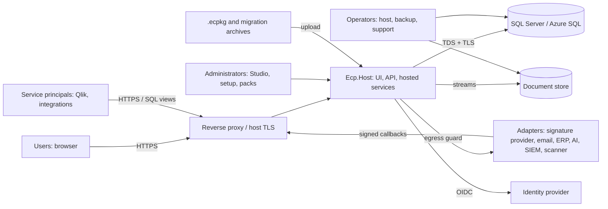

# Threat Model

Status: **initial model, pre-implementation.** Method: asset and data-flow decomposition, STRIDE per component, abuse cases for the threats named in Master ("IDOR/BOLA, tenant breakout, workflow bypass, approval spoofing, unsafe uploads, custom-field injection, malicious package imports and privilege escalation"), and mapping to controls (`docs/SECURITY.md`) and tests (`docs/TESTING.md`). It is reviewed at the end of each milestone; the change log is at the bottom. It is not a penetration test and does not imply that any control is already implemented.

Severity (inherent, before controls): **Critical / High / Medium / Low**. "Residual" is what remains with the planned controls.

## 1. System context and data flows

Trust boundaries: TB1 Internet↔host; TB2 host↔database; TB3 host↔document store; TB4 host↔identity provider; TB5 host↔external adapters (outbound and inbound); TB6 tenant↔tenant; TB7 unauthenticated↔authenticated; TB8 ordinary↔privileged roles; TB9 configuration authoring↔runtime; TB10 uploaded content↔platform; TB11 operator↔application (backup, support).

## 2. Threat register

### 2.1 Access control and tenancy

| ID | Threat | Sev | Boundary | Key mitigations | Tests | Residual |
|---|---|---|---|---|---|---|
| T-001 | **IDOR/BOLA**: user changes an id to read or modify another user's contract, document, comment, export or job | Critical | TB6, TB8 | Scoped queries then authorise on the loaded object; 404 vs 403 policy; per-request download authorisation; GUIDs not capabilities | AUT-014, TEN-001, TEN-002, TEN-003 | Low |
| T-002 | **Tenant breakout** via unfiltered query, raw SQL, ignore-filter, background job, cache, search, export or report | Critical | TB6 | Layered isolation (filter + RLS + composite FKs + storage prefix + cache keys + job scope); analyzers; layer-off tests | TEN-001 to TEN-020, TEN-030 to TEN-033, ARC-003 to ARC-006 | Low |
| T-003 | Tenant spoofing: header, claim or host manipulation selects another tenant | Critical | TB6, TB7 | Tenant derived from verified principal or validated host map; never client supplied | TEN-019 | Low |
| T-004 | Cross-organisation read inside one tenant by a user of another organisation | High | TB8 | Organisation layer in evaluator; org filters; tests with `viewer.a2` | TEN-018, AUT-003 | Low |
| T-005 | **Privilege escalation** via delegated administration (grant self or others higher rights; role template import) | Critical | TB8 | Delegation bounded by grantor rights; `roles.delegate` scope; packages cannot assign people; audit; step-up | AUT-009, AUT-011, PKG-008 | Low |
| T-006 | Stale rights: ended category assignment still edits | High | TB8 | Evaluate active assignment at action time; 60 s role cache bound | AUT-005 | Low |
| T-007 | Classification bypass via search, counts, reports, exports, notifications or AI prompts | High | TB8 | Clearance in `IAccessScope`; omit not mask in lists/exports; notification names only readable records | AUT-006, TEN-007, IMP-002, NTF-006 | Medium |
| T-008 | Support/elevated access abused or not visible | High | TB11 | Reason, expiry, tenant-visible banner, full audit, read-only default | AUT-012, AUD-006 | Medium (operator trust) |
| T-009 | Existence oracle through error messages, timing or counts | Medium | TB6 | Uniform 404/generic errors; no cross-tenant counts; constant-time comparisons for tokens | TEN-017, SEC-021 | Low |
| T-010 | Last administrator removed or locked out; or hidden super-admin | Medium | TB8 | Last-admin protection; all admin grants audited | AUT-011 | Low |

### 2.2 Workflow, approvals and records

| ID | Threat | Sev | Boundary | Key mitigations | Tests | Residual |
|---|---|---|---|---|---|---|
| T-020 | **Workflow bypass**: set status directly via API/mass assignment, or call a later transition skipping guards | Critical | TB8 | `status` has no setter; transitions by code; guards in one transaction; DTOs exclude status | WFL-001, WFL-002, WFL-006 | Low |
| T-021 | **Approval spoofing**: forged callback or edited body attributes approval to someone else; submitter approves own submission | Critical | TB5, TB8 | Approver identity from session; callback HMAC and inbox; SoD default on; matrix pinned | WFL-004, APR-007, ADP-004 | Low |
| T-022 | Locked record modified via a side path (import, API, rule action, AI accept, Variation misuse, unlock reuse) | Critical | TB8 | Domain-layer lock enforcement; migration uses Contracts contract; unlock time-boxed; Variation limited to `Variation only` fields | WFL-004, WFL-009, WFL-011, MIG-015 | Low |
| T-023 | Approval matrix gap/overlap routes a high-value contract to a low-level approver, or silently skips approval | High | TB9 | Publish-time gap/overlap/tie validation; fail closed on no match; simulation | APR-002, APR-003, APR-004 | Low |
| T-024 | In-flight records change behaviour when configuration changes | High | TB9 | Pinned workflow and matrix versions; safe-change rules | WFL-007, NCD-007 | Low |
| T-025 | Concurrent double approval or transition | Medium | TB8 | Row version, idempotency key, unique approval constraint | CNC-001, CNC-002 | Low |
| T-026 | Registered Date or legacy flags forged via import or edit | High | TB8 | Registered Date set only by Approve or authorised legacy load with second-person confirmation | WFL-005, MIG-015 | Low |
| T-027 | Reminder spam, loss or duplication | Low | TB5 | Dedupe keys; idempotent send; dead-letter | NTF-001 to NTF-005, WFL-010 | Low |

### 2.3 Uploads, imports and files

| ID | Threat | Sev | Boundary | Key mitigations | Tests | Residual |
|---|---|---|---|---|---|---|
| T-030 | **Unsafe upload**: malware, polyglot, wrong type, script in document, oversize | High | TB10 | Allowlist, signature sniffing, size limits, quarantine, scanner hook, download gating, `nosniff`, `Content-Disposition` | SEC-011 to SEC-016, ADP-006 | Medium (depends on scanner) |
| T-031 | **Zip slip / path traversal** in archive or filename | High | TB10 | Normalise and reject traversal, absolute, drive, UNC, reserved names, symlinks; keys are hashes not names | MIG-012, SEC-012 | Low |
| T-032 | **Decompression bomb / resource exhaustion** | High | TB10 | Entry, size, ratio, depth limits; streaming; job quotas; timeouts | MIG-013, SEC-013 | Low |
| T-033 | XXE or billion-laughs in OOXML/XML; macro or embedded object execution | High | TB10 | DTD prohibited; no resolver; macros rejected; no Office automation server-side | SEC-014 | Low |
| T-034 | **CSV/Excel formula injection** through exports and error workbooks | Medium | TB10 | Cell prefixing | MIG-021, IMP-003 | Low |
| T-035 | ReDoS through configured naming-rule or field-pattern regexes | Medium | TB9, TB10 | Non-backtracking engine, length cap, timeout | MIG-019, NCD-004 | Low |
| T-036 | Migration cross-tenant reference or file linking to another tenant's contract | Critical | TB6 | Validation and commit-time checks; tenant in all keys | MIG-008, TEN-010 | Low |
| T-037 | Rollback damages unrelated data | High | TB8 | Selection by batch provenance only; preview; reference-count rule | MIG-006, MIG-016 | Low |
| T-038 | Duplicate content hash leaks cross-tenant existence | Medium | TB6 | Dedupe within tenant only | TEN-021 | Low |
| T-039 | Source files containing personal or commercial data retained in staging indefinitely | Medium | TB10 | Staging retention policy and audited discard; restricted access | MIG-005, MIG-022 | Medium |

### 2.4 Configuration and packages

| ID | Threat | Sev | Boundary | Key mitigations | Tests | Residual |
|---|---|---|---|---|---|---|
| T-040 | **Custom-field / configuration injection**: stored XSS via labels, help, terminology, templates; JSON injection; mass assignment | High | TB9 | Output encoding; plain/restricted markup; code patterns; closed schemas | SEC-005, NCD-002, NCD-005 | Low |
| T-041 | **Malicious package import**: traversal, bomb, macros, unsigned, tampered, role grants, secrets, SSRF URLs | Critical | TB10 | Package safety rules; hash and signature verification; import-as-draft; no assignments; step-up; second-person publish | PKG-001 to PKG-008, PRT-008 | Low |
| T-042 | Arbitrary code via expressions, templates or calculated fields | Critical | TB9 | Closed vocabularies; interpreters with limits; banned APIs (Roslyn, Jint, scripting, `Assembly.Load`, `Process`) by architecture test | NCD-003, ARC-007 | Low |
| T-043 | Malicious or buggy release breaks the platform (non-terminating rules, huge definitions) | Medium | TB9 | Limits; pass cap; validation and simulation; instant rollback; last-good retention | NCD-006, NCD-008 | Low |
| T-044 | Branding SVG/CSS used for XSS or UI redress | Medium | TB9 | SVG sanitise or rasterise; no custom CSS/HTML | SEC-017 | Low |
| T-045 | Pack signing key theft or rogue publisher key registration | High | TB9 | Keys offline/HSM; trust registration is a privileged audited act (`packs.trust.manage`, Tenant Administrator only, recent sign-in); revocation list; only public keys accepted; no private key committed | PKG-005; `PackSigningTests`; `Production_refuses_unsigned_and_untrusted_packs_until_the_publisher_key_is_trusted`; `No_private_signing_key_is_committed` | Medium (operational: Production key custody is external) |
| T-046 | **Hostile pack upload (S7)**: zip bomb, traversal, extra files, tampered documents, code or script in a document, same key and version with different bytes, another person's or tenant's upload, stored XSS and CSV formula injection from pack text | High | TB10 | `docs/PACK_SECURITY.md` section 3: limits, closed archive, hashes, canonical signed manifest, content scan, owning validators, quarantine owned by the uploader, tenant-scoped storage and rows with RLS, drafts only, encoding, formula defusing | `PackFormatTests`, `PackSigningTests`, `PackManagerScenarios`, `PackManagerUiTests`, `PackRuleTests` | Low; SQL Server RLS on the three new tables verified in CI only |

### 2.5 Setup, identity and secrets

| ID | Threat | Sev | Boundary | Key mitigations | Tests | Residual |
|---|---|---|---|---|---|---|
| T-050 | **Setup takeover** on a fresh internet-exposed install | Critical | TB1 | Setup token, loopback default, 404 without token, one session, route removal | SEC-008, SEC-009 | Low |
| T-051 | **Demo identity or defaults in Production** | Critical | TB7 | Start-up guard and readiness check; Production refuses | SEC-010 | Low |
| T-052 | OIDC attacks: token substitution, nonce/state replay, account linking by email, open redirect, group overage ignored | High | TB4 | PKCE, state/nonce, `(iss, sub)` linking, local return URLs, fail-closed group resolution | SEC-004, AUT-016 | Low |
| T-053 | Session theft or fixation; CSRF | High | TB7 | Secure cookies, rotation, antiforgery, SameSite, short lifetimes | SEC-002, SEC-003 | Low |
| T-054 | Secret exposure in config, logs, errors, exports, support bundles, packages | High | TB11 | Secret references; redaction; package scanner; write-only entry | SEC-030, PRT-007 | Low |
| T-055 | Key ring lost or exposed (cookie forgery, unreadable secrets after restart) | High | TB11 | Persisted protected key ring; readiness R-SEC-04 | DEP-002 | Medium (operator) |
| T-056 | Brute force or credential stuffing | Medium | TB7 | IdP controls; rate limits on sign-in callbacks and Demo login | SEC-020 | Low |

### 2.6 Integrations and egress

| ID | Threat | Sev | Boundary | Key mitigations | Tests | Residual |
|---|---|---|---|---|---|---|
| T-060 | **SSRF** via URL fields, webhooks, website retrieval, catalogue URLs, AI/provider endpoints | High | TB5 | Single egress client: https only, IP range checks after resolution, no redirects across hosts, allowlist | SEC-007, ADP-007 | Low |
| T-061 | Forged or replayed inbound webhook (e-signature) | High | TB5 | HMAC, timestamp window, inbox dedupe, tenant-bound secrets | ADP-004, ADP-005 | Low |
| T-062 | Outbound webhook leaks sensitive data or is directed at an internal target | High | TB5 | Minimal payloads; egress guard; per-tenant allowlist | SEC-007, TEN-013 | Low |
| T-063 | **External reporting bypasses security**: Qlik principal reads base tables or another tenant | Critical | TB2, TB6 | Curated views, RLS, per-tenant principals, no base-table grants | SEC-040 to SEC-045 | Medium (network config) |
| T-064 | **AI prompt injection / data egress / unreviewed change** | High | TB5, TB10 | Disabled default; no-write principal; proposals; delimiting; schema-validated output; sensitive-field exclusion; audit | SEC-050 to SEC-053 | Medium |
| T-065 | Adapter failure causes data loss or blocks core operation | Medium | TB5 | Outbox, retries, dead-letter, manual fallbacks | ADP-001, ADP-002 | Low |

### 2.7 Audit, data and operations

| ID | Threat | Sev | Boundary | Key mitigations | Tests | Residual |
|---|---|---|---|---|---|---|
| T-070 | **Audit tampering** or deletion; silent gaps | High | TB2, TB11 | Append-only grants, hash chain, sequence, same-transaction write, verification job, exported anchors | AUD-001 to AUD-005 | Medium (privileged DBA can still restore/alter; detected by chain) |
| T-071 | Sensitive values leak into audit values | Medium | TB2 | Field sensitivity redaction | AUD-004 | Low |
| T-072 | Backup contains all tenants and leaks | High | TB11 | Encryption, access limited to `ops.manage`, tested restore, retention | BRS-002 | Medium (operator) |
| T-073 | Export/download link guessed or shared | Medium | TB7 | User-bound, short-lived, authorised tokens; expiry | IMP-004 | Low |
| T-074 | Denial of service: expensive search/report/export/import, large uploads, many jobs | Medium | TB1 | Rate limits, quotas, async jobs with caps, query limits, pagination | PER-004, SEC-020 | Medium |
| T-075 | Time manipulation or skew breaks reminders, token validity, hash chain order | Low | TB11 | UTC clock abstraction; skew check R-OPS-04; sequence not time ordered | AUD-003 | Low |
| T-076 | Dependency compromise or licence violation | High | Supply chain | Locked restores, vulnerability scan, SBOM, licence allowlist, pinned images | SEC-060 to SEC-062 | Medium |
| T-077 | Data kept longer or deleted earlier than authorised (retention, legal hold) | High | TB8 | Archive-before-delete; hold checks; second approval; default Indefinite | RET-001 to RET-006 | Low |
| T-078 | Wrong-tenant maintenance (e.g., job or migration running without scope) | High | TB6 | Scope required by data layer; fail closed | TEN-005, ARC-004 | Low |

### 2.8 Lifecycle, Legal review, register authorisation and notifications (added with the lifecycle slice)

| ID | Threat | Sev | Boundary | Key mitigations | Tests (lifecycle slice) | Residual |
|---|---|---|---|---|---|---|
| T-080 | **Crafted transition**: POST a transition code or target the screen does not offer, replay a step, skip Legal, or run a managed step (approve, sign, Variation) through the generic call | Critical | TB8 | Engine order of checks, managed-role refusal, from-state and expected-state checks, idempotency key, no public status setter | `Every_state_offers_exactly_its_transitions_and_every_other_step_is_refused`, `A_locked_contract_refuses_every_crafted_step_and_edit_whoever_asks`, `The_same_step_taken_twice_at_once_happens_once`; API `Register_authorisation_is_refused_to_everyone_but_the_assigned_approvers_and_to_the_second_responder` | Low |
| T-081 | **Self-approval or double registration**: the submitter approves; two approvers decide at once | Critical | TB8 | `SubmitterNotApprover` and `AuthorisedApprover` guards (validation refuses definitions without them); unique pending request; first response wins | `Register_authorisation_rules_self_approval_backup_rejection_and_registered_date`, `Two_people_deciding_at_once_produce_one_decision_and_one_registration` (SQL Server) | Low |
| T-082 | **Editing an Effective contract** through documents, owner relationship, import, a Variation misuse or an unlock reused after expiry | Critical | TB8 | Domain-layer lock; Variation field allow-list with before and after; unlock bound to opener, fields, time and reason; automatic re-lock | `A_locked_contract_refuses_every_crafted_step_and_edit_whoever_asks`, `A_Variation_changes_an_effective_contract_only_when_approved_and_keeps_before_and_after`, `A_force_unlock_needs_permission_recent_sign_in_reason_and_a_time_limit_and_is_fully_audited`, `Cancelling_or_rejecting_a_Variation_leaves_the_parent_exactly_as_it_was` | Low |
| T-083 | **Legal Privileged record disclosed** by a role, scope, queue, dashboard, notification, audit event, history or an elevation | Critical | TB8 | Privileged layer in the evaluator; every read path goes through the secured services; notifications filtered and redacted at write and read time; elevations never carry the permission | `Legal_privileged_records_need_an_explicit_grant_and_a_role_or_ceiling_alone_never_opens_them`, `Legal_rounds_are_kept_and_a_privileged_review_is_invisible_to_those_without_the_grant`, `Notification_content_never_leaks_a_classified_record_to_people_who_could_not_open_it`, `A_person_who_loses_access_to_a_record_sees_nothing_about_it_in_their_inbox`, `Dashboards_never_show_or_count_a_record_the_reader_could_not_open`, `Audit_evidence_about_a_classified_record_is_visible_only_where_the_record_is` | Low |
| T-084 | **Workflow definition as an attack surface**: an administrator publishes a definition that unlocks records, drops approval guards, names unknown code or references a missing permission | High | TB9 | Closed vocabularies; unknown members are errors; validator checks (no unlocking transitions, approval guards, dead ends, bounds); draft, validate, publish, rollback and audit; existing contracts stay pinned | unit `WorkflowDefinitionTests` (validator rules), `A_published_workflow_applies_to_new_contracts_while_existing_ones_stay_pinned_and_an_invalid_one_is_refused` | Low |
| T-085 | **Notification template injection**: markup, logic, header injection or unknown placeholders in a template or in record values | Medium | TB5 | Plain-text templates with allow-listed placeholders validated at publication; control characters removed; lengths bounded; markup stays text | unit `NotificationPolicyTests`, `NotificationRendererTests` | Low |
| T-086 | **Notification disclosure or spam**: wrong recipient, a recipient who cannot open the record, duplicate or lost reminders after ownership change | High | TB5 | Recipients resolved at send time from current ownership and filtered by read access; dedupe keys; one row per reminder window; unique-violation handling for concurrent scans | `A_workflow_event_tells_the_right_people_once_and_a_second_run_changes_nothing`, `Reminders_are_sent_once_per_window_and_follow_current_ownership`, `Ownership_changes_tell_only_the_person_affected`, `A_disposition_request_reaches_the_approver_group_and_no_other_group` | Low |
| T-087 | **Cross-tenant or cross-organisation access** to any lifecycle, queue, dashboard or administration call | Critical | TB6 | Tenant query filters, RLS, composite foreign keys, organisation-scoped administration | `Another_tenants_records_do_not_exist_for_any_lifecycle_call`, `Notification_administrators_see_only_their_own_organisations_deliveries` | Low |
| T-088 | **Failed or unreachable email** hides an important notice | Medium | TB5 | In-app notification is independent; back-off then dead-letter; administrators see failures and retry | `Failed_email_is_retried_with_a_back_off_then_dead_lettered_where_administrators_can_see_and_retry_it`, `Background_job_runs_are_recorded_and_visible_only_to_administrators` | Medium: SMTP and Graph are not verified against live services |
| T-089 | **Forged or replayed signature event** claims a document was signed | High | TB5 | Only a verified event reaches the inbox (HMAC over the raw body with a per-tenant secret, 5-minute freshness, constant-time compare: `HmacCallbackVerifier`); each provider event id is processed once; a provider's words are mapped explicitly and an unknown word changes nothing; a completed request only supplies the executed copy, stored through the normal document rules; register authorisation always needs the executed copy and a separate approver; the mock provider, its verifier and simulated events are refused in Production; no live adapter or callback endpoint exists yet | `Provider_events_are_mapped_processed_once_and_never_move_the_contract`, `A_new_adapter_with_its_own_words_runs_end_to_end_with_no_change_to_the_lifecycle`, `The_signature_boundary_stores_the_request_and_status_and_a_completed_request_only_supplies_the_executed_copy`, unit `SignatureProviderTests` | Medium: the live adapter and the callback HTTP endpoint are Future (ADP-004); the verification helper and inbox are implemented and tested without a live provider |
| T-090 | **Matrix tampering**: an unauthorised or unreviewed change to an approval matrix reroutes approvals | High | TB9 | Matrix is a Configuration kind (permissioned draft, validation, publish, version history, rollback, audit with row-by-row change summary); second-person publish option; plans pinned per request | `Publication_refuses_a_matrix_with_gaps_overlaps_or_ties_and_one_a_workflow_still_needs`, `Every_publication_rollback_delegation_and_simulation_is_in_the_audit_history_with_what_changed`, `A_plan_is_pinned_to_the_release_it_was_made_under` | Low |
| T-091 | **Delegation abuse**: authority passed outside the group, passed on, looped or kept indefinitely so nobody (or everybody) can approve | High | TB8 | Own authority only, to a group member, at most 90 days, not self, not transitive, cycle detection among overlapping delegations, loop edges ignored at resolution, revocation by delegator or administrator, audit | `Delegation_is_bounded_audited_non_transitive_and_never_circular`, `A_delegation_from_someone_who_cannot_act_is_ignored_and_a_circle_in_the_data_gives_nobody_authority`, unit `A_loop_is_found_whether_it_has_two_members_or_many` | Low |
| T-092 | **Approver identity disclosure** through the simulator or explanations | Medium | TB6 | `approvals.simulate` and `approvals.matrix.read` are organisation-scoped; the plan view shows the trace and reasons only to matrix readers; simulation is audited | `The_simulator_shows_the_resolution_without_touching_any_record_and_is_for_administrators_only`, API `A_contract_approved_through_a_matrix_shows_its_plan_and_the_reasons_to_matrix_readers_only` | Low |
| T-093 | **Wrong or missing approver by a rule gap**: unknown facts, ties, missing currency rate or empty groups silently choose someone or nobody | High | TB9 | Unknown facts never satisfy a condition; ties, no match, no rate and missing approvers are blocked with a trace; empty groups warn at publication and block at submission | `No_match_blocks_with_an_explanation_and_never_defaults`, `A_priority_tie_at_run_time_blocks_rather_than_picking_one`, `Currency_needs_a_rate_in_force_on_the_date_and_is_never_assumed`, `A_submission_nobody_can_approve_is_blocked_with_the_reason_and_can_be_resubmitted_once_fixed` | Low: facts the platform does not store reach the resolver only via contributors, so such rows block |
| T-094 | **Cross-tenant or cross-organisation matrix, delegation or resolution** | Critical | TB6 | Tenant filters, RLS and composite keys on `approvals` tables; organisation-scoped permission checks | `Matrices_delegations_and_resolutions_belong_to_one_tenant` | Low |

### 2.9 Configurable metadata, search, views, exports and the Studio (added with CFG-03/DOM-03/STU-01)

| ID | Threat | Sev | Boundary | Key mitigations | Tests | Residual |
|---|---|---|---|---|---|---|
| T-100 | **Hidden field read** through the form, details, register columns, filters, sorts, free text, an export, the reporting schema, a Variation, an approval snapshot or the change history | Critical | TB6 | Per-request visibility (role, state, type, dates, classification, privileged); hidden fields absent, not blanked; unknown-field answers; values held at the more sensitive level | `Classified_and_privileged_fields_are_hidden_from_people_without_the_level`, `The_register_only_ever_returns_what_the_person_may_read_and_hidden_fields_cannot_be_used_to_find_anything`, `An_export_carries_the_same_columns_and_filters_and_only_what_the_person_may_export`, `A_Variation_changes_configured_fields_only_the_person_may_see_and_only_when_approved`, `The_change_history_shows_each_edit…` | Low |
| T-101 | **Injection through a definition, view or filter** (SQL, script, expression, template, pattern denial of service, hostile labels) | High | TB9 | Strict typed documents; closed operators and calculation list; non-backtracking patterns with a time limit; catalogue-matched names; labels encoded on output; Studio writes from a typed model | unit `CustomFieldTests` (patterns, markup, closed calculations), `StudioModelTests`, scenario `Typed_search_filters_sorts_and_pages_correctly_over_core_fields` (grammar refusals) | Low |
| T-102 | **Destructive definition change**: deleting or retyping a used field, removing a used choice, rolling back over live data | High | TB9 | Retire, never delete; publish and rollback validation against usage; impact analysis; a failed publish changes nothing | `Definitions_are_versioned_retired_never_deleted_and_the_values_they_hold_are_protected`, `A_failed_publish_leaves_the_published_definitions_and_the_cache_unchanged`, `A_draft_is_edited_ordered_validated_published_retired_and_rolled_back_through_the_studio` | Low |
| T-103 | **Stale or crossed configuration**: a cache serving an old definition after a publish, or one tenant's definitions to another | High | TB6 | Tenant in the cache key; generation guard; invalidation before and after commit; a failing invalidation fails the publish; a failing read falls back to the database | `Definitions_and_values_belong_to_one_tenant_and_the_published_cache_never_crosses_or_goes_stale`, `A_cache_that_fails_never_changes_an_answer_and_a_failed_invalidation_stops_the_publish` | Low |
| T-104 | **Export abuse**: bulk exfiltration, formula injection, exporting hidden or non-reportable data | High | TB5 | `records.export`; readable and reportable columns only; normal and large limits with a recorded reason; formula neutralisation; audit with filters and counts | `An_export_carries_the_same_columns_and_filters_and_only_what_the_person_may_export`, `The_reporting_schema_is_stable_and_follows_what_the_person_may_export` | Medium: a person cleared for a field can still export it within limits; row limits are not rate limits |
| T-105 | **Register search as a probe** (counting, ordering or text matching to infer a hidden value; deep paging; expensive queries) | High | TB6 | Hidden fields unusable in filters, sorts and text; page-size cap; filter/sort/value limits; uncorrelated subqueries; measured baseline | scenario above, `PerformanceBaseline` (shape guard) | Low: offset paging gets slower on deep pages |
| T-106 | **Approval fact abuse**: a field exposed to approvals leaks its value in explanations, or a matrix keys off a fact that is absent | Medium | TB9 | Only fields marked usable in approvals; snapshots show only those; `fact_unavailable` at publication; one fact service for live and simulated | `A_matrix_cannot_use_a_field_that_is_not_marked_usable_in_approvals`, `A_live_submission_and_a_simulation_from_the_same_contract_choose_the_same_steps` | Low |
| T-107 | **Migration into configured fields** guessing a choice, writing a retired field, or leaving values after a rollback | Medium | TB4 | Dry run checks every key and value; lookups explicit; retired fields blocked; provenance and before-image; rollback restores or removes | `MigrationCustomFieldScenarios` (4 scenarios) | Low |
| T-108 | **Studio misuse**: someone without configuration rights editing, or reaching another organisation | High | TB9 | Policy on every page; configuration permissions in the service; organisations filtered by right; not-found for others | `StudioUiTests`, `A_draft_is_edited_…_through_the_studio` (owner refused) | Low |

## 3. Abuse cases (walk-throughs used as test scenarios)

1. **A category owner whose assignment ended opens an old URL** (T-001, T-006): record readable (read all), edit denied, audit entry shows the assignment reason.
2. **A user in organisation A2 guesses a contract id in A1** (T-004): 404.
3. **An administrator imports a package granting `Tenant Administrator` to a user id** (T-005, T-041): rejected at validation; no assignments allowed in packages.
4. **A forged signature-provider callback claims "completed"** (T-021, T-061): rejected, audited; contract remains Out for Signature; even a genuine completion only supplies the executed copy.
5. **A migration ZIP contains `../../etc/x`, a 1 GB zero file, and a macro-enabled workbook** (T-031, T-032, T-033): each rejected with its message code; batch continues for other files; counts reconcile.
6. **A Business Configuration Administrator publishes a rule set that never stabilises** (T-043): validation fails in simulation; if forced via package, runtime pass cap blocks the transition with explanation.
7. **A fresh Docker instance is exposed to the Internet before setup** (T-050): `/setup` returns 404 without the console token; remote requests are refused by default.
8. **Qlik principal for tenant A attempts `SELECT * FROM contracts.Contract`** (T-063): permission denied; the views return only tenant A rows.
9. **A document claims to be a PDF but contains script/HTML** (T-030): signature mismatch rejects it; if allowed type but malicious, scanner verdict gates download.
10. **A support engineer opens elevated access** (T-008): tenant administrators see the banner; every action carries the elevation id; access expires.
11. **An owner POSTs `Approve` for their own contract** (T-080, T-081): refused; the step is managed, the guard names the submitter, the history shows nothing.
12. **Two group heads press Approve at the same moment** (T-081): one registration, one `already_decided`, one Registered Date.
13. **A record is reclassified above a reviewer's ceiling after a notification about it was sent** (T-083, T-086): the old inbox item shows only "a record you can no longer open", with no title, body or link (`A_person_who_loses_access_to_a_record_sees_nothing_about_it_in_their_inbox`).
14. **An administrator publishes a workflow whose transition returns an Effective contract to Draft** (T-084): validation refuses it with the path of the transition; existing contracts keep the earlier release.

## 4. Assumptions and limitations

- The host OS, hypervisor, network and cloud control plane are trusted to the extent the operator secures them (R-DEP checks verify some settings but cannot prove the platform's security).
- A database administrator with unrestricted access can alter data; audit hash chaining detects but does not prevent this. Separation of duties for DBA access is an operational control.
- Malware detection quality depends on the configured scanner.
- Identity-provider compromise compromises the platform for the users it asserts; step-up and short sessions limit blast radius.
- Real e-signature and email providers (a live signature provider, SMTP, Microsoft Graph) are not exercised against live services; mocks are for Demo and Test only. Retention periods and legal holds are scaffolded, not enforced.
- Penetration testing, formal security review and accreditation are external governance and not performed by this project.

## 5. Review process

At every milestone exit: re-run the abuse cases as automated tests; add threats for new features (new adapters, new input formats); record the outcome below; unresolved High/Critical items block the milestone.

## 6. Change log

| Date | Change | By |
|---|---|---|
| 2026-10-15 | Initial model created during pre-implementation repository review | Claude Code session |
| 2026-10-16 | M1 implementation evidence: tenant filters, RLS, composite FKs, append-only audit and Production guard verified on SQL Server 2022 Developer; runtime role needed explicit SELECT on the RLS predicate functions (finding fixed). Setup, upload and OIDC threats remain unmitigated until their milestones | Claude Code session |
| 2026-10-16 | Setup and onboarding implemented and tested: T-050 (token, single session, loopback `404`, closure after completion, restart and CLI tests), T-051 (Production guard in the `mode` step and readiness `R-DEMO-01`), T-054 (secret references only; sanitised-report test). New residual risks: the setup token is a bearer credential on an operator terminal (ASM-20); with `Ecp:Setup:AllowRemote` the token and network controls are the only barrier; onboarding publication can grant viewer and category-owner access, so it is restricted to roles that hold organisation-level configuration rights and cannot map administrator or approver roles (ADR-0017); the live OpenID Connect step-up (`prompt=login`) is verified only against a mock provider | Claude Code session |
| 2026-10-16 | Migration slice implemented and tested (T-030 to T-039 mitigations exercised: unsafe archive entries, bomb limits, XXE refusal, `.xlsm`, formula neutralisation, naming-rule engine, cross-tenant batch access, provenance-driven rollback). Residuals: no real malware scanner adapter (mock outside Production; files held in Production), synchronous commit within the request (resumable), staging retention beyond acceptance is a manual purge (`migration.staging.purged`). | Claude Code session |
| 2026-10-16 | Lifecycle slice: section 2.8 added (T-080 to T-089) with the tests that exercise each mitigation; abuse cases 11 to 14; limitation for unverified external providers and scaffolded retention. | Claude Code session |
| 2026-10-16 | CFG-03/DOM-03/STU-01: section 2.9 added (T-100 to T-108) for configurable metadata, search, views, exports and the Studio; measurement found and fixed a per-row lookup that made configured-field search quadratic (T-105) | Claude Code session |
| 2026-10-17 | S7 external solution packs: T-045 updated and T-046 added (hostile pack upload); the pack trust boundary is now implemented (ADR-0026, `docs/PACK_SECURITY.md`) | Claude Code session |

### 2.10 Terminology (added with S4)

| Threat | Mitigation | Test |
|---|---|---|
| Stored XSS or template injection through a label | Plain-text validation (no `<`, `>`, entities, `javascript:`, event handlers, `{{ }}`, `${ }`, `<% %>`, `@(`), encoded output, constrained token language | `TerminologyTests` (unsafe content), `TerminologyUiTests` (markup never stored or run) |
| A label used to confuse an approver (impersonating a role) | Role codes are shown beside labels on administrator pages; authority never depends on a label; publish needs second person and recent sign-in; every change is audited and reversible | `TerminologyUiTests`, `TerminologyScenarios` |
| Cross-tenant or cross-organisation label leak | Release lookup, cache key and draft are tenant- and organisation-scoped; named organisation checked against the grant | `TerminologyScenarios` isolation, cache isolation |
| Stale cache after publish or rollback | Release id in the cache key plus explicit invalidation | `TerminologyScenarios` cache invalidation |
| Poisoned pack terminology | Hashed and signed with the manifest; content scan; installs as draft only | `PackTerminologyTests` |
| User data read as a token | Expansion before argument formatting | `TerminologyTests`, `NotificationDeliveryTests` |
| Denial of service by a huge document | 600-term and field-length limits, bounded cache | `TerminologyTests` |

## Capabilities (S6)

| ID | Threat | Mitigation | Residual |
|---|---|---|---|
| T-S6-01 | A tenant or organisation reads another's capability switches through the cache | Cache key carries tenant, organisation and the release and pack identity; invalidated on publish; tested in `tests/Ecp.Integration.Tests/CapabilityScenarios.cs` | Low |
| T-S6-02 | A capability switch is used to bypass an approval or a lock | A capability only removes optional steps and cannot grant or skip a permission, lock, classification or lifecycle rule; the gate runs after those checks at the single engine chokepoint | Low |
| T-S6-03 | A pack or organisation document carries script or template syntax | Plain-data document; validator refuses markup, template and expression syntax in notes; unknown keys have no effect | Low |
| T-S6-04 | A capability is turned off to strand in-flight work | Turning one off with work in flight, or while a published workflow uses it, is refused; work already under way can always be finished | Low |

## Second business pack (S9)

| ID | Threat | Mitigation | Residual |
|---|---|---|---|
| T-S9-01 | One business's wording, workflow, matrix, field, view or notification text is served to another business in the same tenant | Every resolver is keyed by tenant and organisation; the isolation scenario installs three packs in one tenant and a fourth organisation in a second tenant and compares what each sees | Low |
| T-S9-02 | A business-specific shortcut creeps into generic source "to make the pack work" | `SecondBusinessGuardTests`: construction vocabulary scan of all shipped platform files, no project file names the pack, no compiled assembly contains it, and the S9 commits' diff is confined to the pack, tests and documents plus a short written list of generic fixes | Low |
| T-S9-03 | A tenant-level document (classification scale, branding) of one business overrides another's in a shared tenant | Documented limit; the proof uses a single tenant for three businesses and records that these two kinds are tenant-wide | Medium (design limit) |
| T-S9-04 | A synthetic example is mistaken for real advice or a real company | The pack states in its description and documentation that it is synthetic, fictional and not advice | Low |

## Regional settings and identifiers (S10)

| Threat | Control |
|---|---|
| A hidden identifier is inferred from a duplicate error, a count or a changed list | Classification gate before any duplicate check; the same "not found" answer; uniqueness scoped to the organisation (tested) |
| A crafted identifier rule causes catastrophic backtracking or runs code | Closed rule and checksum catalogues, bounded values (80 characters), no customer expressions; regular expressions in the platform use non-backtracking matching |
| Markup or template syntax in a label reaches a page or message | Labels are plain text, validated; Razor encodes; notification placeholders are a closed list and values are cleaned |
| Another organisation's or tenant's regional settings are served from cache | Cache key includes tenant, organisation and version; tests warm two organisations, change one, and read both |
| A wrong time zone or locale silently shifts dates | Date-only values are never shifted; instants are UTC and converted with the organisation's IANA zone; an unavailable zone blocks publication; readiness reports the host |
| An export leaks a locale-dependent ambiguity | Business exports state their style; machine exports are ISO/UTC and stable |
| A claim of verification is mistaken for a registry check | Statuses are structural; external statuses are reserved and unused; documents and UI say so |

## Operational resilience: backup, restore, maintenance and leases (OPS-01 / OPS-02 foundation)

Assets: the backup (the whole installation, every tenant, including confidential contract data), the manifest (the statement of what a backup is), the restore path (which writes a database), the maintenance flag and the operation leases. Boundaries: the shared backup directory (database server and application), the privileged backup account, the operator interface. Tests: `BackupRestoreSqlServerTests`, `BackupFailureSqlServerTests`, `OperationsFoundationScenarios`, `OperationsUiTests`, `OperationsCommandLineTests`, `RecoveryTests`.

| ID | Threat | Control | Residual |
|---|---|---|---|
| T-OPS-01 | **Backup theft** (the backup holds every tenant's data) | Written outside served paths (refused otherwise); folder mode lets others enter but not list; optional SQL Server certificate encryption of the database file; the operator states storage protection and the manifest and evidence record it. Backup tooling is permission `operations.backup` (System Administrator only) | The platform cannot encrypt or access-control the storage and cannot verify the statement: the operator must (`docs/BACKUP_AND_RESTORE.md` section 13). Document objects and package files are not encrypted by the platform |
| T-OPS-02 | **Backup tampering** (a file changed after it was made) | SHA-256 per file in the manifest, per object in the document index, SQL Server `CHECKSUM` and `RESTORE VERIFYONLY`; verification at creation, on demand and before every restore; a restore re-verifies inside the lease | An attacker who can rewrite the manifest **and** its seal is not detectable from the files; see T-OPS-03 |
| T-OPS-03 | **Restore from an untrusted or forged manifest** | Strict parser (version, scope, unknown fields, path rules); the manifest hash is recorded in the audit event and run history and can be demanded at restore (`--expect-sha256`); the preview shows what is about to happen; environment mismatch is a blocker | Needs the operator to keep the hash outside the backup storage |
| T-OPS-04 | **Path traversal** in a manifest, an index or a backup id | Names must be plain relative names (no `..`, no absolute, no backslash, no empty segment, bounded length and depth); every path is resolved against the backup root and re-checked; backup ids are matched against a fixed pattern | |
| T-OPS-05 | **Symlink attacks** (a link in the backup or in the document store pointing outside) | Links are detected on every path component and on the file; the backup's own folder may not be a link; the document store enumeration skips and reports links and never reads them | Time-of-check races on a hostile local file system are not defended beyond this |
| T-OPS-06 | **Archive bombs** | A backup is a directory of plain files, not an archive: nothing is extracted by restore. Package archives (`.ecpkg`) are opened only through the safe reader with its size and entry limits (S7) | |
| T-OPS-07 | **Incomplete backup mistaken for a recovery point** | The manifest is written last; a folder without one is Incomplete or Failed, listed as such and refused by restore; failed attempts delete their payload; a backup is Completed only after the integrity check | |
| T-OPS-08 | **Stale backup relied upon** | Readiness `R-BKP-01` reports no verified backup or one older than `StaleBackupDays`; the Operations page shows the age | The threshold is a default; the organisation sets the objective |
| T-OPS-09 | **Cross-tenant restore** (restoring one tenant's data into another) | Restore is installation-level only; it has no tenant parameter; the manifest scope must be `installation`; the copy keeps tenant ids and hashes unchanged; row-level security and `SESSION_CONTEXT` are validated on the copy (VAL-007, 008) | Per-tenant restore is Future |
| T-OPS-10 | **Restore into the wrong environment** (production data into a lower environment) | The manifest records the environment mode; a mismatch blocks the restore unless an explicit override is given and audited | The override is a person's decision |
| T-OPS-11 | **Restore over the live database by mistake** | Restore targets a new database; the target's identity is read from the server and compared with the active database (aliases cannot disguise it); system and unusual names refused; an existing database refused; the disaster-recovery path is command line only with its own typed phrase | An operator with direct database rights can do anything; this protects the platform's own path |
| T-OPS-12 | **Secret leakage** into a manifest, report, bundle, audit event, log or error message | Backups hold references, never values; operator free text is masked and flattened; every manifest, evidence report and bundle is scanned and refused if a secret remains; connection strings never appear in exceptions; the privileged account is a separate secret reference | The scan is pattern-based; the controls are that the documents are built from fields that cannot hold secrets |
| T-OPS-13 | **Operator privilege escalation** | Six new permissions held only by the System Administrator; each service call re-checks the permission and that the caller is in the installation tenant (an installation-scope role granted inside a customer tenant does not work); state-changing actions need a recent sign-in; restore needs a reason and a typed phrase; tenant, organisation and business administrators are refused | |
| T-OPS-14 | **Concurrent backup and restore** (corruption, double work) | One lease, decided by the database (unique key and optimistic concurrency), shared by backup, restore and validation; 16 contenders on 4 instances yield one owner; a lost lease stops the work | |
| T-OPS-15 | **Malicious evidence report** (a crafted value executed in a spreadsheet) | CSV is written through the formula-safe writer (cells starting `=`, `+`, `-`, `@` or a tab are prefixed); JSON is encoded | |
| T-OPS-16 | **Log injection** through a reason or a name | Operator text is flattened (no line breaks) before it reaches the manifest, audit trail, history, evidence or bundle; log lines kept for the bundle are flattened and redacted | |
| T-OPS-17 | **Maintenance-mode bypass** | Enforced in host middleware on the normalised path (segment match, case-insensitive; look-alike paths refused) for every state-changing method, and by pausing background jobs; the flag is a database row, not a configuration value | A process with direct database access, or a read-only request with a side effect, is outside this control |
| T-OPS-18 | **Lease manipulation** (forging or stealing a lease to block or duplicate work) | Leases are rows in a table that only the installation tenant can see (row-level security); takeover needs `operations.maintenance`, a recent sign-in and a reason, and is audited; the old owner's next renewal fails | Clock skew between instances can mislead expiry; keep clocks synchronised |
| T-OPS-19 | **Audit-chain mismatch** (history rewritten, or regenerated by a restore) | Each tenant's chain is verified at backup (head sequence and hash recorded) and at restore (VAL-009: valid, and ending where the backup recorded); a chain already broken is preserved and reported, never repaired; a restore only appends its own events | |
| T-OPS-20 | **A restored copy sends old notifications** | The copy is held in maintenance mode and jobs take no work until validation passes; the runbook says to review the queue before cut-over | The decision to clear a queue is the operator's |
| T-OPS-21 | **The support bundle becomes a leak** | Built from fields that cannot hold secrets or content; log lines redacted and limited to level, category and exception type; canary secrets and personal data tested absent (SEC-030, SEC-031) | The operator remains responsible for where it is sent |

## Upgrade safety (OPS-02; ADR-0035; `docs/UPGRADES.md`)

Assets: the production schema and data, the upgrade manifest (the statement of what an upgrade does), the migration history, the verified pre-upgrade backup, maintenance mode, the upgrade and recovery leases. Boundaries: the operator interface (pages and commands), the privileged database account, the backup directory, the build artefact. Tests: `UpgradeTests`, `UpgradeFoundationScenarios`, `UpgradeSqlServerTests`, `UpgradeUiTests`, `UpgradeCommandLineTests`.

| ID | Threat | Control | Residual |
|---|---|---|---|
| T-UPG-01 | **Tampered upgrade manifest** (a changed list of migrations or a waived prerequisite) | Canonical JSON with its own SHA-256 re-computed on load (`UPM-002`); embedded in the build, not read from a writable path; `--expect-sha256` pins the hash the operator reviewed; the manifest is compared with the migrations compiled into the build (`UPM-050`); a manifest cannot waive backup or maintenance mode (`UPM-021`); a missing or invalid manifest means no path is called safe | An attacker who can replace the whole build can replace the manifest too; supply-chain controls (ADR-0014) and signed images are the answer |
| T-UPG-02 | **Modified historical migration** (a released migration changed so that databases diverge) | Frozen baseline ledgers with per-migration checksums; manifest validation refuses a changed or removed one (`UPM-011`, `UPM-012`); the pre-flight compares the compiled checksum with the recorded one (`UPF-015`); a test fails the build if a baseline migration changes | A migration changed *and* its baseline regenerated in the same commit; review of the baseline file is a code-review control |
| T-UPG-03 | **Schema drift** (database changed outside the platform) | Catalogue-view comparison of tables and columns with the model of the last applied migration (`UPF-016`, `UPV-002`); critical on drift; SQL Server only | Indexes, constraints and permissions beyond tables and columns are checked by validation (`VAL-007`) and not by drift; SQLite reports Not Verified |
| T-UPG-04 | **Wrong or newer version** (older application against a migrated database; wrong build for the source) | State detection (Empty, AtSource, AtTarget, Partial, Ahead, Inconsistent); Ahead and Inconsistent block (`UPF-011`, `UPF-013`); rollback names the application version it needs (`RBK-010`) | An operator who runs an old build with the pre-flight skipped; the application does not refuse to start against a newer schema (**Future**) |
| T-UPG-05 | **Unsupported upgrade path** | Only versions the manifest lists are sources (`UPF-012`); a partial state (`UPF-014`) is never treated as a known source | |
| T-UPG-06 | **Missing, unverified or stale backup** | A named verified backup is required for Apply (`UPF-020`); integrity is re-checked at the moment of the pre-flight, not trusted from a file listing; age beyond the release's limit warns (`UPF-021`) and needs explicit acceptance | The backup may be verified but its storage unprotected (operator-owned) |
| T-UPG-07 | **Wrong backup** (another installation, environment or version) | The backup must belong to this installation (`UPF-022`), this environment mode, and hold exactly the source schema (`UPF-024`); a foreign backup is refused | A backup of a clone of this installation passes as this installation; the audit anchors and tenant ids are the evidence |
| T-UPG-08 | **Pack or configuration incompatibility** causing silent damage | Module probes judge installed packs and published configuration against this build's validators (`UPG-PCK-*`, `UPG-CFG-*`); a pack or live release in use that fails blocks; the upgrade never rewrites signed bytes, republishes, rewrites a release or moves a pin | Content that validates but means something different in the new version (breaking changes are listed in the manifest for a human to read) |
| T-UPG-09 | **Privilege escalation** (a business administrator, or the installation administrator acting from a customer tenant, runs an upgrade) | New permission `operations.upgrade` held only by the System Administrator; every service method re-checks the permission and that the caller is in the installation tenant; changing actions need a recent sign-in; pages and posts are refused for others (403) before anything is shown | |
| T-UPG-10 | **Concurrent upgrade** (two upgrades, or an upgrade beside a backup or restore) | Two exclusive leases decided by the database (`upgrade.exclusive` and `recovery.exclusive`) with fencing; a lease lost mid-run aborts it; a second apply is refused | |
| T-UPG-11 | **Maintenance-mode bypass** (changes during the migration) | Host middleware for requests; `IMaintenanceGate` refuses configuration publish and rollback and migration commit from any caller inside the process; background jobs take nothing new; quiescence waits for running job leases and stops before migrating if they do not finish | A process that talks to the database directly, outside the platform |
| T-UPG-12 | **Script injection** (an operator-supplied or hostile string reaching SQL) | There is no operator-supplied SQL: scripts are generated from the compiled migrations and are for reading; the module name for a script is matched against the registered modules; the target database name is validated and quoted; the typed confirmation is compared, never executed | |
| T-UPG-13 | **Log and report injection** (a reason or a name forging lines or fields) | Operator text is flattened and masked before reaching audit, history, evidence or logs; JSON is produced by a serialiser; evidence names are fetched by exact name only, never by path | |
| T-UPG-14 | **Restore or rehearsal into the wrong database or environment** | The rehearsal target must be a new database and is never the active one; environment mode must match unless explicitly allowed; the typed phrase names the backup | |
| T-UPG-15 | **Secrets in output** | Reports, manifests, evidence, scripts and audit events hold identifiers, counts, hashes and outcomes; each finished document is scanned (`Redaction.ContainsSecret`) and refused if one is found; CI scans the evidence artefact | |
| T-UPG-16 | **Partial migration** (a failure leaves the schema half-changed) | The run stops at the failing migration, maintenance mode stays on (*Upgrade failed*), the state is classified Partial by the next pre-flight, and nothing continues or retries by itself; leaving needs an explicit acknowledgement; recovery is rollback by restore | A migration that cannot be wrapped in one transaction (DDL batches) can leave partial changes by nature; that is why the backup is mandatory |
| T-UPG-17 | **Formula injection** in downloaded reports | CSV through the formula-safe writer (cells starting `=`, `+`, `-`, `@`, tab or carriage return are neutralised) | |
| T-UPG-18 | **Audit or release rewrite by a migration** | The review register requires a recorded review for any migration that alters or rewrites data; post-upgrade validation re-verifies every tenant's audit chain and compares release hashes and counts with the backup; a restored-copy rehearsal compares data identity | A review that is wrong; review is a human control |

## Operations dashboard and observability (OPS-03; ADR-0036; `docs/OPERATIONS_DASHBOARD.md`)

Assets: the dashboard and its JSON form (a map of the installation), the metrics and structured events, the support bundle. Boundaries: the operator interface; tenant scopes; the log and any future exporter. Tests: `OperationsDashboardScenarios`, `OperationsDashboardTests`, `OperationsDashboardUiTests`, `OperationsDashboardGuardTests`.

| ID | Threat | Control | Residual |
|---|---|---|---|
| T-DSH-01 | **Information disclosure through the dashboard** (it is a map of the installation: versions, tenants' counts, key expiry) | System-administrator-only, installation-tenant-only, checked in the service; the JSON form has the same checks; anonymous health shows overall status only in Production; technical detail needs `operations.validate` | An authorised operator sees the map by design |
| T-DSH-02 | **Cross-tenant read** through aggregation | Facts come from probes that return counts and times only (a fact type that cannot carry text), each run inside its own tenant scope under row-level security; an architecture test forbids probes from reading text columns and the dashboard builder from reading module tables | A new probe written carelessly; the architecture test and review are the control |
| T-DSH-03 | **Content or secret in a metric, event or log line** | Fixed-word tags and parameters; operator free text never in an event; redaction; canary tests (secret, token, connection string, personal address, job error text with a contract title) over events, metrics, dashboard JSON and bundle | An exporter configured later must keep the same tags (INT-04) |
| T-DSH-04 | **False assurance** (Not Verified read as a pass; a green page mistaken for approval) | Four distinct words, worst-wins rule, empty set is Not Verified, page text states it is not an approval; tests assert unbuilt, unreadable and never-run items are Not Verified and a Verified line never carries "not built" wording | Human reading |
| T-DSH-05 | **Failure hidden or softened** | Failed upgrade/restore stay Failed in health, upgrade and failure panels; maintenance mode is not cleared by looking; no retry is offered for restore or upgrade | |
| T-DSH-06 | **Unsafe retry** (a restore or upgrade repeated blindly; another tenant's message retried by an operator) | Retry offered only for backup, validation, rehearsal and rollback evidence, as a fresh attempt; restore and upgrade never; no cross-tenant action exists | |
| T-DSH-07 | **Denial of service by repeated dashboard builds** | A build is counts and a handful of queries per tenant; it takes no lease and changes nothing; only the System Administrator can call it | Very many tenants make a build slower (documented) |
| T-DSH-08 | **Support bundle abuse** (bulk data, path tricks, unaudited download) | Recent sign-in; allow-listed entry names; 2 MB per entry and 5 MB total; fixed archive timestamps; hashed manifest; one audit event with size, hash and correlation id; secret scan | The recipient's handling is the organisation's |
| T-DSH-09 | **Stale facts mistaken for current** | Each integrity line shows the time and correlation id of the validation it came from; gauges are labelled "from the last dashboard build" | |

## Implementation readiness (ADR-0037; `docs/IMPLEMENTATION_READINESS.md`)

Assets: configuration releases, the review inbox, the organisation list, approver-group membership, the form editors, uploaded files. Boundaries: the administration pages; the configuration lifecycle; the document store. Tests: `ConfigurationGovernanceScenarios`, `ConfigurationRollbackKindsScenarios`, `ConfigurationReviewUiTests`, `OrganisationCreationScenarios`, `ApproverGroupScenarios`, `FormEditorTests`, `FormEditorScenarios`, `FormEditorUiTests`, `DocumentScanningScenarios`, `NoCodeRehearsal*`.

| ID | Threat | Control | Residual |
|---|---|---|---|
| T-IRG-01 | **Self-approval of a configuration change**, or publication of content other than what was reviewed | Submission bound to the content hash; publisher differs from creator, last editor and submitter; any edit voids the submission; hash mismatch fails; refusals audited | Two colluding administrators; the audit trail is the control |
| T-IRG-02 | **Re-saving to become "last editor" or to slip in a change after review** | Saving identical content changes nothing; a changed save voids the submission and says so | |
| T-IRG-03 | **Rollback as a back door** around second-person publication | Same permission, recent sign-in, reason and second person; creates a new release; earlier releases immutable | |
| T-IRG-04 | **Organisation creation abused** (duplicate keys, cross-tenant collision, privilege escalation through the initial administrator) | `organisations.manage` only; names and keys unique per tenant and checked field by field; administrator scoped to the new organisation; widening one-way and audited; reset refused once anything is recorded | A Tenant Administrator is trusted by design |
| T-IRG-05 | **Injection through form fields** (JSON structure, script, expression, template logic) | The document is built from the schema, field by field; closed vocabularies; templates allow `{{placeholders}}` from a fixed list; the validator rejects logic and markup at publication; tests feed hostile text | |
| T-IRG-06 | **Approver group emptied from under live work** | Registry with in-use and last-member protections and a preview of who could approve before and after | A group not yet referenced can be emptied |
| T-IRG-07 | **Private signing key in the application** | None is created, held or requested; an architecture test fails otherwise; the Packs page refuses a pasted private key | A user pasting a key into an unrelated free-text field |
| T-IRG-08 | **Unscanned or infected file used as evidence** | Fail-closed gate: only Clean releases; guards count only downloadable documents; infected files quarantined; scan history audited | No real scanner in this product (Not Verified) |
| T-IRG-09 | **Reading another organisation's held files** | The scanning service is scoped to the organisations the person administers; outside them a file is not found | |

## Company rehearsal enablement (ADR-0038; `docs/IMPLEMENTATION_REHEARSAL.md` section 9)

Assets: the governance setting, email configuration and test results, scanner configuration and acceptances, masked-data declarations, the evidence pack, the pack-tool artefact. Boundaries: the host configuration; Operations pages (technical roles); the migration commit; the Pack Publisher's machine. Tests: `GovernanceModeTests`, `GovernanceModeUiTests`, `EmailRulesTests`, `EmailEnablementTests`, `ScannerReadinessTests`, `ScannerPageTests`, `AcceptedWarningTests`, `MaskedDataDeclarationTests`, the 23-step rehearsal, `NetworkDiagnosticsTests`, `ImplementationEvidenceTests`, `PackToolArtefactTests`, `RenderedPageSweepTests`.

| ID | Threat | Control | Residual |
|---|---|---|---|
| T-CRE-01 | **Governance lowered by configuration** (a Production host told to relax the second-person rule) | Production ignores the setting; Test and Demo can only be as strict or as simple as their mode says; the effective mode is shown on the setup report, health and dashboard, and stamped on configuration audit events and releases | A Test installation left on the simplified path is visibly labelled, not prevented |
| T-CRE-02 | **Misleading pass** (a configured but unreachable mail server, an untested or demonstration scanner, a Blocked pre-flight shown as success) | One evidence-semantics rule; email and scanner Healthy only after a real interaction with the current settings; results go stale; simulated providers never read Healthy; the ledger keeps the operational outcome beside the verdict | Real services were not exercised: SMTP only against a loopback relay, Graph and a real scanner not at all (Not Verified) |
| T-CRE-03 | **Secret disclosure through email or scanner configuration** | Secret references only; a typed secret is refused and never echoed; results, audit and evidence redact; the evidence pack and error text are scanned for secret shapes in tests | A secret placed in a free-text reason field is a user error the redactor catches only by shape |
| T-CRE-04 | **Mock scanner accepted as protection** | Registered only in Demo by default, in Test only by name, never in Production; TEST MODE warning; always Not Verified; masked-data commit needs a recorded acceptance (who, reason, scope, at most 90 days, audited, revocable) | Acceptance records a decision; it adds no protection |
| T-CRE-05 | **Real data loaded into Test claiming to be masked** | A declaration by a named owner and approver, expiry, permitted users and environment; commit refused without it (MDD codes); Production refuses the classification | The platform cannot detect unmasked data; masking is the customer's responsibility and is stated everywhere |
| T-CRE-06 | **Acceptance abuse** (warnings accepted silently or forever) | System Administrator, recent sign-in, reason, scope, expiry of at most 90 days, audit, revocation; accepted exceptions listed in the evidence pack | A System Administrator can accept a warning they should not; the record is the control |
| T-CRE-07 | **Private pack key exposure by the standalone tool** | Key referenced by `env:` or `file:` only; never printed, stored or logged; output and reports redacted; there is no browser signing; tests assert absence of key material in every output | Custody of the key file or variable is the publisher's |
| T-CRE-08 | **Proxy header spoofing to fake HTTPS** | Forwarded headers honoured only from configured proxies; an untrusted sender yields `ECP-NET-002`, never a pass; the container shortcut trusts any sender and is documented as acceptable only where only the proxy can reach the container | Real proxy products not exercised (Not Verified) |
| T-CRE-09 | **Information leak in diagnostics** (stack traces, header values, token diagnostics) | Safe page shows a code, a sentence, an action and a correlation id only; leftover terminology tokens are replaced with a neutral marker | |
| T-CRE-10 | **Evidence pack leaks contract content, or injects spreadsheet formulas** | Counts, codes, hashes and correlation ids only; formula-safe CSV; secret scan in tests | |

## Guided administration: preview, synthetic people and Test-mode access (ADR-0039)

| Threat | Control | Status |
|---|---|---|
| Preview used to read more than the previewer may see | Containment: every active grant of the target must be one the previewer could give (delegation policy); re-checked on every request; installation-scope people are never previewable | Implemented, tested (SQLite and SQL Server) |
| Preview used to act as another person | Read-only at the request layer and the database layer; only audit and the preview's own record are writable; no credential or identity is touched | Implemented, tested |
| Forged or stale `ecp:preview` claim | The claim names a database row; the row, the mode, the previewer's right to manage people and the target's status are re-checked per request; Production ignores and ends it | Implemented; Production HTTP forgery test **Not Verified** (service-level Production tests pass) |
| Preview or Test-mode access present in Production | Refused in the services, not only hidden; the same applies to demonstration sign-in for new people | Implemented, tested against a Production-mode installation |
| Self-grant through the Test-mode shortcut | Only Demo/Test, only an administrator of the organisation, recent sign-in, bounded set of profiles, never System or Tenant Administrator, audited, removable; self-approval prevention unchanged | Implemented, tested |
| Identity group mapped to a privileged role | Closed safe role catalogue at the store and the screen; `rolemappings.manage`; delegation policy; no high classification ceiling | Implemented, tested |
| Onboarding published while the organisation is not ready | Service-level publish gate on the pack's Required items | Implemented, tested |
