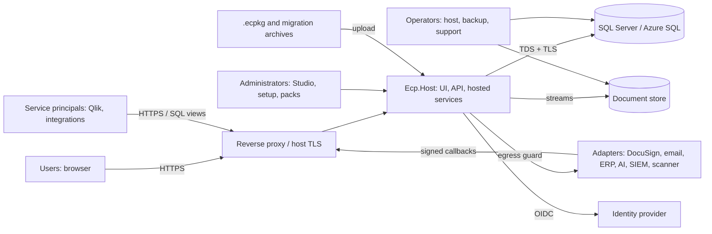

# Threat Model

Status: **initial model, pre-implementation.** Method: asset and data-flow decomposition, STRIDE per component, abuse cases for the threats named in Master ("IDOR/BOLA, tenant breakout, workflow bypass, approval spoofing, unsafe uploads, custom-field injection, malicious package imports and privilege escalation"), and mapping to controls (`docs/SECURITY.md`) and tests (`docs/TESTING.md`). It is reviewed at the end of each milestone; the change log is at the bottom. It is not a penetration test and does not imply that any control is already implemented.

Severity (inherent, before controls): **Critical / High / Medium / Low**. "Residual" is what remains with the planned controls.

## 1. System context and data flows

Trust boundaries: TB1 Internet↔host; TB2 host↔database; TB3 host↔document store; TB4 host↔identity provider; TB5 host↔external adapters (outbound and inbound); TB6 tenant↔tenant; TB7 unauthenticated↔authenticated; TB8 ordinary↔privileged roles; TB9 configuration authoring↔runtime; TB10 uploaded content↔platform; TB11 operator↔application (backup, support).

## 2. Threat register

### 2.1 Access control and tenancy

| ID | Threat | Sev | Boundary | Key mitigations | Tests | Residual |
|---|---|---|---|---|---|---|
| T-001 | **IDOR/BOLA**: user changes an id to read or modify another user's contract, document, comment, export or job | Critical | TB6, TB8 | Scoped queries then authorise on the loaded object; 404 vs 403 policy; per-request download authorisation; GUIDs not capabilities | AUT-014, TEN-001, TEN-002, TEN-003 | Low |
| T-002 | **Tenant breakout** via unfiltered query, raw SQL, ignore-filter, background job, cache, search, export or report | Critical | TB6 | Layered isolation (filter + RLS + composite FKs + storage prefix + cache keys + job scope); analyzers; layer-off tests | TEN-001 to TEN-020, TEN-030 to TEN-033, ARC-003 to ARC-006 | Low |
| T-003 | Tenant spoofing: header, claim or host manipulation selects another tenant | Critical | TB6, TB7 | Tenant derived from verified principal or validated host map; never client supplied | TEN-019 | Low |
| T-004 | Cross-organisation read inside one tenant by a user of another organisation | High | TB8 | Organisation layer in evaluator; org filters; tests with `viewer.a2` | TEN-018, AUT-003 | Low |
| T-005 | **Privilege escalation** via delegated administration (grant self or others higher rights; role template import) | Critical | TB8 | Delegation bounded by grantor rights; `roles.delegate` scope; packages cannot assign people; audit; step-up | AUT-009, AUT-011, PKG-008 | Low |
| T-006 | Stale rights: ended category assignment still edits | High | TB8 | Evaluate active assignment at action time; 60 s role cache bound | AUT-005 | Low |
| T-007 | Classification bypass via search, counts, reports, exports, notifications or AI prompts | High | TB8 | Clearance in `IAccessScope`; omit not mask in lists/exports; notification names only readable records | AUT-006, TEN-007, IMP-002, NTF-006 | Medium |
| T-008 | Support/elevated access abused or not visible | High | TB11 | Reason, expiry, tenant-visible banner, full audit, read-only default | AUT-012, AUD-006 | Medium (operator trust) |
| T-009 | Existence oracle through error messages, timing or counts | Medium | TB6 | Uniform 404/generic errors; no cross-tenant counts; constant-time comparisons for tokens | TEN-017, SEC-021 | Low |
| T-010 | Last administrator removed or locked out; or hidden super-admin | Medium | TB8 | Last-admin protection; all admin grants audited | AUT-011 | Low |

### 2.2 Workflow, approvals and records

| ID | Threat | Sev | Boundary | Key mitigations | Tests | Residual |
|---|---|---|---|---|---|---|
| T-020 | **Workflow bypass**: set status directly via API/mass assignment, or call a later transition skipping guards | Critical | TB8 | `status` has no setter; transitions by code; guards in one transaction; DTOs exclude status | WFL-001, WFL-002, WFL-006 | Low |
| T-021 | **Approval spoofing**: forged callback or edited body attributes approval to someone else; submitter approves own submission | Critical | TB5, TB8 | Approver identity from session; callback HMAC and inbox; SoD default on; matrix pinned | WFL-004, APR-007, ADP-004 | Low |
| T-022 | Locked record modified via a side path (import, API, rule action, AI accept, Variation misuse, unlock reuse) | Critical | TB8 | Domain-layer lock enforcement; migration uses Contracts contract; unlock time-boxed; Variation limited to `Variation only` fields | WFL-004, WFL-009, WFL-011, MIG-015 | Low |
| T-023 | Approval matrix gap/overlap routes a high-value contract to a low-level approver, or silently skips approval | High | TB9 | Publish-time gap/overlap/tie validation; fail closed on no match; simulation | APR-002, APR-003, APR-004 | Low |
| T-024 | In-flight records change behaviour when configuration changes | High | TB9 | Pinned workflow and matrix versions; safe-change rules | WFL-007, NCD-007 | Low |
| T-025 | Concurrent double approval or transition | Medium | TB8 | Row version, idempotency key, unique approval constraint | CNC-001, CNC-002 | Low |
| T-026 | Registered Date or legacy flags forged via import or edit | High | TB8 | Registered Date set only by Approve or authorised legacy load with second-person confirmation | WFL-005, MIG-015 | Low |
| T-027 | Reminder spam, loss or duplication | Low | TB5 | Dedupe keys; idempotent send; dead-letter | NTF-001 to NTF-005, WFL-010 | Low |

### 2.3 Uploads, imports and files

| ID | Threat | Sev | Boundary | Key mitigations | Tests | Residual |
|---|---|---|---|---|---|---|
| T-030 | **Unsafe upload**: malware, polyglot, wrong type, script in document, oversize | High | TB10 | Allowlist, signature sniffing, size limits, quarantine, scanner hook, download gating, `nosniff`, `Content-Disposition` | SEC-011 to SEC-016, ADP-006 | Medium (depends on scanner) |
| T-031 | **Zip slip / path traversal** in archive or filename | High | TB10 | Normalise and reject traversal, absolute, drive, UNC, reserved names, symlinks; keys are hashes not names | MIG-012, SEC-012 | Low |
| T-032 | **Decompression bomb / resource exhaustion** | High | TB10 | Entry, size, ratio, depth limits; streaming; job quotas; timeouts | MIG-013, SEC-013 | Low |
| T-033 | XXE or billion-laughs in OOXML/XML; macro or embedded object execution | High | TB10 | DTD prohibited; no resolver; macros rejected; no Office automation server-side | SEC-014 | Low |
| T-034 | **CSV/Excel formula injection** through exports and error workbooks | Medium | TB10 | Cell prefixing | MIG-021, IMP-003 | Low |
| T-035 | ReDoS through configured naming-rule or field-pattern regexes | Medium | TB9, TB10 | Non-backtracking engine, length cap, timeout | MIG-019, NCD-004 | Low |
| T-036 | Migration cross-tenant reference or file linking to another tenant's contract | Critical | TB6 | Validation and commit-time checks; tenant in all keys | MIG-008, TEN-010 | Low |
| T-037 | Rollback damages unrelated data | High | TB8 | Selection by batch provenance only; preview; reference-count rule | MIG-006, MIG-016 | Low |
| T-038 | Duplicate content hash leaks cross-tenant existence | Medium | TB6 | Dedupe within tenant only | TEN-021 | Low |
| T-039 | Source files containing personal or commercial data retained in staging indefinitely | Medium | TB10 | Staging retention policy and audited discard; restricted access | MIG-005, MIG-022 | Medium |

### 2.4 Configuration and packages

| ID | Threat | Sev | Boundary | Key mitigations | Tests | Residual |
|---|---|---|---|---|---|---|
| T-040 | **Custom-field / configuration injection**: stored XSS via labels, help, terminology, templates; JSON injection; mass assignment | High | TB9 | Output encoding; plain/restricted markup; code patterns; closed schemas | SEC-005, NCD-002, NCD-005 | Low |
| T-041 | **Malicious package import**: traversal, bomb, macros, unsigned, tampered, role grants, secrets, SSRF URLs | Critical | TB10 | Package safety rules; hash and signature verification; import-as-draft; no assignments; step-up; second-person publish | PKG-001 to PKG-008, PRT-008 | Low |
| T-042 | Arbitrary code via expressions, templates or calculated fields | Critical | TB9 | Closed vocabularies; interpreters with limits; banned APIs (Roslyn, Jint, scripting, `Assembly.Load`, `Process`) by architecture test | NCD-003, ARC-007 | Low |
| T-043 | Malicious or buggy release breaks the platform (non-terminating rules, huge definitions) | Medium | TB9 | Limits; pass cap; validation and simulation; instant rollback; last-good retention | NCD-006, NCD-008 | Low |
| T-044 | Branding SVG/CSS used for XSS or UI redress | Medium | TB9 | SVG sanitise or rasterise; no custom CSS/HTML | SEC-017 | Low |
| T-045 | Pack signing key theft or rogue publisher key registration | High | TB9 | Keys offline/HSM; trust registration is a privileged audited act; revocation list | PKG-005 | Medium (operational) |

### 2.5 Setup, identity and secrets

| ID | Threat | Sev | Boundary | Key mitigations | Tests | Residual |
|---|---|---|---|---|---|---|
| T-050 | **Setup takeover** on a fresh internet-exposed install | Critical | TB1 | Setup token, loopback default, 404 without token, one session, route removal | SEC-008, SEC-009 | Low |
| T-051 | **Demo identity or defaults in Production** | Critical | TB7 | Start-up guard and readiness check; Production refuses | SEC-010 | Low |
| T-052 | OIDC attacks: token substitution, nonce/state replay, account linking by email, open redirect, group overage ignored | High | TB4 | PKCE, state/nonce, `(iss, sub)` linking, local return URLs, fail-closed group resolution | SEC-004, AUT-016 | Low |
| T-053 | Session theft or fixation; CSRF | High | TB7 | Secure cookies, rotation, antiforgery, SameSite, short lifetimes | SEC-002, SEC-003 | Low |
| T-054 | Secret exposure in config, logs, errors, exports, support bundles, packages | High | TB11 | Secret references; redaction; package scanner; write-only entry | SEC-030, PRT-007 | Low |
| T-055 | Key ring lost or exposed (cookie forgery, unreadable secrets after restart) | High | TB11 | Persisted protected key ring; readiness R-SEC-04 | DEP-002 | Medium (operator) |
| T-056 | Brute force or credential stuffing | Medium | TB7 | IdP controls; rate limits on sign-in callbacks and Demo login | SEC-020 | Low |

### 2.6 Integrations and egress

| ID | Threat | Sev | Boundary | Key mitigations | Tests | Residual |
|---|---|---|---|---|---|---|
| T-060 | **SSRF** via URL fields, webhooks, website retrieval, catalogue URLs, AI/provider endpoints | High | TB5 | Single egress client: https only, IP range checks after resolution, no redirects across hosts, allowlist | SEC-007, ADP-007 | Low |
| T-061 | Forged or replayed inbound webhook (e-signature) | High | TB5 | HMAC, timestamp window, inbox dedupe, tenant-bound secrets | ADP-004, ADP-005 | Low |
| T-062 | Outbound webhook leaks sensitive data or is directed at an internal target | High | TB5 | Minimal payloads; egress guard; per-tenant allowlist | SEC-007, TEN-013 | Low |
| T-063 | **External reporting bypasses security**: Qlik principal reads base tables or another tenant | Critical | TB2, TB6 | Curated views, RLS, per-tenant principals, no base-table grants | SEC-040 to SEC-045 | Medium (network config) |
| T-064 | **AI prompt injection / data egress / unreviewed change** | High | TB5, TB10 | Disabled default; no-write principal; proposals; delimiting; schema-validated output; sensitive-field exclusion; audit | SEC-050 to SEC-053 | Medium |
| T-065 | Adapter failure causes data loss or blocks core operation | Medium | TB5 | Outbox, retries, dead-letter, manual fallbacks | ADP-001, ADP-002 | Low |

### 2.7 Audit, data and operations

| ID | Threat | Sev | Boundary | Key mitigations | Tests | Residual |
|---|---|---|---|---|---|---|
| T-070 | **Audit tampering** or deletion; silent gaps | High | TB2, TB11 | Append-only grants, hash chain, sequence, same-transaction write, verification job, exported anchors | AUD-001 to AUD-005 | Medium (privileged DBA can still restore/alter; detected by chain) |
| T-071 | Sensitive values leak into audit values | Medium | TB2 | Field sensitivity redaction | AUD-004 | Low |
| T-072 | Backup contains all tenants and leaks | High | TB11 | Encryption, access limited to `ops.manage`, tested restore, retention | BRS-002 | Medium (operator) |
| T-073 | Export/download link guessed or shared | Medium | TB7 | User-bound, short-lived, authorised tokens; expiry | IMP-004 | Low |
| T-074 | Denial of service: expensive search/report/export/import, large uploads, many jobs | Medium | TB1 | Rate limits, quotas, async jobs with caps, query limits, pagination | PER-004, SEC-020 | Medium |
| T-075 | Time manipulation or skew breaks reminders, token validity, hash chain order | Low | TB11 | UTC clock abstraction; skew check R-OPS-04; sequence not time ordered | AUD-003 | Low |
| T-076 | Dependency compromise or licence violation | High | Supply chain | Locked restores, vulnerability scan, SBOM, licence allowlist, pinned images | SEC-060 to SEC-062 | Medium |
| T-077 | Data kept longer or deleted earlier than authorised (retention, legal hold) | High | TB8 | Archive-before-delete; hold checks; second approval; default Indefinite | RET-001 to RET-006 | Low |
| T-078 | Wrong-tenant maintenance (e.g., job or migration running without scope) | High | TB6 | Scope required by data layer; fail closed | TEN-005, ARC-004 | Low |

### 2.8 Lifecycle, Legal review, register authorisation and notifications (added with the lifecycle slice)

| ID | Threat | Sev | Boundary | Key mitigations | Tests (lifecycle slice) | Residual |
|---|---|---|---|---|---|---|
| T-080 | **Crafted transition**: POST a transition code or target the screen does not offer, replay a step, skip Legal, or run a managed step (approve, sign, Variation) through the generic call | Critical | TB8 | Engine order of checks, managed-role refusal, from-state and expected-state checks, idempotency key, no public status setter | `Every_state_offers_exactly_its_transitions_and_every_other_step_is_refused`, `A_locked_contract_refuses_every_crafted_step_and_edit_whoever_asks`, `The_same_step_taken_twice_at_once_happens_once`; API `Register_authorisation_is_refused_to_everyone_but_the_assigned_approvers_and_to_the_second_responder` | Low |
| T-081 | **Self-approval or double registration**: the submitter approves; two approvers decide at once | Critical | TB8 | `SubmitterNotApprover` and `AuthorisedApprover` guards (validation refuses definitions without them); unique pending request; first response wins | `Register_authorisation_rules_self_approval_backup_rejection_and_registered_date`, `Two_people_deciding_at_once_produce_one_decision_and_one_registration` (SQL Server) | Low |
| T-082 | **Editing an Effective contract** through documents, owner relationship, import, a Variation misuse or an unlock reused after expiry | Critical | TB8 | Domain-layer lock; Variation field allow-list with before and after; unlock bound to opener, fields, time and reason; automatic re-lock | `A_locked_contract_refuses_every_crafted_step_and_edit_whoever_asks`, `A_Variation_changes_an_effective_contract_only_when_approved_and_keeps_before_and_after`, `A_force_unlock_needs_permission_recent_sign_in_reason_and_a_time_limit_and_is_fully_audited`, `Cancelling_or_rejecting_a_Variation_leaves_the_parent_exactly_as_it_was` | Low |
| T-083 | **Legal Privileged record disclosed** by a role, scope, queue, dashboard, notification, audit event, history or an elevation | Critical | TB8 | Privileged layer in the evaluator; every read path goes through the secured services; notifications filtered and redacted at write and read time; elevations never carry the permission | `Legal_privileged_records_need_an_explicit_grant_and_a_role_or_ceiling_alone_never_opens_them`, `Legal_rounds_are_kept_and_a_privileged_review_is_invisible_to_those_without_the_grant`, `Notification_content_never_leaks_a_classified_record_to_people_who_could_not_open_it`, `A_person_who_loses_access_to_a_record_sees_nothing_about_it_in_their_inbox`, `Dashboards_never_show_or_count_a_record_the_reader_could_not_open`, `Audit_evidence_about_a_classified_record_is_visible_only_where_the_record_is` | Low |
| T-084 | **Workflow definition as an attack surface**: an administrator publishes a definition that unlocks records, drops approval guards, names unknown code or references a missing permission | High | TB9 | Closed vocabularies; unknown members are errors; validator checks (no unlocking transitions, approval guards, dead ends, bounds); draft, validate, publish, rollback and audit; existing contracts stay pinned | unit `WorkflowDefinitionTests` (validator rules), `A_published_workflow_applies_to_new_contracts_while_existing_ones_stay_pinned_and_an_invalid_one_is_refused` | Low |
| T-085 | **Notification template injection**: markup, logic, header injection or unknown placeholders in a template or in record values | Medium | TB5 | Plain-text templates with allow-listed placeholders validated at publication; control characters removed; lengths bounded; markup stays text | unit `NotificationPolicyTests`, `NotificationRendererTests` | Low |
| T-086 | **Notification disclosure or spam**: wrong recipient, a recipient who cannot open the record, duplicate or lost reminders after ownership change | High | TB5 | Recipients resolved at send time from current ownership and filtered by read access; dedupe keys; one row per reminder window; unique-violation handling for concurrent scans | `A_workflow_event_tells_the_right_people_once_and_a_second_run_changes_nothing`, `Reminders_are_sent_once_per_window_and_follow_current_ownership`, `Ownership_changes_tell_only_the_person_affected`, `A_disposition_request_reaches_the_approver_group_and_no_other_group` | Low |
| T-087 | **Cross-tenant or cross-organisation access** to any lifecycle, queue, dashboard or administration call | Critical | TB6 | Tenant query filters, RLS, composite foreign keys, organisation-scoped administration | `Another_tenants_records_do_not_exist_for_any_lifecycle_call`, `Notification_administrators_see_only_their_own_organisations_deliveries` | Low |
| T-088 | **Failed or unreachable email** hides an important notice | Medium | TB5 | In-app notification is independent; back-off then dead-letter; administrators see failures and retry | `Failed_email_is_retried_with_a_back_off_then_dead_lettered_where_administrators_can_see_and_retry_it`, `Background_job_runs_are_recorded_and_visible_only_to_administrators` | Medium: SMTP and Graph are not verified against live services |
| T-089 | **Forged or replayed signature event** claims a document was signed | High | TB5 | Executed copy is supplied by the owner (Manual) or by a simulated event (Mock, Demo/Test only); the external adapter has no endpoint or credentials in this release; register authorisation always needs the executed copy and a separate approver | `The_signature_boundary_stores_envelope_status_and_a_completed_envelope_only_supplies_the_executed_copy`, unit `SignatureProviderTests` | Medium: live adapter, HMAC callbacks and inbox are Future (ADP-004) |
| T-090 | **Matrix tampering**: an unauthorised or unreviewed change to an approval matrix reroutes approvals | High | TB9 | Matrix is a Configuration kind (permissioned draft, validation, publish, version history, rollback, audit with row-by-row change summary); second-person publish option; plans pinned per request | `Publication_refuses_a_matrix_with_gaps_overlaps_or_ties_and_one_a_workflow_still_needs`, `Every_publication_rollback_delegation_and_simulation_is_in_the_audit_history_with_what_changed`, `A_plan_is_pinned_to_the_release_it_was_made_under` | Low |
| T-091 | **Delegation abuse**: authority passed outside the group, passed on, looped or kept indefinitely so nobody (or everybody) can approve | High | TB8 | Own authority only, to a group member, at most 90 days, not self, not transitive, cycle detection among overlapping delegations, loop edges ignored at resolution, revocation by delegator or administrator, audit | `Delegation_is_bounded_audited_non_transitive_and_never_circular`, `A_delegation_from_someone_who_cannot_act_is_ignored_and_a_circle_in_the_data_gives_nobody_authority`, unit `A_loop_is_found_whether_it_has_two_members_or_many` | Low |
| T-092 | **Approver identity disclosure** through the simulator or explanations | Medium | TB6 | `approvals.simulate` and `approvals.matrix.read` are organisation-scoped; the plan view shows the trace and reasons only to matrix readers; simulation is audited | `The_simulator_shows_the_resolution_without_touching_any_record_and_is_for_administrators_only`, API `A_contract_approved_through_a_matrix_shows_its_plan_and_the_reasons_to_matrix_readers_only` | Low |
| T-093 | **Wrong or missing approver by a rule gap**: unknown facts, ties, missing currency rate or empty groups silently choose someone or nobody | High | TB9 | Unknown facts never satisfy a condition; ties, no match, no rate and missing approvers are blocked with a trace; empty groups warn at publication and block at submission | `No_match_blocks_with_an_explanation_and_never_defaults`, `A_priority_tie_at_run_time_blocks_rather_than_picking_one`, `Currency_needs_a_rate_in_force_on_the_date_and_is_never_assumed`, `A_submission_nobody_can_approve_is_blocked_with_the_reason_and_can_be_resubmitted_once_fixed` | Low: facts the platform does not store reach the resolver only via contributors, so such rows block |
| T-094 | **Cross-tenant or cross-organisation matrix, delegation or resolution** | Critical | TB6 | Tenant filters, RLS and composite keys on `approvals` tables; organisation-scoped permission checks | `Matrices_delegations_and_resolutions_belong_to_one_tenant` | Low |

## 3. Abuse cases (walk-throughs used as test scenarios)

1. **A category owner whose assignment ended opens an old URL** (T-001, T-006): record readable (read all), edit denied, audit entry shows the assignment reason.
2. **A user in organisation A2 guesses a contract id in A1** (T-004): 404.
3. **An administrator imports a package granting `Tenant Administrator` to a user id** (T-005, T-041): rejected at validation; no assignments allowed in packages.
4. **A forged DocuSign callback claims "completed"** (T-021, T-061): rejected, audited; contract remains Out for Signature; even a genuine completion only supplies the executed copy.
5. **A migration ZIP contains `../../etc/x`, a 1 GB zero file, and a macro-enabled workbook** (T-031, T-032, T-033): each rejected with its message code; batch continues for other files; counts reconcile.
6. **A Business Configuration Administrator publishes a rule set that never stabilises** (T-043): validation fails in simulation; if forced via package, runtime pass cap blocks the transition with explanation.
7. **A fresh Docker instance is exposed to the Internet before setup** (T-050): `/setup` returns 404 without the console token; remote requests are refused by default.
8. **Qlik principal for tenant A attempts `SELECT * FROM contracts.Contract`** (T-063): permission denied; the views return only tenant A rows.
9. **A document claims to be a PDF but contains script/HTML** (T-030): signature mismatch rejects it; if allowed type but malicious, scanner verdict gates download.
10. **A support engineer opens elevated access** (T-008): tenant administrators see the banner; every action carries the elevation id; access expires.
11. **An owner POSTs `Approve` for their own contract** (T-080, T-081): refused; the step is managed, the guard names the submitter, the history shows nothing.
12. **Two group heads press Approve at the same moment** (T-081): one registration, one `already_decided`, one Registered Date.
13. **A record is reclassified above a reviewer's ceiling after a notification about it was sent** (T-083, T-086): the old inbox item shows only "a record you can no longer open", with no title, body or link (`A_person_who_loses_access_to_a_record_sees_nothing_about_it_in_their_inbox`).
14. **An administrator publishes a workflow whose transition returns an Effective contract to Draft** (T-084): validation refuses it with the path of the transition; existing contracts keep the earlier release.

## 4. Assumptions and limitations

- The host OS, hypervisor, network and cloud control plane are trusted to the extent the operator secures them (R-DEP checks verify some settings but cannot prove the platform's security).
- A database administrator with unrestricted access can alter data; audit hash chaining detects but does not prevent this. Separation of duties for DBA access is an operational control.
- Malware detection quality depends on the configured scanner.
- Identity-provider compromise compromises the platform for the users it asserts; step-up and short sessions limit blast radius.
- Real e-signature and email providers (DocuSign-style envelopes, SMTP, Microsoft Graph) are not exercised against live services; mocks are for Demo and Test only. Retention periods and legal holds are scaffolded, not enforced.
- Penetration testing, formal security review and accreditation are external governance and not performed by this project.

## 5. Review process

At every milestone exit: re-run the abuse cases as automated tests; add threats for new features (new adapters, new input formats); record the outcome below; unresolved High/Critical items block the milestone.

## 6. Change log

| Date | Change | By |
|---|---|---|
| 2026-10-15 | Initial model created during pre-implementation repository review | Claude Code session |
| 2026-10-16 | M1 implementation evidence: tenant filters, RLS, composite FKs, append-only audit and Production guard verified on SQL Server 2022 Developer; runtime role needed explicit SELECT on the RLS predicate functions (finding fixed). Setup, upload and OIDC threats remain unmitigated until their milestones | Claude Code session |
| 2026-10-16 | Setup and onboarding implemented and tested: T-050 (token, single session, loopback `404`, closure after completion, restart and CLI tests), T-051 (Production guard in the `mode` step and readiness `R-DEMO-01`), T-054 (secret references only; sanitised-report test). New residual risks: the setup token is a bearer credential on an operator terminal (ASM-20); with `Ecp:Setup:AllowRemote` the token and network controls are the only barrier; onboarding publication can grant viewer and category-owner access, so it is restricted to roles that hold organisation-level configuration rights and cannot map administrator or approver roles (ADR-0017); the live OpenID Connect step-up (`prompt=login`) is verified only against a mock provider | Claude Code session |
| 2026-10-16 | Migration slice implemented and tested (T-030 to T-039 mitigations exercised: unsafe archive entries, bomb limits, XXE refusal, `.xlsm`, formula neutralisation, naming-rule engine, cross-tenant batch access, provenance-driven rollback). Residuals: no real malware scanner adapter (mock outside Production; files held in Production), synchronous commit within the request (resumable), staging retention beyond acceptance is a manual purge (`migration.staging.purged`). | Claude Code session |
| 2026-10-16 | Lifecycle slice: section 2.8 added (T-080 to T-089) with the tests that exercise each mitigation; abuse cases 11 to 14; limitation for unverified external providers and scaffolded retention. | Claude Code session |
